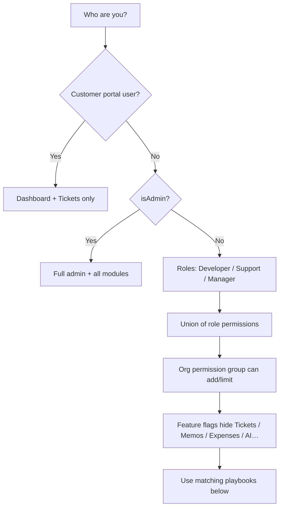

# Choose your role

**Audience:** Everyone  
**Access path:** Read this before browsing modules — then jump via wiki links  
**Requires:** Knowing how your account was set up (internal roles vs customer portal vs admin flag)  
**When missing:** Unsure what you are? Open the user menu → **My Profile**, then ask an admin which roles and org permission group you have. See [[05-reference/permissions-matrix]].

## Purpose

Myelin shows different menus and buttons depending on **account type**, **global roles**, **org permission groups**, and a small set of **System Settings feature flags**. This note maps common personas to the right how-tos so you do not hunt for UI that is intentionally hidden.

## How Myelin decides what you can do

| Layer | What it controls | Examples |
|-------|------------------|----------|
| Account type | Portal vs internal shell | Customer users never see Planning / Timesheet / Administration |
| Global roles | Base permission set | `IsDeveloper`, `IsSupport`, `IsManager` (union if several) |
| Admin flag | Override | `isAdmin` has full access |
| Org permission group | Extra / restricted org capabilities | Manage members, settings, budget visibility |
| Feature flags | Instance-wide modules | Tickets, Memos, Expenses, AI, Outlook calendar — see [[02-settings/feature-toggles-overview]] |
| Page permissions | Module gates | Planning needs `CanViewPlanning`; editing needs plan permissions |

There is **no** System Settings toggle that turns off Planning, Timesheet, Call Records, Work Summary, Projects, or Dashboard. Those use permissions (or are always available to eligible internal users). Details: [[01-getting-started/what-you-see-depends-on-settings]].

## 1 — Internal contributor (Developer / Support)

You create and complete work, log time, and may triage tickets.

**Typical day**

1. [[01-getting-started/navigation]] — orient in the shell.
2. [[03-modules/create-and-complete-task]] or open work from [[03-modules/projects-and-tasks]].
3. [[03-modules/timesheet-and-timers]] — timers and timesheet.
4. [[03-modules/planning]] — view your allocations (edit if you have plan permissions).
5. If tickets are enabled and you have Support / ticket permissions → [[03-modules/tickets]], [[03-modules/jira-boards-and-tickets]].

**Workflows**

- [[04-workflows/task-first-delivery]]
- [[04-workflows/timer-context-switch]]
- [[04-workflows/jira-sync]] (when Jira is configured)

## 2 — Manager / approver

Everything in the contributor path, plus capacity, approvals, and reporting.

**Add these**

| Need | Note |
|------|------|
| Customers & projects | [[03-modules/create-customer]], [[03-modules/create-project]] |
| Resource Gantt (split, multi-alloc, replan) | [[03-modules/planning]] |
| Approvals queues | [[03-modules/approvals]] |
| Reporting hub | [[03-modules/reporting]] |
| Org vocabulary & members | [[02-settings/organization-settings]] |
| Permission reference | [[05-reference/permissions-matrix]] |
| Planned vs actual | [[04-workflows/planned-vs-actual]] |
| Global project governance | [[04-workflows/global-project-governance]] |

Managers typically hold broader defaults (budget, assign, delete, reports). Org permission groups can still refine what you see inside an organization.

## 3 — Organization admin (settings in the UI)

You configure an organization (members, statuses, integrations, task form defaults) and may also be a global admin.

**Add these**

- [[02-settings/organization-settings]]
- [[02-settings/task-form-visibility]]
- [[02-settings/feature-toggles-overview]] (global admin)
- [[03-modules/integrations]]
- [[08-ai-assistant/admin-configuration]] (if AI is used)
- [[03-modules/approvals]] for vacation / OOO / time / expense queues

## 4 — Operator / deployer

You install and run the server — not day-to-day delivery work.

1. [[06-install-and-ops/install-wizard]]
2. [[06-install-and-ops/environment-variables]]
3. [[06-install-and-ops/docker-and-health]]
4. [[06-install-and-ops/deploy-checklist]]
5. [[06-install-and-ops/redis]] (optional)
6. [[06-install-and-ops/schema]]
7. [[06-install-and-ops/sso-for-companions]] when Synapse/companions need SSO

## 5 — Customer portal user

You represent an external customer.

| You can | You cannot |
|---------|------------|
| Use Dashboard (needs attention, project summaries) | Open Planning, Timesheet, Call Records |
| Work tickets when internal tickets are enabled | Access Administration / org settings |
| Create tickets (no project picker) | See Expenses, Memos, Reporting packs |

Start: [[03-modules/customers-and-portal]] · ticket path: [[04-workflows/ticket-to-delivery]] (portal entry only).

## 6 — Companion / power user

You use Myelin together with desktop, IDE, or browser helpers.

- [[07-companions/desktop-app]]
- [[07-companions/ide-extensions]]
- [[07-companions/tampermonkey]]
- [[03-modules/synapse-bridge]]
- API tokens from [[02-settings/profile]] (Profile → API Tokens)

## Quick chooser

| If you need to… | Open |
|-----------------|------|
| Log in the first time | [[01-getting-started/first-login]] |
| Find a missing menu | [[01-getting-started/what-you-see-depends-on-settings]] |
| Create → complete a task | [[03-modules/create-and-complete-task]] |
| Plan people on a Gantt | [[03-modules/planning]] |
| Approve time / leave / expenses | [[03-modules/approvals]] |
| Turn optional modules on/off | [[02-settings/feature-toggles-overview]] |

## Tips

- Multiple roles use **OR** logic — you get the union of permissions.
- Manager role grants the broadest non-admin default set; admin still overrides everything.
- Feature flags never replace a permission check — both can hide UI.

## Done criteria

- You identified your persona (contributor, manager, admin, operator, portal, companion).
- You opened the matching starter notes above.
- You know missing UI is usually permission or flag — not a missing “Planning toggle”.

## Related

- [[01-getting-started/navigation]]
- [[05-reference/permissions-matrix]]
- [[05-reference/glossary]]
- [[start]]
