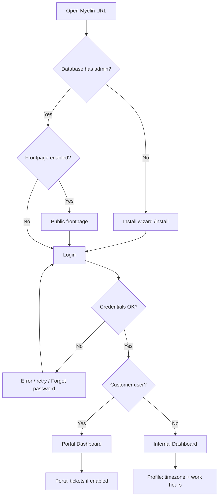

# First login

**Audience:** End user, Customer portal user, Admin  
**Access path:** Your Myelin URL → `/login` (or `/install` on a brand-new empty database)  
**Requires:** A user account created by an admin (or the first admin from the Install wizard). SMTP must be configured if you need **Forgot password** mail to arrive.  
**When missing:** Wrong URL or server down → contact your operator. No account → ask an admin. Forgot-password link never arrives → SMTP not configured (preferences can still save).

## Purpose

Sign in safely, land in the right shell (internal app vs customer portal), and complete the first profile steps so Planning, calendars, and email alerts behave correctly.

## 1 — Fresh instance (operators only)

If nobody has installed Myelin yet, opening the app redirects to the **Install wizard** (`/install`).

1. Complete admin username, email, password, first/last name.
2. Set the initial organization name.
3. Optionally configure SMTP (can be finished later under Administration → System Settings → Email).
4. Finish the wizard — it is then permanently disabled.
5. Sign in at `/login` with the admin you just created.

See [[06-install-and-ops/install-wizard]].

> **SCREENSHOT** — Capture Install wizard first step (no secrets visible).
> File to add: `media/docs-getting-started-install.png`

## 2 — Sign in on an existing instance

1. Open the Myelin URL your operator gave you.
2. If **Enable Front Page** (`frontpageEnabled`) is on, you may see a public landing page first — use the link/button to reach login. If that flag is off, the root URL goes straight to login.
3. Enter **username or email** and **password**.
4. Submit. On success the server sets an HTTP-only session cookie (not readable by page scripts).
5. You land on:
   - **Internal users** → Dashboard (`/dashboard`) inside the full AppShell.
   - **Customer portal users** → Customer Dashboard (`/dashboard`) with a minimal sidebar (Dashboard + Tickets when internal tickets are enabled).

Companion apps (for example Synapse) may send you through SSO handoff (`/sso/authorize…`) so you log in once in Myelin and return to the companion. That flow still uses the same Myelin account.

> **SCREENSHOT** — Capture login form (no passwords visible).
> File to add: `media/docs-getting-started-login.png`

## 3 — Forgot password

1. On `/login`, open **Forgot password**.
2. Enter your email and submit.
3. Check your inbox for a reset link (`/reset-password?token=…`). Tokens expire (about one hour) and are single-use.
4. Choose a new password and sign in.

Myelin never reveals whether the email exists in the database — responses stay generic on purpose.

**If mail never arrives:** ask an admin/operator to finish SMTP under Administration → System Settings → Email (or env-based mail). Your account can still be reset by an admin who edits users.

## 4 — After first login (internal users)

Do these before heavy Planning or time tracking:

| Step | Where | Why |
|------|--------|-----|
| 1 | [[02-settings/profile]] → Profile info | Correct name, email, **timezone** |
| 2 | Profile → **Work hours** | Per-weekday capacity, work start time, lunch — Planning uses these |
| 3 | [[02-settings/email-preferences]] | Opt in/out of task, ticket, planning, and summary mail |
| 4 | Ask admin | Confirm organization membership, role (Developer / Support / Manager), and permission group |
| 5 | [[01-getting-started/navigation]] | Learn sidebar sections, search, user menu |

Optional soon after:

- Avatar upload on Profile info.
- Hourly rate if your managers use budget views (`CanViewBudgetInfo`).
- [[02-settings/theme-and-language]] if you prefer another chrome language or theme.

## 5 — After first login (customer portal users)

1. Confirm you see **Dashboard** and (when tickets are enabled) **Tickets** only.
2. Open Profile for identity, security, and the limited email preferences (ticket-related).
3. You will **not** see Planning, Timesheet, Call Records, Administration, or internal management menus.

See [[03-modules/customers-and-portal]] and [[01-getting-started/choose-your-role]].

## Tips

- Bookmark `/login` or your operator’s preferred entry URL.
- Use a password manager; sessions are cookie-based — sign out on shared computers from the user menu.
- Empty menus after login almost always mean **permissions**, **feature flags**, or **wrong account type** — not a broken install. Read [[01-getting-started/what-you-see-depends-on-settings]].

## Done criteria

- You can sign in and reach Dashboard without errors.
- Timezone and work hours (internal) are saved.
- You know whether you are an internal user or a customer portal user.
- You know who to ask for org membership or SMTP issues.

## Related

- [[01-getting-started/choose-your-role]]
- [[01-getting-started/navigation]]
- [[01-getting-started/what-you-see-depends-on-settings]]
- [[02-settings/profile]]
- [[06-install-and-ops/install-wizard]]
