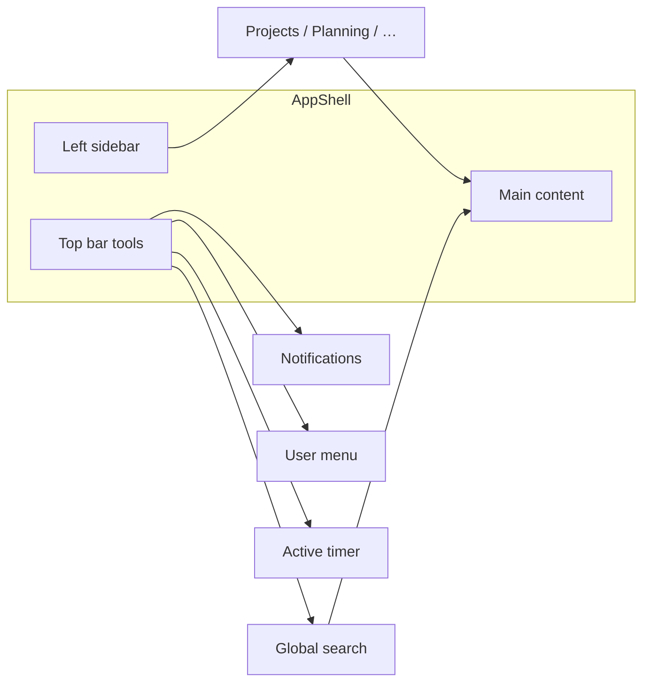

# Navigation

**Audience:** End user, Manager, Admin  
**Access path:** After login — left sidebar + top bar (AppShell)  
**Requires:** Signed-in session. Sidebar items depend on account type, permissions, feature flags, and optional personal menu-visibility prefs.  
**When missing:** Empty or short sidebar → see [[01-getting-started/what-you-see-depends-on-settings]]. Customer portal users intentionally see only Dashboard (+ Tickets when enabled).

## Purpose

Learn the Synapse AppShell so you can reach daily work quickly: sections, recent/pinned shortcuts, search, notifications, timers, and the account menu.

## 1 — Sign in and land

1. Sign in at `/login` (or via companion SSO). See [[01-getting-started/first-login]].
2. Confirm you are in the expected shell:
   - **Internal** — full sidebar with Delivery / Work / Service / Management / Reporting sections (labels depend on language).
   - **Customer portal** — Dashboard and Tickets only (when tickets are enabled).
3. Note the branded company name/logo in the chrome (from Administration branding).

## 2 — Left sidebar (internal users)

The sidebar starts as a narrow icon rail. Hover expands labels; you can **pin** it expanded so content shifts right.

### Sections (catalog)

Exact labels follow your UI language. Items appear only when system rules allow them.

| Section | Typical items | Notes |
|---------|---------------|-------|
| (top) | **Dashboard** | Overview, Calendar, Analytics (role-dependent) |
| **Delivery** | Projects, Planning | Planning is **not** a feature flag — page needs `CanViewPlanning` |
| **Work** | Timesheet, Expenses, Call Records, Work Summary | Expenses needs `expensesEnabled` + expense permission |
| **Service** | Tickets, Memos | Tickets → `internalTicketsEnabled` + Support/ticket perms; Memos → `memosEnabled` |
| **Management** | Customers, Applications, Approvals (or Approvals & Expenses), Dev Support | Dev Support is for leaders/admins managing others |
| **Reporting** | Reporting | Needs report / manager access for packs |

Customer users never see Delivery/Work/Management/Reporting catalogs — only portal-safe links.

> **SCREENSHOT** — Capture top bar and left sidebar with sections visible (expanded).
> File to add: `media/docs-getting-started-navigation.png`

### Recent items and pinned projects

When the sidebar is expanded:

1. Open **Projects**, **Customers**, **Applications**, or **Memos**.
2. Expand the chevron next to the item (when recent entries exist).
3. Click a recent child to jump back.
4. On **Projects**, use the pin control to keep important projects listed above recent ones.

### Customize which menus you see

1. Open the sidebar **menu visibility** control (eye / visibility affordance near the sidebar header).
2. Hide menus you never use — this is **personal only** (stored for your user).
3. Remember: personal prefs can only **hide** items that system rules already allow. They cannot re-show Tickets/Expenses/Memos when a feature flag or role blocks them.

## 3 — Top bar tools

The top bar (via chrome tools) typically includes:

| Control | What it does |
|---------|----------------|
| **Global search** | Find tasks, tickets (if enabled), projects, organizations, users — [[01-getting-started/global-search]] |
| **Active timer** | Shows running timer; open to stop/switch — [[03-modules/timesheet-and-timers]] |
| **Quick create / actions** | Shortcuts such as create customer/org when you have permission (availability varies) |
| **Notifications** | Bell with live badge; in-app alerts update without refresh |
| **User menu** | Profile, Docs, Administration (admins), theme, language, color vision, sign out |

On narrow phones, some tools move into a compact/hamburger pattern; search may be harder to reach below small breakpoints — use a wider viewport when possible.

## 4 — User menu

1. Click your **avatar / name** in the top bar.
2. Common entries:

| Item | For |
|------|-----|
| **My Profile** | Identity, work hours, leave, email prefs, API tokens, task form — [[02-settings/profile]] |
| **Docs** | In-app manual (`/docs`) — internal users |
| **Administration** | System Settings, users, holidays, … — admins |
| **Language** | English, Português, Español, Français — [[02-settings/theme-and-language]] |
| **Theme** | Light / Dark / System + palette |
| **Color vision** | Default, Deuteranopia, Protanopia, Tritanopia |
| **Sign out** | Clears the session cookie |

> **SCREENSHOT** — Capture profile dropdown with Profile, Docs, Theme, Language.
> File to add: `media/docs-getting-started-user-menu.png`

## 5 — Organization context

You may belong to **several organizations**. Work (projects, statuses, members, integrations) is org-scoped.

1. When a page offers an **organization** filter or selector, pick the org you intend to work in.
2. Profile → **Task form** visibility is **per organization** — switch the org dropdown there when customizing layouts.
3. Open organization detail from Administration → Organizations (or `/organizations/:id`) when you manage settings — [[02-settings/organization-settings]].

If lists look empty, confirm you are a **member** of that organization and that filters are not excluding everything.

## 6 — Mobile behaviour

| Area | Behaviour |
|------|-----------|
| Sidebar | Drawer / hover rail — pin on desktop for comfort |
| Planning | **Read-only** on phones (≤767px) even if you can plan on desktop — [[03-modules/planning]] |
| Search | Prefer desktop/tablet widths for the full search dropdown |

## Tips

- Missing **Tickets / Memos / Expenses** → check feature flags first, then permissions.
- Missing **Planning** access → `CanViewPlanning` (permission), not a Features toggle. You may still see the link in some shells; the page itself enforces access.
- **Approvals** label becomes **Approvals & Expenses** when the Expenses module is enabled.
- Demo mode (admin branding flag) may show extra banners — ignore unless you are testing.

## Common mistakes

- Assuming a missing module is “broken” — read [[01-getting-started/what-you-see-depends-on-settings]].
- Hiding a menu via personal visibility and forgetting you hid it.
- Expecting customer portal accounts to see Timesheet or Planning.

## Done criteria

- You can expand/pin the sidebar and open Projects, Timesheet, and Dashboard (as allowed).
- You can open Profile and Notifications from the top bar.
- You know how to restore a menu you hid personally.

## Related

- [[01-getting-started/global-search]]
- [[01-getting-started/choose-your-role]]
- [[01-getting-started/what-you-see-depends-on-settings]]
- [[03-modules/dashboard]]
- [[03-modules/notifications]]
