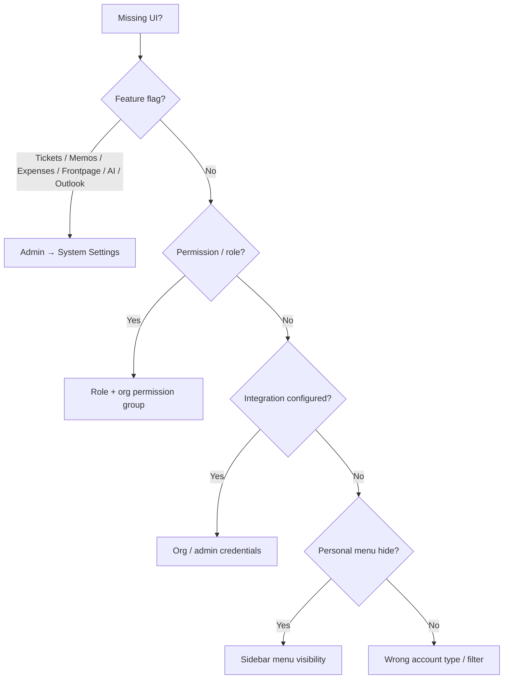

# What you see depends on settings

**Audience:** Everyone  
**Access path:** Compare your sidebar to this note whenever a menu or button is missing  
**Requires:** Understanding three independent gates: feature flags, permissions, integrations  
**When missing:** Do **not** invent a fictional “module off” switch. Planning, Timesheet, Call Records, and Work Summary are **not** System Settings feature flags.

## Purpose

Menus and buttons change for different reasons. This note is the accuracy guide for the whole vault: which toggles are real, which gates are permissions, and how to diagnose a “missing” feature.

## 1 — Feature flags (Administration → System Settings)

These are the **only** instance-wide product flags that hide or reshape modules. Admins find them under:

- **Features** tab — product toggles and auto-approve switches  
- **AI** tab — assistant enable + provider  
- **Email** section — Outlook calendar enable + Graph credentials  

| Setting key | Admin label (EN) | Default (typical) | Effect when off / notes |
|-------------|------------------|-------------------|-------------------------|
| `frontpageEnabled` | Enable Front Page | On | Root URL skips public frontpage and goes to login |
| `internalTicketsEnabled` | Enable Internal Ticket System | On | Hides **Tickets** nav, ticket KPIs, ticket search hits. Does **not** remove ticket/Jira fields on tasks |
| `memosEnabled` | Enable Memos Menu | On | Hides **Memos** in the navbar only |
| `expensesEnabled` | Enable Expenses Module | **Off** | Hides Expenses UI; expense APIs return 403 |
| `autoApproveExpenses` | Auto-approve expenses | Off | New expenses created as **approved** (only meaningful when expenses are on) |
| `autoApproveTimeEntries` | Auto-approve time entries | Off | New time entries created as approved |
| `autoApproveVacations` | Auto-approve vacations | Off | Vacation requests approved immediately |
| `autoApproveOutOfOffice` | Auto-approve out of office | Off | OOO requests approved immediately |
| `aiAssistantEnabled` | Enable AI Assistant | Off | Hides AI widget / AI actions until a provider is also configured |
| `outlookCalendarEnabled` | Outlook Calendar (Email section) | Off | No Outlook overlay on Planning / Dashboard calendar |

Full admin walkthrough: [[02-settings/feature-toggles-overview]].

> **SCREENSHOT** — Capture Administration → System Settings → Features with the real toggles only.
> File to add: `media/docs-settings-feature-toggles.png`

### Not feature flags

These stay available based on **role / permission / account type** (or are always in the shell for eligible internal users):

- Planning / Gantt  
- Timesheet / timers  
- Call Records  
- Work Summary  
- Projects / Dashboard  
- Customers / Applications  
- Reporting hub (permission-gated packs)  

Redis (`REDIS_ENABLED`) is an **environment** setting for operators — not a Features checkbox. See [[06-install-and-ops/redis]].

## 2 — Permissions (role + org permission group)

Global roles (`Developer`, `Support`, `Manager`) and optional **permission groups** on organization membership decide buttons and pages.

| You want… | Typical gate |
|-----------|----------------|
| Open Planning | `CanViewPlanning` |
| Drag / edit allocations | Plan permissions (e.g. `CanPlanTasks`); mobile Planning is read-only |
| Reporting Extract / packs | `CanViewReports` and/or admin/manager |
| Budget / rates | `CanViewBudgetInfo` (role **or** org group) |
| Tickets (when flag on) | Support role or ticket create/manage permissions |
| Expenses (when flag on) | `CanViewExpenses` / `CanCreateExpenses` (admins always) |
| Manage org members & statuses | Org manage-settings capability / admin |
| Approve time / leave / expenses | Approver scope — [[03-modules/approvals]] |

**Rules of combination**

- Multiple roles → **union** (OR) of permissions.  
- Manager defaults are broad; `isAdmin` overrides everything.  
- UI hides actions you cannot use; the **API still enforces** the same rules.

Matrix: [[05-reference/permissions-matrix]].

## 3 — Integrations (must be configured)

Missing **Import from…** menus usually mean credentials are missing — not a fictional Planning toggle.

| Integration | Where configured | What appears when ready |
|-------------|------------------|-------------------------|
| Jira (tickets / projects) | Organization → Integrations | Search/import, board views, status check |
| GitHub / Gitea | Organization → Integrations | Import issues into project |
| SMTP | Administration → Email | Password reset, notification mail, digests |
| Outlook calendar | Administration → Email | Busy overlays on Planning / calendar |
| Outlook email → task queue | Cloudflare worker + API token | Project → Import from Outlook Queue |
| AI provider | Administration → AI | Floating assistant, translate/summarize |

See [[03-modules/integrations]], [[08-ai-assistant/admin-configuration]].

## 4 — Personal sidebar hide prefs

Internal users can hide allowed menus via sidebar **menu visibility**.

1. Open the visibility control on the sidebar.
2. Unhide any item you previously turned off.
3. If it still does not appear, the block is system-level (flag/permission) — personal prefs cannot override that.

See [[01-getting-started/navigation]].

## 5 — Account type

| Account | Shell |
|---------|-------|
| Internal user | Full AppShell (filtered by flags + permissions) |
| Customer portal user | Dashboard + Tickets (if tickets enabled); Profile/Notifications in chrome |

Portal users never gain Planning or Timesheet by flipping a feature flag.

## 6 — Common “missing menu” cases

| Missing item | Likely cause (check in order) |
|--------------|-------------------------------|
| Tickets | `internalTicketsEnabled` off → then Support/ticket permission → then personal hide |
| Expenses | `expensesEnabled` off (default) → then expense permission |
| Memos | `memosEnabled` off → then personal hide |
| Planning access | No `CanViewPlanning` (not a feature flag); on phone, edit tools disabled |
| Reporting | No `CanViewReports` / not manager-admin for packs |
| Import from Jira / Git / Queue | Integration not configured for org/project |
| Approvals queues empty | No approval scope for that queue |
| AI widget | `aiAssistantEnabled` off **or** provider not configured |
| Outlook busy blocks | `outlookCalendarEnabled` off or Graph credentials incomplete |
| Frontpage | `frontpageEnabled` off → root goes to login (expected) |
| Email never arrives | SMTP incomplete — prefs still save |
| Almost empty sidebar | Customer portal account, or wrong user |

## 7 — How to escalate

1. Confirm account type and roles with an admin.  
2. Compare Features tab to the table above.  
3. Check org membership + permission group.  
4. Check integrations and SMTP.  
5. Clear personal menu hides.  
6. Still stuck → [[05-reference/troubleshooting]].

## Tips

- Task form fields disappearing are **task form visibility**, not feature flags — [[02-settings/task-form-visibility]].  
- Auto-approve flags change **workflow defaults**, not whether the module exists.  
- Turning off internal tickets does not remove Jira/ticket linkage fields on tasks.

## Done criteria

- You can name the real feature flags from memory or this table.  
- You can explain why Planning is missing without inventing a Planning toggle.  
- You know the three gates: flags → permissions → integrations (+ personal hide).

## Related

- [[02-settings/feature-toggles-overview]]
- [[05-reference/permissions-matrix]]
- [[01-getting-started/choose-your-role]]
- [[01-getting-started/navigation]]
- [[05-reference/troubleshooting]]
