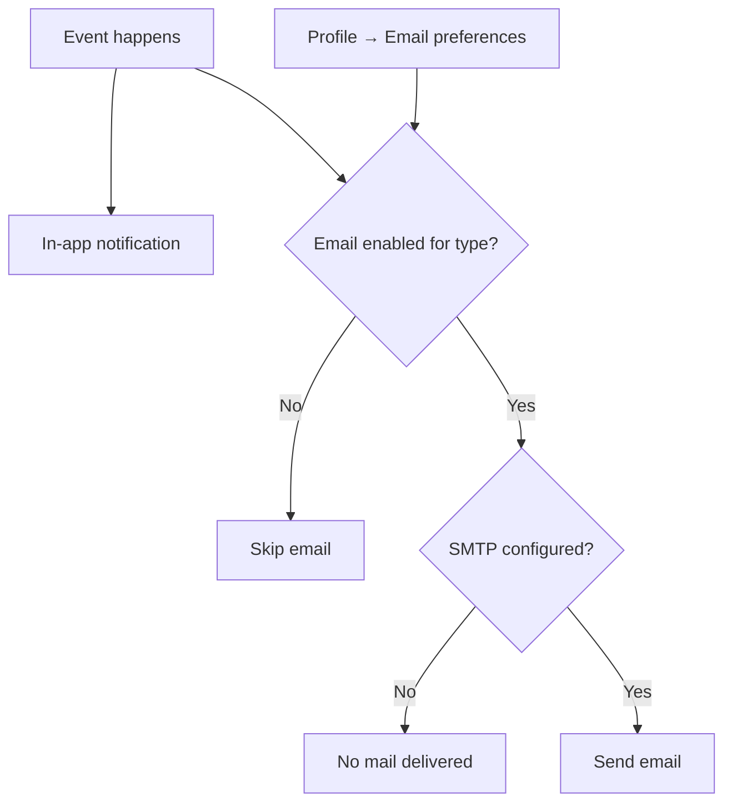

# Email preferences

**Audience:** End user (internal and customer portal)  
**Access path:** User menu → My Profile → **Email preferences**  
**Requires:** Signed-in session. Outbound mail needs SMTP under Administration → System Settings → Email (operators may also set env-based mail).  
**When missing:** Preferences still save if SMTP is incomplete — messages simply never arrive. In-app notifications continue even when email is disabled for a type.

## Purpose

Choose which events send you **email**. Turning a type off stops email for that type only; the notification bell can still show the same event in-app.

## 1 — Open and save preferences

1. Open **My Profile**.
2. Select the **Email preferences** tab.
3. Review categories (Tasks, Projects, Tickets, Planning, Summaries — internal). Customer portal users see a **short ticket-only** list.
4. Toggle each type on or off (defaults are **enabled** until you change them).
5. Click **Save** (or the page save control for email prefs).
6. Optional: use any **test summary** action offered for daily/weekly summaries when available, to verify SMTP.

> **SCREENSHOT** — Capture Profile email preferences tab with categories expanded.
> File to add: `media/docs-profile-email-prefs.png`

## 2 — Notification types (internal users)

| Category | Type key | Label | Typical trigger |
|----------|----------|-------|-----------------|
| Tasks | `task_assigned` | Task Assigned to You | You become assignee |
| Tasks | `task_status` | Task Status Changed | Status update on your task |
| Tasks | `task_deleted` | Task Deleted | Task removed |
| Tasks | `task_comment` | New Comment on Task | Comment on a task you follow/own |
| Tasks | `task_due_soon` | Task Due Soon | Due-date reminder (~1 day before) |
| Tasks | `task_overdue` | Task Overdue | Past due |
| Tasks | `task_mentioned` | Mentioned in Task Comment | `@username` in a comment |
| Projects | `project_added` | Added to Project | Membership / assignment to project |
| Projects | `project_status` | Project Status Changed | Project status update |
| Tickets | `ticket_created` | New Ticket Created | New ticket in your scope |
| Tickets | `ticket_assigned` | Ticket Assigned to You | Support/developer assignment |
| Tickets | `ticket_status` | Ticket Status Changed | Ticket status update |
| Tickets | `ticket_comment` | New Comment on Ticket | Comment on ticket |
| Tickets | `ticket_developer` | Assigned as Developer | Developer field set to you |
| Planning | `allocation_assigned` | Task Allocation Assigned | Allocation placed on you |
| Planning | `allocation_conflict` | Allocation Conflict Detected | Conflict signal |
| Summaries | `daily_work_summary` | Daily Work Summary | Scheduled summary around your work day |
| Summaries | `weekly_work_summary` | Weekly Work Summary | Weekly summary (first work day of week / schedule) |

Labels in the UI match the product language pack; keys above are stable identifiers.

## 3 — Customer portal preferences

Portal accounts only manage ticket-related mail:

- New ticket created  
- Ticket status changed  
- New comment on ticket  

Other categories do not appear.

## 4 — When mail never arrives

Work through this list:

1. Confirm the preference toggle is **on** for that type.  
2. Confirm your Profile **email** address is correct.  
3. Ask an admin to verify **SMTP** (host, port, credentials, FROM address) and send a test email from System Settings.  
4. Check spam/junk.  
5. Remember: disabling email does **not** disable the in-app bell.

Operator references: [[06-install-and-ops/environment-variables]], Administration → System Settings → Email.

## Tips

- Keep `task_assigned`, `task_mentioned`, and `task_due_soon` on if you live in email.  
- Turn off noisy types (`project_status`, frequent comments) if your inbox is overloaded.  
- Work summary mail respects these prefs and a server-side send log (avoids duplicates on restart).  
- Scheduled **project PDF** reports use configured recipients — that is separate from this panel.

## Done criteria

- Preferences saved successfully.  
- You know in-app ≠ email.  
- You can escalate SMTP issues without assuming the preference UI is broken.

## Related

- [[02-settings/profile]]
- [[03-modules/notifications]]
- [[03-modules/timesheet-and-timers]] (work summary context)
- [[01-getting-started/what-you-see-depends-on-settings]]
