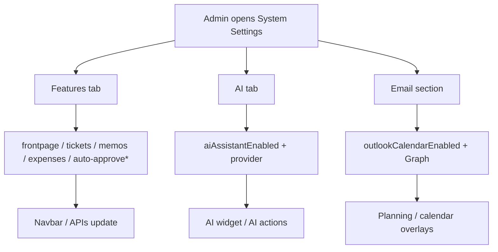

# Feature flags (System Settings)

**Audience:** Admin  
**Access path:** Administration → System Settings → **Features** (and **AI** tab; Outlook under **Email**)  
**Requires:** `isAdmin`. Changes apply instance-wide for all users.  
**When missing:** Non-admins do not see Administration. If a module is still visible after you turn a flag off, hard-refresh and confirm you saved the correct tab.

## Purpose

Turn a **small, fixed set** of optional behaviours on or off for the whole Myelin instance. This is not a general “module marketplace” — most delivery tools use **permissions** instead.

## 1 — Open and save

1. Sign in as an admin.
2. Open **Administration → System Settings**.
3. Select the **Features** tab for product toggles and auto-approve switches.
4. Change only the real flags listed below.
5. **Save** settings (use the page save control).
6. For AI: open the **AI** tab — enable the assistant and configure OpenAI or Ollama.
7. For Outlook calendar: open the **Email** section — enable Outlook calendar and enter Azure AD credentials.
8. Ask a non-admin user to refresh and confirm nav changes.

> **SCREENSHOT** — Capture Features tab checkboxes as shipped in the product.
> File to add: `media/docs-settings-feature-toggles.png`

## 2 — Real feature flags

### Product modules & frontpage

| Key | Admin label (EN) | Typical default | When OFF / notes |
|-----|------------------|-----------------|------------------|
| `frontpageEnabled` | Enable Front Page | On | Visiting `/` redirects straight to login; frontpage editor unused |
| `internalTicketsEnabled` | Enable Internal Ticket System | On | Hides Tickets nav, ticket KPIs, ticket search. **Does not** remove ticket/Jira fields on tasks |
| `memosEnabled` | Enable Memos Menu | On | Hides Memos in the navbar only |
| `expensesEnabled` | Enable Expenses Module | **Off** | Hides Expenses UI; expense APIs return **403** |

### Auto-approve workflow helpers

These do not create modules; they change default approval behaviour:

| Key | Admin label (EN) | Effect when ON |
|-----|------------------|----------------|
| `autoApproveExpenses` | Auto-approve expenses | New expenses created as **approved** (only useful if expenses enabled) |
| `autoApproveTimeEntries` | Auto-approve time entries | New time entries created as approved |
| `autoApproveVacations` | Auto-approve vacations | Vacation requests approved immediately |
| `autoApproveOutOfOffice` | Auto-approve out of office | OOO requests approved immediately |

### AI (AI tab)

| Key | Admin label (EN) | Effect |
|-----|------------------|--------|
| `aiAssistantEnabled` | Enable AI Assistant | Master switch for the floating assistant and related AI actions |

Also configure on the AI tab:

- Provider: **OpenAI** (API key + model) or **Ollama** (base URL + model)  
- Without a working provider, enabling the flag alone is not enough  

See [[08-ai-assistant/admin-configuration]].

### Outlook calendar (Email section)

| Key | Admin label (EN) | Effect when ON |
|-----|------------------|----------------|
| `outlookCalendarEnabled` | Outlook Calendar integration | Planning / Dashboard calendar can load Graph events |

Also required: Tenant ID, Client ID, Client Secret (**Value**, not Secret ID). Credentials are encrypted at rest. Others’ events show as **Busy** on Planning.

See FEATURES / [[03-modules/planning]] overlays.

## 3 — Not feature flags

Do **not** look for these under Features — they use permissions (or are always present for eligible internal users):

| Area | Real gate |
|------|-----------|
| Planning / Gantt | `CanViewPlanning` / plan permissions; mobile read-only |
| Timesheet / timers | Internal user + time permissions |
| Call Records | Internal navigation (not a Features checkbox) |
| Work Summary | Internal navigation + email prefs for mail |
| Projects / Dashboard | Role permissions (e.g. `CanViewDashboard`) |
| Reporting hub | `CanViewReports` / manager-admin packs |
| Redis cache | Env `REDIS_ENABLED` — [[06-install-and-ops/redis]] |
| Task form fields | Visibility cascade — [[02-settings/task-form-visibility]] |

End-user diagnosis guide: [[01-getting-started/what-you-see-depends-on-settings]].

## 4 — Interaction with permissions

Flags and permissions **stack**:

1. Flag off → module hidden / API 403 (Expenses) regardless of permission.  
2. Flag on → permission still required (Tickets need Support/ticket perms; Expenses need expense perms).  
3. Personal sidebar hide prefs can hide an allowed item but cannot re-show a flagged-off item.

## 5 — Recommended rollout order

1. Finish SMTP before relying on auto-approve email side effects or leave mail.  
2. Enable **internal tickets** only when Support processes and SLA vocabularies are ready.  
3. Keep **expenses** off until categories and approvers exist.  
4. Enable **AI** only after provider credentials and a privacy review.  
5. Enable **Outlook calendar** after Azure app registration is complete.  
6. Use auto-approve flags deliberately — they reduce Approvals queue volume.

## Tips

- Approvals nav label becomes **Approvals & Expenses** when expenses are enabled.  
- Turning tickets off is the correct way to hide the Tickets module globally; it is not the same as removing Jira from tasks.  
- Document your instance’s flag choices for operators in your runbook.

## Common mistakes

- Searching for a “Disable Planning” checkbox — it does not exist.  
- Enabling AI without a provider and assuming the widget is broken.  
- Enabling expenses without `CanApproveExpenses` / category setup, then wondering why the queue is empty or blocked.

## Done criteria

- Features / AI / Outlook settings saved.  
- A test user sees the expected navbar (Tickets / Memos / Expenses).  
- You can list every real flag from the table above without inventing extras.

## Related

- [[01-getting-started/what-you-see-depends-on-settings]]
- [[02-settings/organization-settings]]
- [[08-ai-assistant/admin-configuration]]
- [[03-modules/expenses]]
- [[03-modules/approvals]]
- [[06-install-and-ops/redis]]
