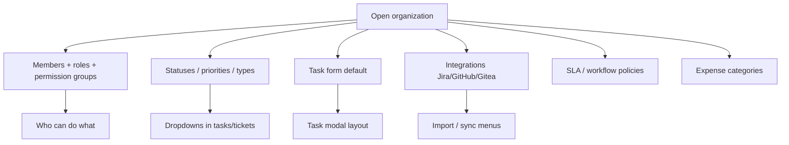

# Organization settings (managers)

**Audience:** Manager, Admin, members with org manage-settings  
**Access path:** Administration → Organizations → open org (`/organizations/:id`), or list redirect `/organizations` → Administration organizations tab  
**Requires:** Org membership. Tabs such as Integrations, SLA, Workflow policies, and Task form appear when you can **manage settings** (admin role on the org, or `CanManageSettings`).  
**When missing:** Read-only members see overview/projects/history but cannot edit statuses or integrations. Customer portal users never manage organizations.

## Purpose

Configure the vocabulary, membership, integrations, and defaults for one organization. Projects, tasks, tickets, and expense categories inherit this shape.

## Tabs at a glance

| Tab | Purpose |
|-----|---------|
| **Overview** | Name, description, high-level stats (ticket counts depend on internal tickets flag) |
| **Members** | Add/remove people; role Developer / Support / Manager; optional permission group |
| **Projects** | Projects linked to this org |
| **Permission groups** | Org-level capability packs (manage projects/tasks/members/settings, budget visibility, …) |
| **Status & priorities** | Project/task/ticket vocabularies (see below) |
| **Expense categories** | Groups + categories (relevant when Expenses module is on) |
| **Tags** | Org tags |
| **Integrations** | Jira, GitHub, Gitea credentials (manage-settings) |
| **SLA rules** | Ticket SLA (manage-settings; meaningful when tickets enabled) |
| **Workflow transition policies** | DoR/DoD-style transition rules (manage-settings) |
| **Task form** | Org default field visibility — [[02-settings/task-form-visibility]] |
| **Attachments** | Org-level files |
| **History** | Change audit for the organization |

## 1 — Open the organization

1. Sign in as a manager/admin.
2. Go to **Administration → Organizations** (or open a deep link `/organizations/:id`).
3. Select the organization.
4. Confirm the header shows the org name (and abbreviation if set).

## 2 — Members and roles

1. Open **Members**.
2. Add a user; choose **role**:
   - **Developer** — delivery contributor defaults  
   - **Support** — ticket-oriented defaults  
   - **Manager** — broadest non-admin defaults  
3. Optionally assign a **permission group**.
4. Save. The creator of an org is added as a member automatically on create.
5. Remove members carefully — they lose org-scoped access.

Global admin flag (`isAdmin`) is managed under Administration → Users, not only here.

See [[05-reference/permissions-matrix]].

## 3 — Permission groups

1. Open **Permission groups**.
2. Create a group with flags such as manage projects, tasks, members, settings, budget visibility (exact labels follow the UI).
3. Assign the group on Members.
4. Use sync/delete actions when offered to keep groups consistent.
5. Remember: budget visibility is true if **either** the global role **or** the org group grants `CanViewBudgetInfo`.

## 4 — Statuses, priorities, and types

1. Open **Status & priorities**.
2. Configure each vocabulary:

| Sub-list | Fields |
|----------|--------|
| Project statuses | Value, colour, IsDefault |
| Task statuses | Value, colour, IsDefault |
| Task priorities | Value, colour, IsDefault |
| Task types | Value, colour, icon (Lucide name), IsDefault |
| Milestone types | As offered in UI |
| Ticket statuses | Value, colour, StatusType (`open` / `in_progress` / `waiting` / `resolved` / `closed` / `other`), IsClosed, IsCancelled |
| Ticket priorities | Value, colour, IsDefault |

3. Keep **exactly one default** per list where the product enforces it — defaults pre-select on new items.
4. Map Jira/import statuses after local vocabularies exist — [[03-modules/jira-boards-and-tickets]], [[04-workflows/import-first-delivery]].

Ticket status lists matter for portal “needs your attention” (`waiting`) and closed/cancelled behaviour.

> **SCREENSHOT** — Capture task/ticket status configuration table with colours.
> File to add: `media/docs-settings-org-statuses.png`

## 5 — Task form default

1. Open **Task form** (manage-settings).
2. Set which optional task modal fields/tabs the org shows by default.
3. Optional: **Sync from global** to copy Administration’s template over the org copy.
4. Teammates may still override personally — [[02-settings/task-form-visibility]].

## 6 — Integrations

1. Open **Integrations**.
2. For **Jira**: enable, set Tickets instance and optional Projects instance, test connection, save. Tokens are encrypted and never returned in clear text.
3. For **GitHub / Gitea**: set URL + token; use Project → Import when ready.
4. Project-level Jira board IDs live on the project when Projects integration is configured.

Details: [[03-modules/integrations]].

## 7 — SLA and workflow policies

1. **SLA rules** — define ticket timing expectations for the org.  
2. **Workflow transition policies** — constrain status transitions / DoR–DoD style checks when configured.  
3. Save and verify on a sample ticket/task transition.

## 8 — Expense categories

When `expensesEnabled` is on:

1. Open **Expense categories**.
2. Maintain groups and category values (defaults may be seeded on org create).
3. Set optional **max reimbursement** caps per category.
4. Submitters pick these categories on [[03-modules/expenses]].

## Tips

- Define statuses **before** bulk Jira/CSV imports.  
- Closed/cancelled ticket types drive portal and reporting filters — name them clearly.  
- Prefer permission groups for “can manage settings but not full admin” people.  
- Overview ticket widgets disappear when internal tickets are disabled — expected.

## Common mistakes

- Editing the wrong organization when you belong to several.  
- Leaving multiple “defaults” mentally — the product keeps one IsDefault.  
- Looking for a Planning feature flag on the org — Planning is permission-based.

## Done criteria

- Members have correct roles/groups.  
- Task and ticket vocabularies cover your real workflow.  
- Integrations tested if you rely on imports.  
- Org task-form default matches what the team should see.

## Related

- [[02-settings/task-form-visibility]]
- [[02-settings/feature-toggles-overview]]
- [[05-reference/permissions-matrix]]
- [[03-modules/integrations]]
- [[03-modules/create-project]]
- [[03-modules/expenses]]
