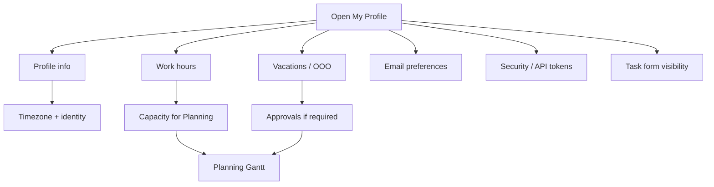

# Profile

**Audience:** End user (internal and customer portal)  
**Access path:** User menu → **My Profile** (`/profile`)  
**Requires:** Signed-in session. Work hours, vacations, OOO, recurring tasks, API tokens, and task-form tabs are for **internal** users only.  
**When missing:** Customer portal accounts see a shorter tab set (no Planning capacity tabs). Hourly rate / budget fields elsewhere still need `CanViewBudgetInfo` for others to view rates.

## Purpose

Keep identity, timezone, capacity, security, and personal tokens accurate. Planning, calendars, work-summary mail, and budget cascade all read values you set here.

## Tabs overview

| Tab | Who | What |
|-----|-----|------|
| **Profile info** | Everyone | Name, email, username, avatar, timezone, hourly rate (internal) |
| **Vacations** | Internal | Request / list vacation days |
| **Out of office** | Internal | Request unavailable days that block capacity |
| **Work hours** | Internal | Per-weekday hours, start times, lunch |
| **Recurring tasks** | Internal | Recurring capacity blocks (pink 🔄 on Planning) |
| **My attachments** | Everyone | Personal attachments list |
| **Security** | Everyone | Change password |
| **API Tokens** | Internal | Personal `pt_…` tokens for integrations / companions |
| **Email preferences** | Everyone | Opt in/out of email categories — [[02-settings/email-preferences]] |
| **Task form** | Internal | Personal field/tab visibility per org — [[02-settings/task-form-visibility]] |

## 1 — Profile info

1. Open **My Profile**.
2. On **Profile info**, update:
   - First name, last name  
   - Email (used for notifications and password recovery)  
   - Username  
3. Upload an **avatar** if offered (profile picture).
4. Set **Timezone** to an IANA zone that matches where you work (for example `Europe/Lisbon`). Wrong timezone skews “today”, reminders, and calendar boundaries.
5. Internal users: set **Hourly rate** when your organization uses monetary budget views. Managers with `CanViewBudgetInfo` may see your rate. Effective cost cascade is task → project → user → `0`.
6. Save.

> **SCREENSHOT** — Capture Profile info with timezone (and rate if visible).
> File to add: `media/docs-profile-info.png`

## 2 — Work hours (capacity)

Planning checks your weekday capacity before placing allocations.

1. Open **Work hours**.
2. For each weekday set **hours** (for example 8 Mon–Fri, 0 Sat–Sun).
3. Set **work start time** per day (when the workday begins for calendar-style planning).
4. Set **lunch time** and **lunch duration** (minutes) so the day schedule inserts a break.
5. Review the weekly total if shown.
6. Save work hours.

| Field | Used for |
|-------|----------|
| Hours Mon–Sun | Max bookable capacity that day |
| Work start time | Where daily schedule starts |
| Lunch time + duration | Break inserted in the day |
| Timezone (Profile info) | Which calendar day is “today” |

> **SCREENSHOT** — Capture weekday hours, start time, lunch, timezone context.
> File to add: `media/docs-profile-work-hours.png`

## 3 — Vacations, OOO, Dev Support

Leave and support overlays affect (or inform) Planning:

| Type | Capacity effect | Where |
|------|-----------------|-------|
| Vacation | Reduces availability (approval unless auto-approve vacations) | Profile → Vacations |
| Out of office | Blocks unavailable days (approval unless auto-approve OOO) | Profile → Out of office |
| Dev Support | **Informational only** — does not cut capacity | Calendar / Management → Dev Support |
| Holidays | Calendar / capacity | Administration → Holidays |

Full steps: [[02-settings/vacations-ooo-dev-support]].

## 4 — Recurring tasks

1. Open **Recurring tasks**.
2. Create or edit recurring blocks that reserve hours on the Planning overlay.
3. Delete future occurrences carefully — confirmation explains the impact.

These show as reserved/pink blocks on the Gantt; see [[03-modules/planning]].

## 5 — Security

1. Open **Security**.
2. Enter current password, new password, and confirmation.
3. Save. Use a strong unique password.

## 6 — API Tokens (internal)

For IDE extensions, Cloudflare email queue, scripts, or companions:

1. Open **API Tokens**.
2. Create a token with a name and optional expiry.
3. Copy the `pt_…` secret **immediately** — it is shown once.
4. Send as `Authorization: Bearer pt_…` on API calls.
5. **Deactivate** to revoke; **Delete** to remove from the list.

Admins can also review all tokens under Administration → API Tokens. Creating a token there still creates it for the admin’s own account.

## 7 — Attachments

Use **My attachments** to review files associated with your user profile. For task/project files, prefer the entity’s own Attachments tab.

## Tips

- Set work hours **before** heavy Planning sessions.  
- Capacity `0` on weekends prevents weekend overbooking.  
- Email preference changes do not require SMTP to save — but mail will not leave the server until SMTP works.  
- Task form overrides are per organization — pick the org in that tab.

## Common mistakes

- Leaving timezone on system default when you travel or work remotely across regions.  
- Expecting Dev Support days to free Gantt capacity — they do not.  
- Losing the API token secret and assuming it can be revealed again — create a new token instead.

## Done criteria

- Profile info and timezone saved.  
- Work hours (internal) match your real week.  
- You know which tabs apply to your account type.  
- Password change path works if you need it.

## Related

- [[02-settings/email-preferences]]
- [[02-settings/vacations-ooo-dev-support]]
- [[02-settings/task-form-visibility]]
- [[03-modules/planning]]
- [[07-companions/ide-extensions]]
