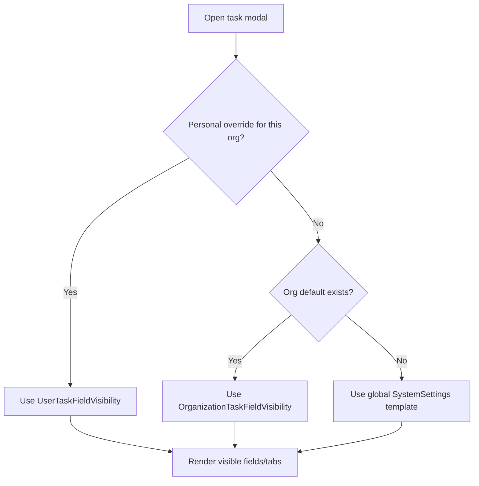

# Task form field visibility

**Audience:** End user, Manager, Admin  
**Access path:**  
- Personal: My Profile → **Task form**  
- Organization default: Organization → **Task form** (manage-settings)  
- Global template: Administration → System Settings → **Task form**  
**Requires:** Internal user for personal overrides. Org/global editors need manage-settings / admin.  
**When missing:** Customer portal users do not get this tab. With no org membership, Profile explains there is nothing to customize.

## Purpose

Simplify the task detail modal by hiding optional fields, header controls, and tabs you do not use. Visibility is **UI-only** — APIs, imports, and integrations can still set hidden values.

## Resolution order

For each user in an organization, Myelin resolves visibility in this order:

1. **Personal override** — Profile → Task form for that organization (`UserTaskFieldVisibility`), if saved.  
2. **Organization default** — Organization → Task form (`OrganizationTaskFieldVisibility`), if present.  
3. **Global template** — Administration → Task form (`SystemSettings.taskFieldVisibility`).

New organizations are seeded from the global template. Missing org rows fall through to global for effective reads.

## Locked (always visible)

These cannot be hidden:

- Task **Name**  
- **Status**  
- **Priority**  
- **Task Type**  
- **Details** tab  

## What you can hide (optional)

Config UI is grouped by location (Modal tabs / Header / Details / Hours) with short location hints.

| Area | Examples of optional controls |
|------|-------------------------------|
| **Modal tabs** | History, Comments, Attachments, Hours, Checklist |
| **Header** | Project/Customer/Synapse pills, timer, hours summary cards, tags, print, task actions menu |
| **Details fields** | Description, linked ticket/Jira board refs, Jira/GitHub/Gitea keys, Assignees, Customer (global projects), Due Date flags, Estimates, Story Points, Application/Release, Custom fields block |
| **Hours fields** | Parent/Depends On, Child tasks list, Planned allocations, Time entries (also hides Hours sub-tabs when empty) |
| **Section labels** | Optional toggle to hide form section headings while keeping fields visible |

## 1 — Personal override (most users)

1. Open **My Profile** → **Task form**.
2. Select the **organization** this layout applies to (overrides are per org).
3. Toggle optional fields/tabs off to simplify the modal.
4. Save.
5. Open any task in that org and confirm hidden controls are gone.
6. To discard your override: use **Use organization default** (deletes the personal copy for that org).

> **SCREENSHOT** — Capture Profile or Administration task form visibility panel (grouped sections).
> File to add: `media/docs-settings-task-form.png`

## 2 — Organization default (managers)

1. Open the organization → **Task form** (requires manage-settings).
2. Adjust the org-wide defaults your team should see.
3. Optional: **Sync from global** — overwrites the org copy with the current Administration template.
4. Tell teammates they can still set personal overrides, or ask them to reset to org default for consistency.

## 3 — Global template (admins)

1. Open **Administration → System Settings → Task form**.
2. Edit the instance-wide template.
3. New orgs inherit from this template; existing orgs keep their copy until someone syncs.

## Tips

- Align **org defaults** before a big rollout so imports and humans see the same shape.  
- Hiding Estimates does not remove Planning’s need for leaf estimates — it only cleans the modal.  
- Jira/GitHub fields hidden in UI can still be filled by import jobs.  
- This is unrelated to System Settings **feature flags** (Tickets/Memos/Expenses/…).

## Common mistakes

- Expecting a hidden field to reject API updates — it will not.  
- Editing the wrong organization in the Profile org dropdown.  
- Confusing “tab hidden” with “you lack permission” — permissions still gate create/edit actions separately.

## Done criteria

- You know the three-level cascade.  
- Personal or org layout saved and visible on a sample task.  
- Locked fields still appear after customization.

## Related

- [[02-settings/profile]]
- [[02-settings/organization-settings]]
- [[03-modules/create-and-complete-task]]
- [[03-modules/projects-and-tasks]]
- [[02-settings/feature-toggles-overview]]
