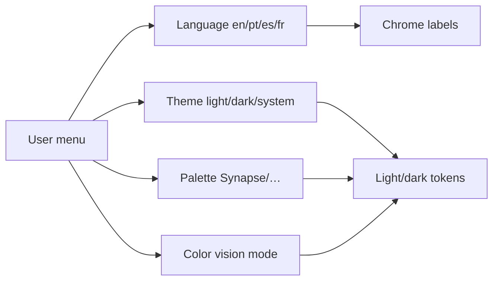

# Theme and language

**Audience:** End user  
**Access path:** User menu (avatar) → Language / Theme / Color vision  
**Requires:** Signed-in browser session. Choices are stored locally (and locale also in a cookie).  
**When missing:** Customer portal users still get theme/language controls in the account menu; **Docs** link stays internal-only.

## Purpose

Personalize chrome appearance and UI language without changing other people’s accounts. Content you type (task titles, comments, memo bodies) stays in the language you write — only product chrome labels switch.

## 1 — Language

1. Open the **user menu**.
2. Find **Language**.
3. Choose one of:

| Code | Label in picker |
|------|-----------------|
| `en` | English |
| `pt` | Português (European Portuguese UI pack) |
| `es` | Español |
| `fr` | Français |

4. The chrome updates immediately; the choice persists (cookie `myelin_locale` + local storage).

**Note:** AI translate targets inside task tools (when AI is enabled) are separate — those pick a translation output language for a piece of text, not the whole UI.

## 2 — Theme mode

1. In the user menu, find **Theme**.
2. Choose:

| Mode | Behaviour |
|------|-----------|
| **Light** | Always light tokens |
| **Dark** | Always dark tokens |
| **System** | Follows the OS / browser `prefers-color-scheme` |

3. Selection applies at once and is stored as `themeMode`.

## 3 — Theme palette

1. Open the palette picker (next to theme controls).
2. Choose a palette:

| Palette | Role |
|---------|------|
| **Synapse** | Default Synapse accent |
| **Catppuccin** | Alternate accent pack |
| **Ocean** | Blue-forward accents |
| **Forest** | Green-forward accents |

3. Palettes work with both light and dark modes (`data-theme-palette` on the document).

## 4 — Color vision

1. Open **Color vision** (accessibility).
2. Choose:

| Mode | Use when |
|------|----------|
| **Default** | Standard colours |
| **Deuteranopia** | Green-weak simulation/adjust |
| **Protanopia** | Red-weak simulation/adjust |
| **Tritanopia** | Blue-yellow simulation/adjust |

3. The mode is stored locally and applied via `data-color-vision`.

> **SCREENSHOT** — Capture theme + language + palette + color vision pickers.
> File to add: `media/docs-settings-theme-language.png`

## Tips

- Prefer **System** theme if you already follow OS dark mode on a schedule.  
- Language changes do not translate user-entered project data.  
- Pair color vision modes with status colours carefully — org status hex values are custom; accessibility modes help chrome/status readability but cannot invent missing contrast in uploaded images.

## Done criteria

- You can switch language and confirm sidebar labels changed.  
- You can set Light/Dark/System and a palette.  
- You know content language ≠ UI language.

## Related

- [[01-getting-started/navigation]]
- [[02-settings/profile]]
- [[08-ai-assistant/widget-usage]] (AI translate is separate)
