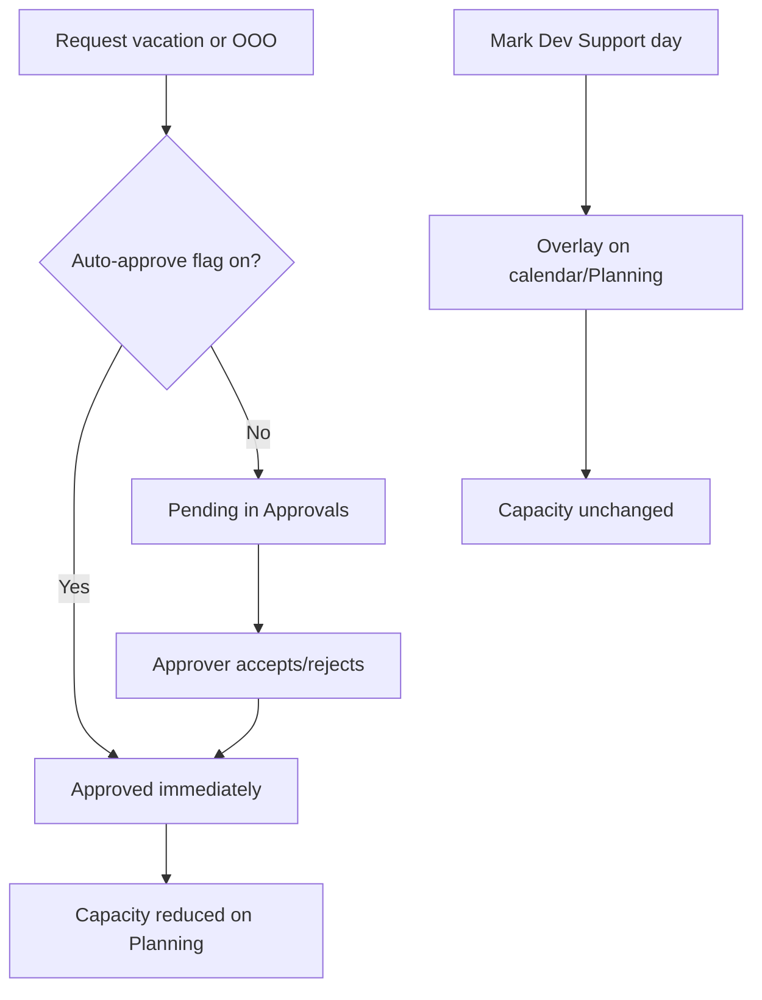

# Vacations, out of office, and Dev Support

**Audience:** End user, Manager / team leader, Admin  
**Access path:**  
- Vacations / OOO: My Profile → **Vacations** / **Out of office**  
- Approvals: **Approvals** (or Approvals & Expenses)  
- Team Dev Support: Management → **Dev Support** (`/dev-support`)  
- Holidays: Administration → **Holidays**  
**Requires:** Internal user profile for personal leave. Approvals depend on approver scope. Optional auto-approve flags live under System Settings → Features.  
**When missing:** Customer portal users do not manage vacations here. Empty Approvals queues usually mean you are not an approver for that type.

## Purpose

Record absence and support rotation so Planning and calendars stay honest. Vacations and OOO change **availability**; Dev Support is an **informational** overlay only.

## Capacity effects

| Type | Effect on planning capacity | Approval |
|------|----------------------------|----------|
| **Vacation** | Reduces availability for the requested days/portions | Required unless `autoApproveVacations` |
| **Out of office** | Blocks unavailable days | Required unless `autoApproveOutOfOffice` |
| **Dev Support** | Informational overlay — does **not** reduce allocation capacity or block drag-and-drop | Auto-saved / managed; not a leave approval |
| **Holidays** | Calendar / capacity (org/instance holidays) | Managed by admins under Holidays |

## 1 — Request vacation

1. Open **My Profile → Vacations**.
2. Review the year summary (days requested / approved as shown).
3. Set **start date** and **end date**.
4. Choose **day portion**: full day or half day.
5. Add optional **notes**.
6. Submit the request.
7. If auto-approve vacations is off, wait until an approver acts in [[03-modules/approvals]].
8. After approval, confirm the days appear on calendars / Planning overlays.

> **SCREENSHOT** — Capture Profile vacation or OOO request UI (dates + portion).
> File to add: `media/docs-settings-ooo.png`

## 2 — Request out of office

1. Open **My Profile → Out of office**.
2. Set date range, **full/half** portion, and notes.
3. Submit.
4. Await approval unless `autoApproveOutOfOffice` is on.
5. Replan any allocations that collide with blocked days — [[03-modules/planning]], [[04-workflows/planned-vs-actual]].

## 3 — Delete or correct your request

1. In the Vacations or OOO list, choose the entry.
2. Delete when the UI allows (confirm the dialog).
3. If the entry is already approved and you need a change, coordinate with an approver/admin — do not leave ghost capacity assumptions on the Gantt.

## 4 — Approve leave (managers)

1. Open **Approvals**.
2. Open the vacations / out-of-office queue (labels follow product language).
3. Accept or reject with any required note.
4. Rejected days should not keep consuming capacity after the workflow completes.

Auto-approve flags (admin):

| Flag | Effect |
|------|--------|
| `autoApproveVacations` | New vacation requests become approved immediately |
| `autoApproveOutOfOffice` | New OOO requests become approved immediately |

See [[02-settings/feature-toggles-overview]].

## 5 — Dev Support (informational)

### Yourself

Mark Dev Support days when you are on support rotation (full days). Entries are auto-saved where the product offers personal marking (calendar / planning overlay). They appear for visibility but **do not** free capacity.

### Team leaders / admins

1. Open **Management → Dev Support** (`/dev-support`).
2. Confirm you have manage scope (leaders/admins).
3. Select year / team member.
4. Configure who is in the Dev Support team if prompted.
5. Add or remove Dev Support days for members.
6. Use Planning overlays to see the informational blocks alongside real capacity limits.

> **SCREENSHOT** — Capture Management → Dev Support calendar or member list.
> File to add: `media/docs-settings-dev-support.png`

## 6 — Holidays

Admins maintain public/company holidays under **Administration → Holidays**. These feed calendars and capacity separately from personal vacation requests.

## Tips

- Request leave **before** planners lock a sprint on those days.  
- Half-day portions matter for capacity math — pick them deliberately.  
- Pair OOO with a Planning replan so work moves to free days.  
- Outlook busy blocks (when Outlook calendar is enabled) are another overlay — privacy shows others as **Busy**.

## Common mistakes

- Expecting **Dev Support** to free Gantt capacity — it never does.  
- Stacking OOO on top of heavy allocations without replanning.  
- Assuming auto-approve is on when Approvals still show pending items.

## Done criteria

- You can submit a vacation or OOO request with the correct portion.  
- You know whether your instance auto-approves leave.  
- You can explain Dev Support vs vacation to a teammate.

## Related

- [[02-settings/profile]]
- [[03-modules/approvals]]
- [[03-modules/planning]]
- [[02-settings/feature-toggles-overview]]
- [[04-workflows/planned-vs-actual]]
