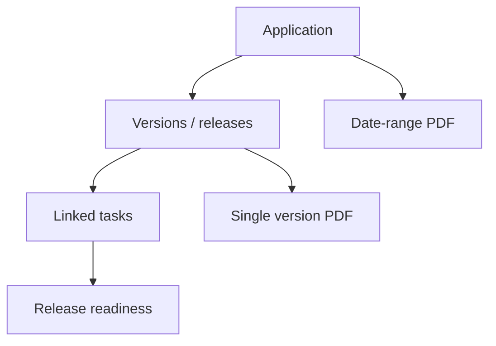
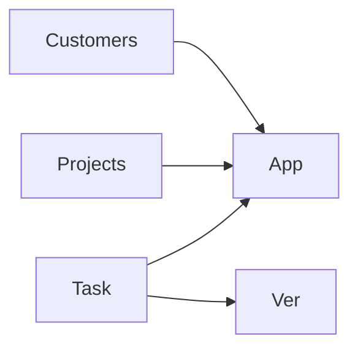

# Applications and releases — complete guide

**Audience:** Manager, End user with application access; Admin for org-wide setup
**Access:** Sidebar → Applications (`/applications`); detail `/applications/:id?tab=…`
**Requires:** Signed-in internal user with access to the applications list. **Not** a Features flag.
**When disabled / missing:** Missing menu = permissions/nav — not a module toggle.

Applications are the products you build or maintain. **Versions (releases)** hold patch notes, dates, and linked tasks. Export PDFs for release communication.

## 1 — Applications list

1. Open **Applications**.
2. Browse cards/table. On phone, grid view is forced; view toggle may hide below `sm`.
3. Create / edit when you have manage permission.
4. Cards show the uploaded image or a package icon fallback.

### Application fields

| Field | Notes |
|-------|--------|
| Name | Required |
| Description | Rich text |
| Repository URL | Optional source link |
| Organization | Owning org |
| Customer-specific | Flag when the app is client-specific |
| Image | **Upload only** (PNG/JPEG/WebP/SVG) to `/uploads/applications/…` — no external image URL field |
| Customers | Searchable multi-select (many-to-many) |

> **SCREENSHOT** — Capture applications with images.
> File to add: `media/docs-applications-list.png`

## 2 — Application detail tabs

Sidebar/tabs persist in `?tab=` so refresh keeps the panel:

| Tab | Purpose |
|-----|---------|
| **Overview** | Description, image, customers, metadata |
| **Versions** | Release list + selected version detail |
| **Commits** | Commit-oriented panel when present in your build |

1. Open an application.
2. Switch tabs; confirm the URL updates with `?tab=`.
3. On phone, Versions may stack the list above the detail panel.

## 3 — Versions (releases)

1. Open **Versions**.
2. Create a version:

| Field | Notes |
|-------|--------|
| Version number | e.g. `1.4.0` |
| Version name | Optional marketing name |
| Status | Org/process status |
| Release date | Used in PDFs and sorting |
| Patch notes | Rich text **with images** |
| Customer-specific | Optional flag |

3. **Link tasks** to the version. A task linked to one version leaves the available pool for other versions; `ReleaseVersionId` is set on the task.
4. Unlink or reassign according to your release process before freezing notes.

> **SCREENSHOT** — Capture version fields and linked tasks.
> File to add: `media/docs-releases-detail.png`

## 4 — Patch notes PDF export

### Single version — Print to PDF

1. Open a version → **Print to PDF**.
2. PDF includes:
   - Application name, version number, release date (header)
   - Patch notes rendered from HTML (images resolved at print time)
   - Linked tasks with status / priority / assignee

### Date-range — Print Date Range

1. Choose start and end dates.
2. Aggregates all releases in range.
3. Each release in its own section; sorted by release date; page breaks between releases.

### Image sources in notes

| Source | Example |
|--------|---------|
| Inline base64 | `data:image/...;base64,...` |
| Local uploads | `/uploads/...` paths |
| External URLs | `http://` / `https://` |

> **SCREENSHOT** — Capture export action on a release.
> File to add: `media/docs-releases-pdf.png`

## 5 — Link from projects, tasks, and customers

| Surface | How it connects |
|---------|-----------------|
| Projects | Associate applications on project create/settings |
| Tasks | Pick application + version when Task Form Visibility shows those fields |
| Customers | Many-to-many on the application (and customer apps list) |
| Release readiness | [[04-workflows/release-readiness]] |

AI-assisted patch-notes improvement may appear when **`aiAssistantEnabled`** and a provider are configured — see [[08-ai-assistant/widget-usage]].

## 6 — Tips and mistakes

- Upload an application image before demos — cards look empty without it.
- Link tasks to a version **before** exporting PDF so the task list is complete.
- Do not paste secrets or internal URLs into patch notes; PDFs are often shared externally.
- There is no `applicationsEnabled` flag — if the menu is missing, check permissions/nav.
- `frontpageEnabled` only affects the public landing page, not Applications.

## Related

- [[03-modules/projects-and-tasks]]
- [[03-modules/customers-and-portal]]
- [[03-modules/create-and-complete-task]]
- [[04-workflows/release-readiness]]
- [[08-ai-assistant/widget-usage]]
- [[02-settings/task-form-visibility]]
