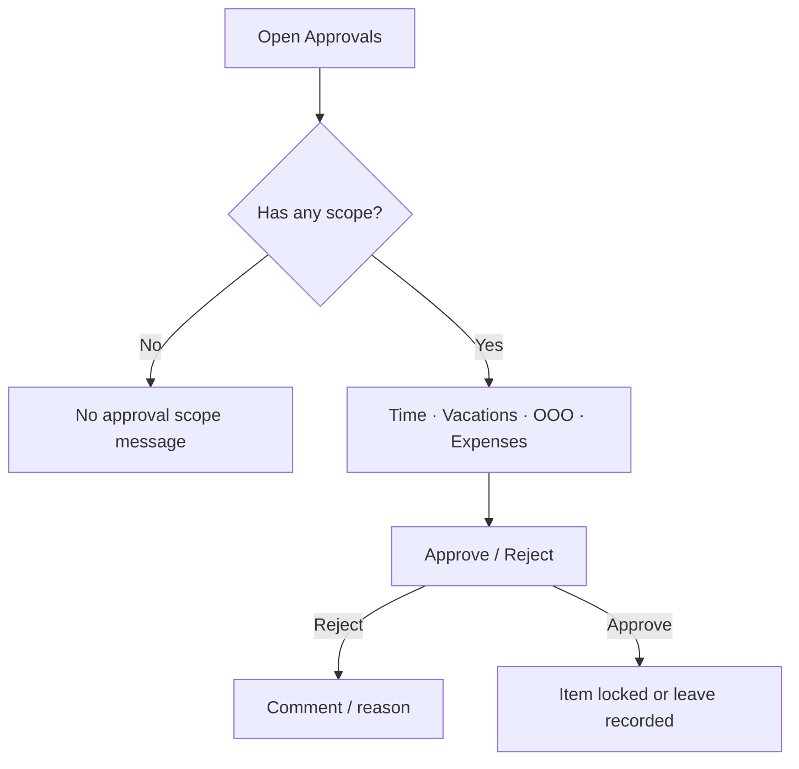
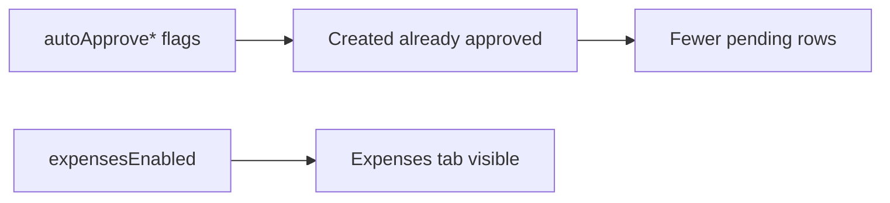

# Approvals — complete guide

**Audience:** Manager, Team leader, Admin
**Access:** Sidebar → **Approvals** (label becomes **Approvals & Expenses** when `expensesEnabled` is on) — `/approvals`
**Requires:** Approval **scope** for time entries, vacations, out-of-office, and/or expenses. Expenses tab only if **`expensesEnabled`**. Auto-approve flags reduce what appears as pending.
**When disabled / missing:** Empty queues or “no approval scope” if you are not a leader/admin for those domains. Auto-approve does not hide the page; it shrinks pending lists.

One place to approve or reject team time, leave, and (when enabled) expenses with reimbursement.

## 1 — Open and choose a tab

1. Open **Approvals** (or **Approvals & Expenses**).
2. Tabs (disabled when you lack scope):

| Tab | What you review | Related flag |
|-----|-----------------|--------------|
| **Time** | Pending time entries | `autoApproveTimeEntries` |
| **Vacations** | Vacation requests | `autoApproveVacations` |
| **Out of Office** | OOO / unavailable requests | `autoApproveOutOfOffice` |
| **Expenses** | Pending expenses + reimbursement | Needs `expensesEnabled`; `autoApproveExpenses` |

3. Query `?tab=` can deep-link a tab when your scope allows it.
4. If every tab is out of scope, you see a clear “no approval scope” message — ask an admin to grant team-leader scope or admin rights.

> **SCREENSHOT** — Capture Time tab with approve/reject controls.
> File to add: `media/docs-detail-approvals-time-tab.png`

## 2 — Time entries

1. Open **Time**.
2. Review user, task, date, hours, description.
3. **Approve** → entry locks for the submitter (cannot edit).
4. **Reject** → include a clear reason; submitter sees the comment on Timesheet.
5. Use bulk **Approve all** for the filtered set when the UI offers it.

Submitter guide: [[03-modules/timesheet-and-timers]].

### Why a row never appears

| Cause | Effect |
|-------|--------|
| `autoApproveTimeEntries` on | New entries created approved |
| Project is **Hobby** | Hobby time can auto-approve |
| Already approved/rejected | Not in pending queue |

## 3 — Vacations

1. Open **Vacations**.
2. Check date range and requester.
3. Approve or reject with a reason when rejecting.
4. Approved vacations reduce Planning **capacity**.

Requests originate from [[02-settings/profile]] / [[02-settings/vacations-ooo-dev-support]].

Flag: **`autoApproveVacations`**.

## 4 — Out of Office

1. Open **Out of Office**.
2. Same approve/reject pattern as vacations.
3. Approved OOO blocks Planning availability.

Flag: **`autoApproveOutOfOffice`**.

## 5 — Expenses tab

Only when **`expensesEnabled`**.

1. Open **Expenses**.
2. Approve or reject pending expenses (reject → reimbursement **not applicable**).
3. Set **amount to reimburse** (may be less than total; category caps may apply).
4. Record **payments**; allow partial reimbursements; mark settled when done.
5. Admins may **revert** rejected → pending, correct fields after payment, and **delete** anytime.

Full submitter flow: [[03-modules/expenses]]. Flag: **`autoApproveExpenses`**.

> **SCREENSHOT** — Capture expense approve + reimbursement controls.
> File to add: `media/docs-detail-approvals-expenses-tab.png`

## 6 — Auto-approve flags (summary)

Configure under [[02-settings/feature-toggles-overview]].

| Flag | Effect on this page |
|------|---------------------|
| `autoApproveTimeEntries` | New time often never pending |
| `autoApproveVacations` | Vacation requests auto-approved |
| `autoApproveOutOfOffice` | OOO auto-approved |
| `autoApproveExpenses` | New expenses created approved (still manage reimbursement here) |

These are **not** separate modules. They only change default approval behaviour.

## 7 — Capacity vs Approvals

| Item | Goes through Approvals? | Affects Planning capacity? |
|------|-------------------------|----------------------------|
| Time entries | Yes (unless auto-approved) | Indirect (actuals), not capacity bars |
| Vacations | Yes | Yes — reduces capacity |
| Out of Office | Yes | Yes — blocks availability |
| Dev Support | **No** — Management → Dev Support | **No** — informational only |
| Expenses | Yes (when enabled) | No — money, not hours |

## 8 — Tips and mistakes

- Reject with a **specific** reason — “fix hours” is not actionable.
- Empty Time tab + auto-approve on is normal, not a bug.
- Dev Support never appears here and never reduces capacity.
- Expenses reimbursement is not hourly budget tracking.
- Dashboard pending-approval badges only help if you have scope — open this page to act.

## Related

- [[03-modules/timesheet-and-timers]]
- [[03-modules/expenses]]
- [[02-settings/vacations-ooo-dev-support]]
- [[02-settings/feature-toggles-overview]]
- [[03-modules/planning]]
- [[03-modules/dashboard]]
