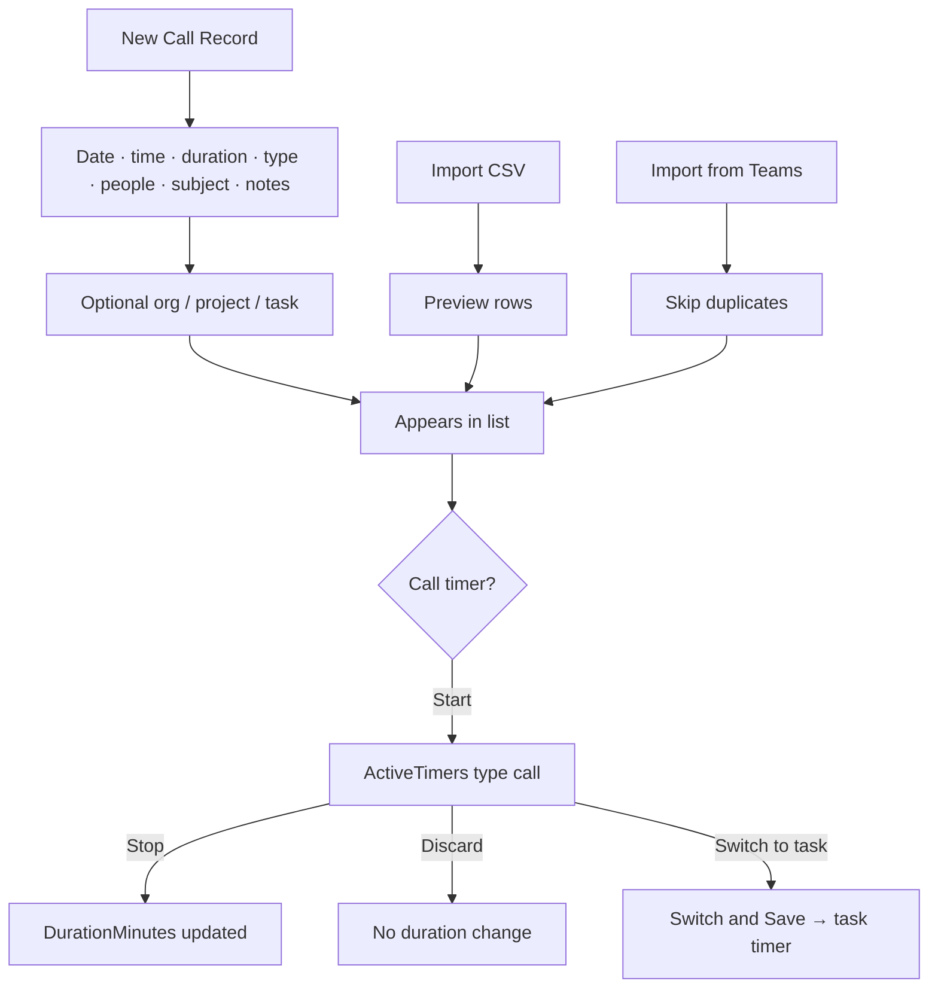
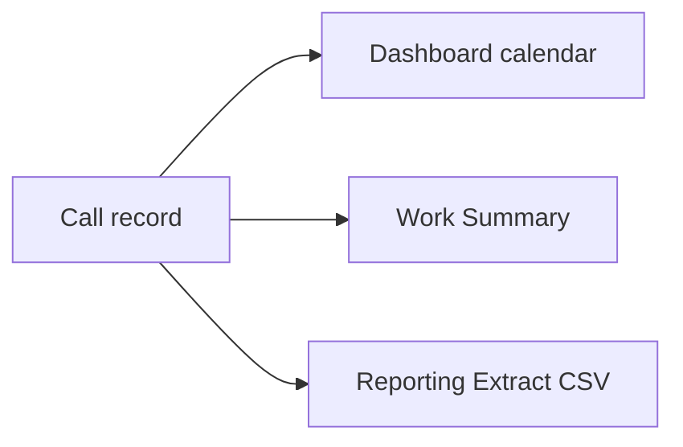

# Call records — complete guide

**Audience:** End user, Manager, Admin
**Access:** Sidebar → Call Records (`/call-records`)
**Requires:** Signed-in **internal** user. There is **no** Call Records feature flag.
**When disabled / missing:** If the menu is hidden, check nav preferences or customer-portal role — not a System Settings module toggle. Customer users never use Call Records.

Log phone calls, meetings, and communication events linked to an organization, project, or task. Optionally run a **call timer** that updates duration only — it does **not** create timesheet entries.

## 1 — Open and filter

1. Open **Call Records**.
2. Filter by date range, call type, and project; search subject or participant name.
3. Filters combine with **AND** logic.
4. Click **Clear Filters** to restore the full list.
5. On phone (≤767px), toolbars stack and action buttons wrap.

> **SCREENSHOT** — Capture list with filters and timer actions.
> File to add: `media/docs-calls-list.png`

## 2 — Create manually

1. Click **New Call Record**.
2. Fill the form:

| Field | Notes |
|-------|--------|
| Call date | Required |
| Start time | Optional / as used by your process |
| Duration (minutes) | Manual entry or filled by the call timer |
| Call type | Meeting, Call, Support, etc. (org vocabulary) |
| Participants | Free-text list of attendees |
| Subject | Title shown in lists and Work Summary |
| Notes | Rich text description |
| Organization | Optional link |
| Project | Optional link |
| Task | Optional link |

3. Save — the record appears immediately with date, duration, participants, and links.

> **SCREENSHOT** — Capture create form with project/task link.
> File to add: `media/docs-calls-form.png`

## 3 — CSV import

1. Click **Import CSV**.
2. Download the template.
3. Fill columns:

| Column | Required | Notes |
|--------|----------|--------|
| `callDate` | Yes | Valid date |
| `startTime` | As needed | Time of day |
| `durationMinutes` | As needed | Numeric minutes |
| `callType` | As needed | Match your vocabulary |
| `participants` | Optional | Free text |
| `subject` | Recommended | Title |
| `notes` | Optional | Body |

4. Upload → review the **preview** → confirm import.
5. Success summary shows imported count.
6. Invalid rows (missing required fields, bad date format) are flagged and skipped or reported — fix and re-import those rows.

CSV import does **not** require a third-party integration. Org/project/task links may need a follow-up edit unless your process adds them after import.

## 4 — Microsoft Teams import

1. Click **Import from Teams** (when Teams integration is available for your instance).
2. Choose period: **7 days**, **30 days**, **90 days**, or a **custom** date range.
3. The system polls Teams for call data.
4. Duplicate detection skips calls already imported (call date + participants hash).
5. Result summary: **imported / skipped / failed**.

If Teams import is missing, ask an admin whether the Teams connection is configured — this is **not** a Features-tab flag.

## 5 — Call timer

At most **one** active timer per user (`task` or `call`). See [[03-modules/timesheet-and-timers]].

1. On a call row, click the **timer** control.
2. Server creates `ActiveTimers` with `TimerType = call` and `CallRecordId`.
3. Navbar shows call subject/type and elapsed `HH:MM:SS` (server-authoritative after reload).
4. **Stop** → writes elapsed minutes into **Duration (minutes)** on the call record. **No** `TimeEntries` row.
5. **Discard** → clears the timer without changing duration.
6. Starting a **task** timer while a call timer runs uses **Switch & Save** (persists call duration first, then starts the task timer) — [[04-workflows/timer-context-switch]].

| | Task timer | Call timer |
|---|------------|------------|
| Start | Task detail | Call record timer button |
| On stop | Creates **time entry** | Updates call **Duration** only |
| TimeEntries | Yes | No |

## 6 — Where call records appear

| Surface | What you see |
|---------|----------------|
| Call Records list | Full CRUD + import + timer |
| Dashboard → Calendar | Call markers on days |
| Work Summary | Chronological mix with time entries |
| Reporting → Extract | Calls CSV dataset when you have Extract access |
| Project / task links | Context for delivery and follow-up |

Call duration is **not** the same as billable or planned hours. Log task work on [[03-modules/timesheet-and-timers]].

## 7 — Tips and mistakes

- Use Call Records for **communication history**; use Timesheet for **task hours**.
- Link project/task when you want Work Summary and calendar context to stay useful.
- Prefer the call timer for live meetings; prefer CSV for bulk historical loads.
- Do not expect CSV columns alone to invent org/project links — edit after import if needed.
- One timer only — never start a second timer mentally; use Switch & Save.

## Related

- [[03-modules/timesheet-and-timers]]
- [[03-modules/dashboard]]
- [[03-modules/reporting]]
- [[03-modules/integrations]]
- [[04-workflows/timer-context-switch]]
