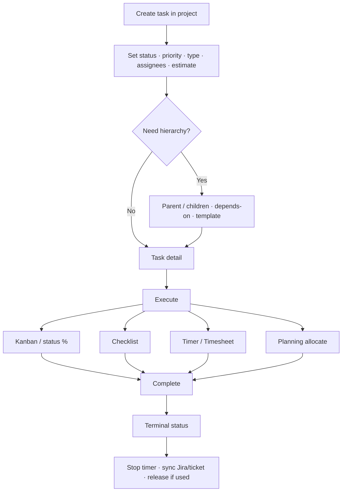

# How to: Create a task through completion

**Audience:** End user, Manager
**Access:** Project → Tasks / Kanban → create; or task modal from Dashboard/search
**Requires:** Project access + task create/manage permissions. Tickets/Jira optional.

This is the **core delivery loop** when work does not start from a ticket. For ticket/Jira entry points see [[04-workflows/ticket-to-delivery]] and [[03-modules/jira-boards-and-tickets]].

## A — Create the task

1. Open the **project** → **Tasks** or **Kanban**.
2. Create task (button / empty column action).
3. Set at least:
   - **Name**
   - **Status**, **Priority**, **Task type** (icon appears on boards)
   - **Assignee(s)** — primary + additional assignees if needed
   - **Estimated hours** (used by planning/reporting; prefer estimates on **leaf** tasks)
   - **Due date** if there is a hard deadline
4. Optional: description (rich text), application/version, parent task, depends-on, sprint, checklist items.
5. Save. The task opens in **Task detail**.

### Hierarchy tips

- Use a **parent** for grouping; put estimates on **children** (leaf-only hour totals).
- **Depends on** blocks sequencing in Gantt/dependency views.

### Templates

From the project task area, **Apply template** can create a predefined set of tasks at once.

> **SCREENSHOT** — Capture create/edit with status, priority, type, estimate, assignees.
> File to add: `media/docs-detail-task-create-edit-modal.png`

## B — Execute (pick tools you use)

### Update progress

1. Move status on Kanban (drag) or in the task modal.
2. Adjust **completion %** if your team uses it (independent from status).
3. Keep **comments** / **@mentions** and **attachments** current.

### Checklist

1. Open **Checklist** tab.
2. Add items; check them off; watch the progress bar.

### Time (optional but usual)

1. **Start timer** on the task (navbar shows running timer).
2. Or log hours later in **Timesheet** (Daily/Weekly).
3. Switching to another task/call: start there → **Switch & Save** (one active timer). See [[04-workflows/timer-context-switch]].

### Plan dates (optional)

1. If you have Planning access, allocate the task on [[03-modules/planning]] (drag to user/day, or split across users).
2. Planned start/end on the task update from allocations (often read-only in the modal).

> **SCREENSHOT** — Capture task modal with timer and status.
> File to add: `media/docs-howto-task-execute.png`

## C — Complete

1. Move status to your org’s **done / closed** value (or cancelled if abandoned).
2. Confirm checklist items are done or explicitly waived in a comment.
3. Stop any active timer; verify Timesheet entry looks right.
4. If linked to a **ticket** or **Jira** issue, update/sync that side so nothing stays “open” externally — [[03-modules/jira-boards-and-tickets]].
5. If the work is in a **release**, ensure the task is linked to the release before export — [[04-workflows/release-readiness]].

## Done criteria (task-first)

- Status is terminal per team convention.
- Leaf estimates/actuals are good enough for reporting.
- Comments/attachments explain the outcome for the next person.
- No orphan open timer.

## Related

- Full field reference: [[03-modules/projects-and-tasks]]
- Planned vs actual control: [[04-workflows/planned-vs-actual]]
