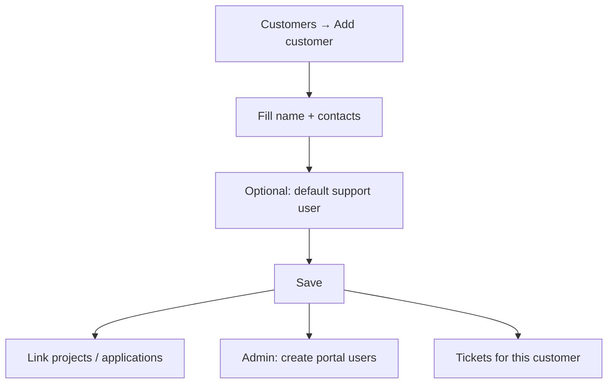

# How to: Create a customer

**Audience:** Manager, Admin, users with customer create permission
**Access:** Customers list → Add customer
**Requires:** Permission to view/create customers (`CanViewCustomers` / `CanCreateCustomers`). Not a feature flag.

## Purpose

Customers are external clients. They link to tickets, projects (when not global), applications, and the customer portal.

## Steps — create

1. Open **Customers** in the sidebar.
2. Click **Add customer** (or equivalent create action).
3. Fill at least **Name**. Common optional fields:
   - External name (reports)
   - Email, phone, address, website
   - Contact person / contact email / phone
   - Notes (rich text)
   - Associated organizations
   - **Default support user** — auto-assigned on new tickets for this customer
4. Save.

## After create

- Attach files on the customer detail **Attachments** tab if needed.
- Review **History** for field changes.
- Link applications and projects as your process requires.
- If portal users will log in, an admin creates **customer user** accounts tied to this customer (they only see portal Dashboard + Tickets when internal tickets are on).

## Tips

- Set default support user before heavy ticket volume.
- Global projects cannot be tied to a customer — use a normal (non-global) project for customer delivery.

> **SCREENSHOT** — Capture create-customer form with name and default support user.
> File to add: `media/docs-howto-create-customer.png`

> **SCREENSHOT** — Capture overview with History/Attachments tabs.
> File to add: `media/docs-howto-customer-detail.png`

