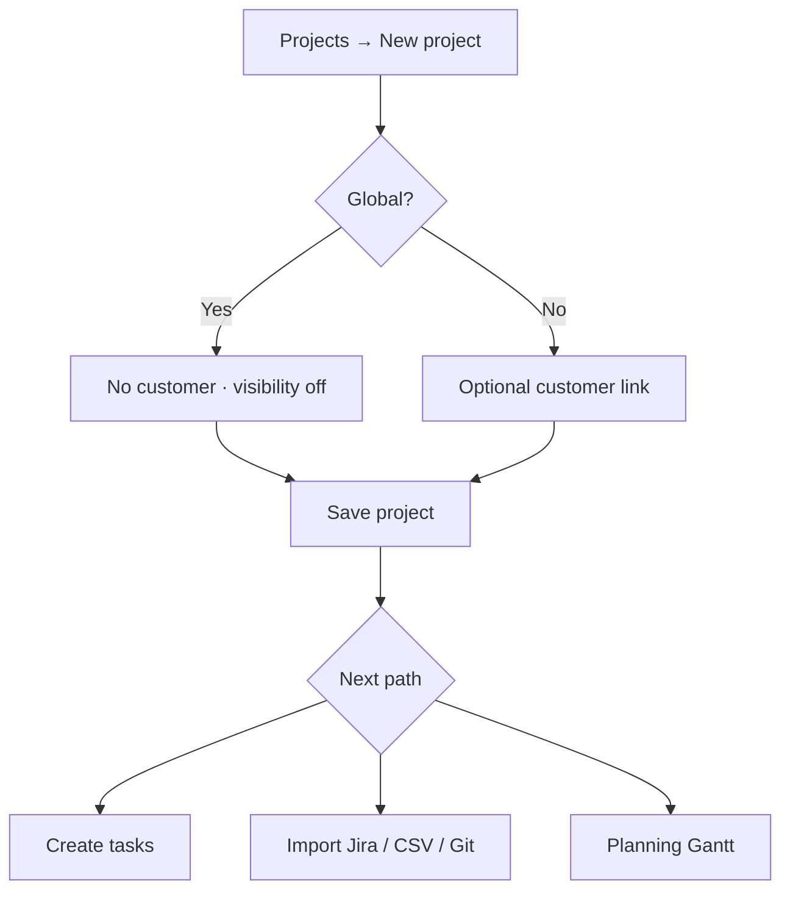

# How to: Create a project

**Audience:** Manager, users with project create permission
**Access:** Projects → New project
**Requires:** `CanCreateProjects` (or manage). Organization membership.

## Purpose

A project is the container for tasks, sprints, reporting, and imports. Work usually lives here even when it started as a ticket or Jira issue.

## Steps — create

1. Open **Projects**.
2. Click **New project**.
3. Set:
   - **Name** (required)
   - **Organization**
   - **Status** (from org project statuses)
   - Start / end dates (optional)
   - Description (rich text, optional)
   - **Customer** — omit if this will be a **Global** project
   - Linked **Applications** (optional)
   - **Budget** / budget type (`monetary` | `hours`) and optional hourly rate (permission-gated visibility later)
   - **Jira Board ID** — only if organization Jira *Projects* integration is configured; used for board import
   - Flags: **Hobby**, **Global**, **Visible to customer**
4. Save and open the project.

## Global project rules

- When **Global** is on: cannot associate a customer; customer visibility is forced off.
- Use global for cross-customer / internal initiatives.

## What you do next (pick a path)

| Next step | Go to |
|-----------|--------|
| Create tasks manually | [[03-modules/create-and-complete-task]] |
| Import from Jira board / sync statuses | [[03-modules/jira-boards-and-tickets]] |
| Import CSV / Git / email | [[04-workflows/import-first-delivery]] |
| Plan people on the Gantt | [[03-modules/planning]] |

## Project tabs you will use

Overview · Tasks · Kanban · Gantt · Burndown · Sprints · Milestones · Attachments · Dependencies · Utilities · History · Reporting (if allowed) · Settings (if you can manage) · Mappings (when Jira mapping applies).

> **SCREENSHOT** — Capture create fields including Global and customer.
> File to add: `media/docs-detail-project-create-modal.png`

> **SCREENSHOT** — Capture RAG banner and overview stats after create.
> File to add: `media/docs-howto-project-overview.png`

