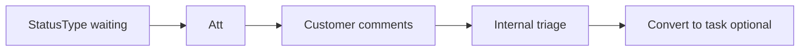

# Customers and portal — complete guide

**Audience:** Manager / Admin (internal CRM); Customer portal users (external)
**Access:** Internal: Sidebar → Customers (`/customers`). Portal: login → **Dashboard** (`/dashboard`); Tickets when enabled. Legacy `/portal` redirects to Dashboard.
**Requires:** Internal customer management permissions. Portal accounts are `CustomerUsers` scoped to one customer. Tickets require **`internalTicketsEnabled`**.
**When disabled / missing:** Portal without tickets is limited to Dashboard + visible projects. Internal tickets off hides Tickets for everyone including portal.


Maintain client records internally; give customers a **narrow** portal for tickets and visible project progress.

**Create / edit customer how-to:** [[03-modules/create-customer]].

```mermaid
flowchart TD
  Internal[Internal user] --> Cust[/customers]
  Cust --> Fields[Contacts · orgs · apps · default support]
  Cust --> Hist[History tab]
  Portal[Customer user login] --> Dash[Portal Dashboard]
  Dash --> Att[Needs your attention]
  Dash --> Stats[Ticket stats]
  Dash --> Proj[Visible projects]
  Dash --> Tkt[/tickets]
  Tkt --> Create[Create ticket without project]
```



## 1 — Internal: customers list and detail

1. Open **Customers**.
2. Search/filter; open a customer. On phone, grid is forced.
3. Tabs persist in `?tab=` (Overview / Attachments / History, etc.).
4. Maintain fields (summary — full form: [[03-modules/create-customer]]):

| Area | Examples |
|------|----------|
| Identity | Name, external name (reports), email, phone, address, website |
| Contacts | Contact person, contact email/phone |
| Notes | Rich-text description |
| Organizations | Many-to-many org links |
| Default support user | Auto-assigned on new tickets |
| Applications / projects | What they use / which projects serve them |

5. **History** tab: every meaningful field change (who/when). History renders in that tab only — not inside Attachments.
6. **Attachments** tab for customer files when used.


> **SCREENSHOT** — Capture customers list and filters.
> File to add: `media/docs-customers-list.png`


> **SCREENSHOT** — Capture customer detail with default support user.
> File to add: `media/docs-howto-customer-detail.png`


## 2 — Customer user accounts

1. Create portal users linked to the customer (admin/manager process).
2. They sign in like normal users but the session carries `customerId`.
3. **CustomerUserGuard** blocks internal pages (Planning, Timesheet, Projects admin, Applications, Reporting packs, etc.).
4. Shell nav is limited: typically **Dashboard** and **Tickets** (if `internalTicketsEnabled`).
5. Header still has **Notifications** and Profile.

Portal users **cannot** set `projectId` when creating tickets — internals assign project later.


## 3 — Portal Dashboard

After login, customer users land on **Dashboard** — not the internal Overview / Kanban / Analytics tabs. See also [[03-modules/dashboard]].

### Header

- Customer **name** as title
- Today’s date
- Contact person / email / phone / website snippets when present

### Needs your attention

1. Lists tickets whose **StatusType = waiting** (awaiting customer response).
2. Each row links to ticket detail for reply.
3. Empty state when nothing is waiting.

### Compact stats (when `internalTicketsEnabled`)

| Card | Meaning |
|------|---------|
| Total | All tickets in scope |
| Open | Open status types |
| In progress | In progress |
| Needs you | Waiting |
| Resolved | Resolved |
| Urgent | High priority / urgent as configured |

Cards navigate to **`/tickets`**. The dashboard does **not** duplicate the full ticket table.

### Recent updates

- Short activity strip of recent ticket changes
- Excludes waiting tickets so they are not duplicated with Needs your attention

### Projects grid

- Projects marked **visible to customer** (`IsVisibleToCustomer`)
- Shows status, progress (completed/total tasks), org name, optional dates
- **Global** projects never appear here (global forces visibility off)


> **SCREENSHOT** — Capture needs-attention, stats, and projects grid.
> File to add: `media/docs-portal-dashboard.png`


## 4 — Portal Tickets

1. Open **Tickets**.
2. Full list + filters for the customer’s tickets only.
3. **Create ticket**: title, description, priority/category as offered — **no project picker**.
4. Comment threads and attachments work like internal tickets within scope.
5. When staff set status to **waiting**, the ticket reappears under Needs your attention.

See [[03-modules/tickets]] · [[04-workflows/ticket-to-delivery]].


## 5 — Internal tips vs portal tips

| Internal | Portal |
|----------|--------|
| Set default support user to reduce triage | Reply on waiting tickets promptly |
| Mark only appropriate projects visible | Do not expect Planning or Timesheet |
| Use History when auditing CRM changes | Use Notifications for mentions/assignments |
| Keep `internalTicketsEnabled` on if portal support matters | If Tickets vanished, the flag is likely off |

## 6 — Tips and mistakes

- External name is what reports should show externally — keep it clean.
- Do not mark a **Global** project visible to customers — the product forces visibility off.
- Portal is not a full CRM: no expenses, memos, call records, or reporting packs.
- `frontpageEnabled` only affects the public marketing landing, not the portal Dashboard.

## Related

- [[03-modules/create-customer]]
- [[03-modules/tickets]]
- [[03-modules/dashboard]]
- [[03-modules/projects-and-tasks]]
- [[03-modules/applications-and-releases]]
- [[03-modules/notifications]]
- [[04-workflows/ticket-to-delivery]]
- [[02-settings/feature-toggles-overview]]
