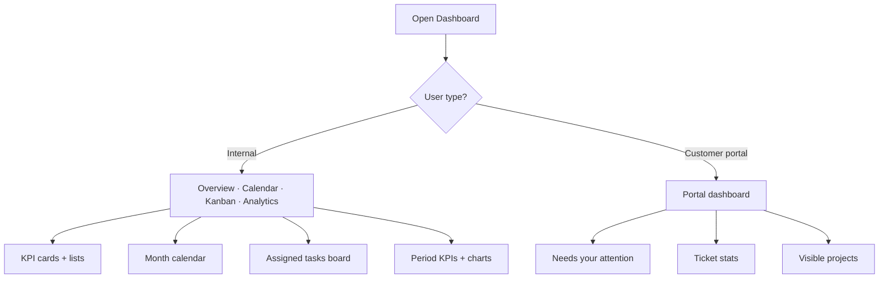

# Dashboard — complete guide

**Audience:** End user, Manager, Admin; Customer portal users see a different layout
**Access:** Sidebar → Dashboard (`/dashboard`). Deep-link `?task=<id>` (or `?taskId=`) opens that task’s detail modal.
**Requires:** `CanViewDashboard` (or admin). **Not** a Features flag. Customer portal users always land here after login when internal tickets are available for their scope.
**When disabled / missing:** Missing Dashboard nav = missing permission or customer-portal role restrictions — not `frontpageEnabled` (that flag only controls the public front page / marketing landing).


The Dashboard is your daily hub: workload KPIs, personal calendar, assigned-task Kanban, and (for managers/admins) analytics. Treat it as standup prep; edit tasks, time, and tickets in their own modules.



```mermaid
flowchart LR
  Card[KPI card] --> Drill[Drill-down list]
  Drill -->|Task / time| Modal[Task detail modal]
  Drill -->|Project| Proj[/projects/id]
  Drill -->|Customer| Cust[/customers/id]
  Drill -->|Ticket| Tkt[/tickets/id]
```

## 1 — Open and orient (internal users)

1. Open **Dashboard**.
2. Use the top tabs:

| Tab | Who | Purpose |
|-----|-----|---------|
| **Overview** | Most internal users | Configurable KPI cards, attention lists, optional mini calendar |
| **Calendar** | Internal | Full month view of due tasks, allocations, calls, holidays, leave, Outlook |
| **Kanban** | Internal | Status board of **your assigned** tasks across projects |
| **Analytics** | Managers / admins (when offered) | Period-based KPIs, charts, task analytics widgets |

3. On phone (≤767px), tabs are horizontal; the same content stacks. A PWA **Install app** banner may appear.
4. Welcome header shows the current date; org switcher in the shell still scopes what you see elsewhere.


> **SCREENSHOT** — Capture Overview with KPI cards and key lists.
> File to add: `media/docs-dashboard-overview.png`


## 2 — Overview tab

### KPI cards

1. Cards show counts such as open tasks, overdue tasks, pending time approvals, open tickets (when `internalTicketsEnabled`), and other widgets your admin configured.
2. **Click a card** → drill-down modal with the same records that drive the total (single source of truth).
3. In the drill-down:
   - Task / time rows → open **Task detail**
   - Project rows → project page
   - Customer rows → customer page
   - Ticket rows → ticket page
4. Managers/admins may rearrange or pin widgets when the KPI editor is available for their role.

### Attention lists and calendar strip

- Overview often includes overdue / due-soon / unassigned-style summaries depending on permissions.
- Optional **show calendar in Overview** keeps a compact month strip without leaving the tab.
- Pending approval badges may appear when you have approval scope (time, leave, expenses).

### Tips

- If a total looks wrong, open the drill-down first — then check status filters and whether tickets are enabled for the instance.
- Leaf-hour rules and planning capacity live in Planning / Reporting, not on Overview cards.


## 3 — Calendar tab

1. Open **Calendar**.
2. Navigate months; click a day for the day’s events list.
3. Typical event types:

| Source | What you see |
|--------|----------------|
| Task due dates | Due markers |
| Planning allocations | Planned work blocks |
| Call records | Logged calls / meetings |
| Vacations / OOO | Leave overlays |
| Holidays | Org/admin holidays |
| Dev Support | Informational (does not cut capacity) |
| Outlook | When `outlookCalendarEnabled` + Graph credentials are set under System Settings → **Email** |

4. Own Outlook events show detail; others’ events on shared planning surfaces appear as **Busy**.
5. Clicking a task-related item opens task detail when linked.


> **SCREENSHOT** — Capture calendar with mixed event types.
> File to add: `media/docs-dashboard-calendar-tab.png`


## 4 — Kanban tab (assigned work)

This board is **your assignments**, not the full project Kanban.

1. Open **Kanban**.
2. Columns follow each organization’s task statuses (multi-org boards group by org when needed).
3. **Drag** a card within or between columns to change status / order (`DisplayOrder` is saved).
4. Filters (often remembered in cookies):

| Filter | Effect |
|--------|--------|
| Organization | Limit to one org or all |
| Project | Narrow to one project |
| Sprint | All / backlog / specific sprint |
| Hide statuses | Per-org hide columns you do not use |

5. Cards typically show name, priority, type icon, assignees, completion %, optional Jira badge.
6. Click a card → task detail modal.


> **SCREENSHOT** — Capture personal Kanban with org/project filters.
> File to add: `media/docs-dashboard-kanban-tab.png`


## 5 — Analytics tab

1. Open **Analytics** (when your role can see it).
2. Choose a **period** before comparing numbers:

| Period | Typical use |
|--------|-------------|
| This week / last week | Short cadence |
| This month / last month | Default ops review |
| All time | Lifetime totals |

3. Period drives hours and many aggregate KPIs. **Task analytics** widgets (priority breakdown, types of work, team workload, parent-task progress) are often a **current-state snapshot** even when the period changes — read labels carefully.
4. Charts may include top projects/contributors and organization-level health when you have access.


> **SCREENSHOT** — Capture period selector and charts.
> File to add: `media/docs-dashboard-analytics-tab.png`


## 6 — Customer portal dashboard

When you sign in as a **customer user**, Dashboard is the portal home (not the internal tabs above). See also [[03-modules/customers-and-portal]].

1. Header shows your **customer name**, date, and contact snippets.
2. **Needs your attention** — tickets with status type **waiting** (awaiting your reply), with links to ticket detail.
3. Compact **stats** (when `internalTicketsEnabled`): total, open, in progress, needs you, resolved, urgent — cards link to **Tickets**.
4. **Recent updates** strip (excludes waiting tickets so they are not duplicated).
5. **Projects** grid for projects marked visible to the customer (status + progress).
6. Sidebar is typically **Dashboard** + **Tickets** only. Full ticket filters live on Tickets, not as a second full table here.


> **SCREENSHOT** — Capture needs-attention and stats for a portal user.
> File to add: `media/docs-portal-dashboard.png`


## 7 — Tips and mistakes

- Use Dashboard to **find** work; use project pages and Planning to **schedule** it.
- Analytics without an explicit period is easy to misread — set period first.
- Portal users: reply on waiting tickets promptly; do not expect internal Planning or Timesheet.
- `frontpageEnabled` only affects the public front page, not this Dashboard.

## Related

- [[03-modules/projects-and-tasks]]
- [[03-modules/planning]]
- [[03-modules/timesheet-and-timers]]
- [[03-modules/tickets]]
- [[03-modules/customers-and-portal]]
- [[03-modules/reporting]]
- [[03-modules/notifications]]
- [[02-settings/feature-toggles-overview]]
