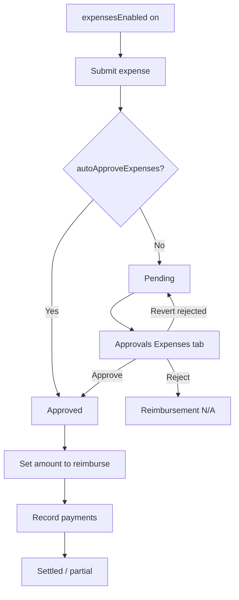

# Expenses — complete guide

**Audience:** End user (submitters); Manager / Team leader / Admin (approvers)
**Access:** Sidebar → Expenses (`/expenses`); approval and reimbursement on **Approvals & Expenses** → Expenses tab (`/approvals`)
**Requires:** Feature flag **`expensesEnabled`** (default **off**) plus expense permissions (`CanViewExpenses`, `CanCreateExpenses`, `CanManageExpenses`, `CanApproveExpenses` as applicable). Optional **`autoApproveExpenses`**.
**When disabled / missing:** Module hidden and expense APIs return **403**. Customer users never see expenses.


Track project and internal (overhead) spend with invoice attachments, approval, and partial reimbursement. Expense money is **not** mixed into hourly budget / `CostSpent` calculations.



```mermaid
flowchart LR
  Exp[/expenses] --> Proj[Project Overview totals]
  Exp --> Rep[Reporting Expenses + Extract]
  Exp --> Dash[Dashboard pending badge]
```

## 1 — Enablement (admin)

1. Administration → System Settings → **Features**.
2. Turn on **Expenses** (`expensesEnabled`).
3. Optionally enable **`autoApproveExpenses`** (new expenses created as approved).
4. Ensure org **Expense Categories** exist (groups + categories, optional max reimbursement) — seeded/defaulted per organization; editable on organization detail.
5. Confirm submitters and approvers have the matching expense permissions.

See [[02-settings/feature-toggles-overview]] · [[03-modules/approvals]].


## 2 — Open the Expenses list

1. Open **Expenses**.
2. Browse your expenses (managers may see a wider scope depending on permissions).
3. Status on the submitter list is **view-only** after create: pending / approved / rejected.
4. Create a new expense with **Create** when you have `CanCreateExpenses`.


> **SCREENSHOT** — Capture list with status and project columns.
> File to add: `media/docs-expenses-list.png`


## 3 — Submit an expense

1. Click create / new expense.
2. Fill fields:

| Field | Notes |
|-------|--------|
| Organization | Scope for categories and approvals |
| Category | From org category catalogue (group → category) |
| Amount + currency/date | Spend date and total |
| Paid by | Employee or company |
| Project / Task | Optional; **null project** = internal/overhead |
| Description | What / why |
| Attachments | Invoice images / PDF (stored as expense attachments) |

3. Save. Status becomes pending unless **`autoApproveExpenses`** is on.
4. While **pending**, you may **delete** your own expense.
5. After any reimbursement payment is recorded, submitters may only update **description** and **attachments**. Admins can correct other fields from Approvals.


> **SCREENSHOT** — Capture create expense with attachment.
> File to add: `media/docs-expenses-form.png`


## 4 — Approval and reimbursement

Approve/reject happens on [[03-modules/approvals]] (**Expenses** tab), **not** as the primary action on `/expenses`.

| Step | Who | Action |
|------|-----|--------|
| Approve / reject | Approver scope or admin | Reject → reimbursement **not applicable** |
| Revert rejected | Admin | Back to pending for re-review |
| Amount to reimburse | Manager/admin | May be **less** than expense total (category **MaxReimbursementAmount** may apply) |
| Payments | Manager/admin | Partial payments allowed; mark fully settled when done |
| Field corrections | Admin on Approvals | Correct fields after payment when needed |
| Delete anytime | Admin on Approvals | Even after approval |

Team leaders approve subordinates’ expenses (same pattern as time entries).


## 5 — Categories and caps

1. Open the organization detail → **Expense Categories** (groups + categories).
2. Optional **MaxReimbursementAmount** per category caps how much can be reimbursed.
3. Approvers should check category caps before setting amount to reimburse.


## 6 — Where expenses appear

| Surface | What |
|---------|------|
| `/expenses` | Your list + create/edit when allowed |
| Project Overview | Expenses section + approved total (when enabled) |
| Approvals & Expenses | Approve, reimburse, admin tools |
| Dashboard | Pending-approval badge when you have approval scope |
| Reporting Hub → Expenses | Approved lines, filters, reimbursement status |
| Reporting → Extract | Expenses CSV when the module is enabled |

Expense amounts do **not** change Planning capacity or hourly burn charts.


## 7 — Tips and mistakes

- Attach invoices **before** approval to avoid back-and-forth.
- Internal overhead: leave **project** empty on purpose.
- Do not hunt for an “expenses” checkbox under AI or Email — only Features → **`expensesEnabled`**.
- Auto-approve still needs reimbursement work on Approvals for employee-paid items.
- If the menu is missing, `expensesEnabled` is almost certainly off (or you lack view permission).

## Related

- [[03-modules/approvals]]
- [[03-modules/reporting]]
- [[03-modules/projects-and-tasks]]
- [[02-settings/feature-toggles-overview]]
- [[02-settings/organization-settings]]
