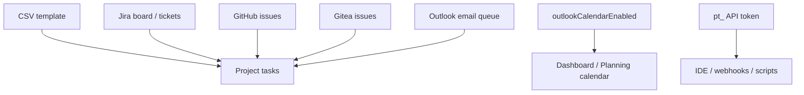
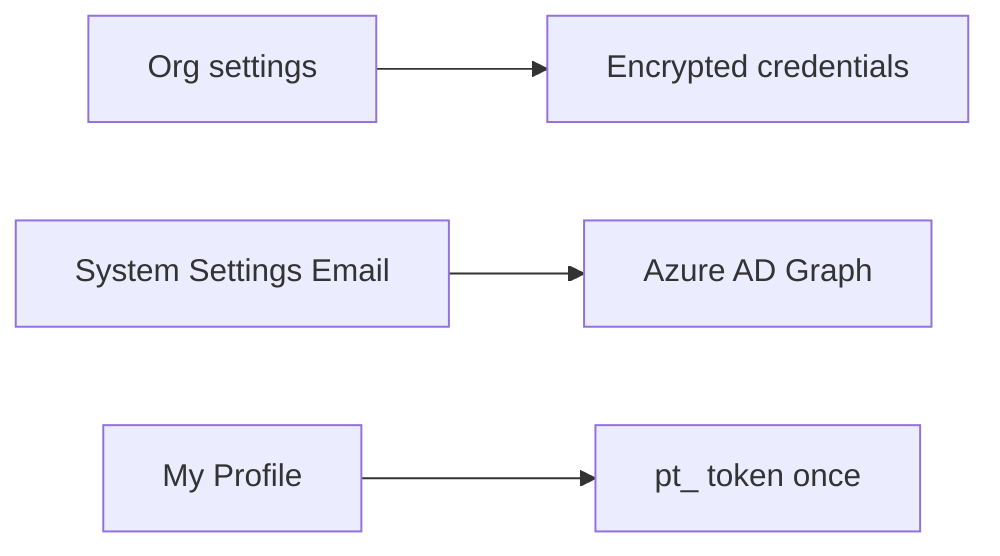
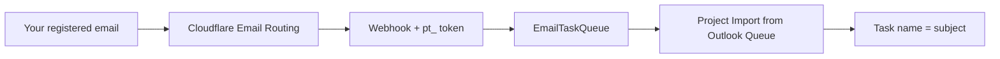

# Integrations — complete guide

**Audience:** End user (import/use), Manager (org credentials), Admin (Email / Outlook / SMTP)
**Access:** Organization settings (Jira / GitHub / Gitea); Administration → System Settings → **Email** (SMTP + Outlook calendar); Profile → **API Tokens**; project **Import Tasks** menu
**Requires:** Integrations are **configured**, not generic Features module toggles. CSV import needs no integration. Outlook calendar uses **`outlookCalendarEnabled`** under Email. Email task queue needs Cloudflare worker + a personal `pt_` token. Jira deep-dive: [[03-modules/jira-boards-and-tickets]].
**When disabled / missing:** Missing Import menu items usually mean credentials or queue emptiness — not a missing “integrationsEnabled” flag.

Connect Myelin to Jira, Git hosts, Outlook calendar, email-to-task, and personal API tokens. Day-to-day use is mostly project import and calendar overlays.

## 1 — Map of integrations

| Integration | Who configures | Who uses | Feature flag? |
|-------------|----------------|----------|---------------|
| CSV import | Nobody | Anyone with task create on the project | No |
| Jira (Tickets + Projects tiers) | Organization | Import / status check / board | No (org toggle + credentials) |
| GitHub | Organization | Import from GitHub | No |
| Gitea | Organization | Import from Gitea | No |
| Outlook calendar | Admin (Email) | Dashboard Calendar + Planning overlay | **`outlookCalendarEnabled`** |
| Email task queue | Operator (Cloudflare) + user token | Import from Outlook Queue | No |
| Personal API tokens | Any user (Profile); admins see all | IDE, scripts, webhooks | No |
| Teams → Call Records | Instance Teams connection | Call Records import | No |

Playbooks: [[04-workflows/jira-sync]] · [[04-workflows/email-to-task]] · [[04-workflows/import-first-delivery]].

> **SCREENSHOT** — Capture import menu with available sources.
> File to add: `media/docs-integrations-import-menu.png`

## 2 — CSV import (no credentials)

1. Open a project → **Tasks** or **Kanban** → **Import Tasks** → CSV.
2. Download the template.
3. Fill task data (parent/child and dependency columns when provided).
4. Upload → **preview** → confirm.
5. Tasks are created in the project; review hierarchy and estimates afterward.

CSV is the safest bulk path when you do not want external systems. Details: [[04-workflows/import-first-delivery]].

## 3 — Jira (summary — deep link)

Myelin supports **two Jira tiers** per organization (Tickets vs Projects). Tokens are encrypted and never returned in API responses.

| Day-to-day action | Where |
|-------------------|--------|
| Search Jira while creating tickets | Tickets UI (Tickets instance) |
| Import board issues as tasks | Project Import → Import from Jira |
| Map Jira status/priority/type | Project **Mappings** tab (Projects URL enabled) |
| Batch refresh local statuses | Import → Check Jira Ticket Status |

**Full guide:** [[03-modules/jira-boards-and-tickets]] · [[04-workflows/jira-sync]].

## 4 — GitHub import

1. Organization settings → configure **GitHub** (URL + personal access token). Token stored encrypted.
2. Open a project → Import Tasks → **Import from GitHub** (only when enabled).
3. Search issues from the configured repository instance.
4. Select issues → import as tasks with `GitHubIssueNumber` reference.
5. Duplicate imports for the same issue number are blocked.

| Tip | Detail |
|-----|--------|
| Scope the token | Prefer least privilege that can read issues |
| After import | Set estimates / assignees locally; GitHub status is not a live sync loop |

## 5 — Gitea import

Same pattern as GitHub:

1. Organization settings → **Gitea** URL + API token.
2. Project → Import Tasks → **Import from Gitea**.
3. Search → select → import with `GiteaIssueNumber`.
4. Duplicates for the same issue are prevented.

Self-hosted Gitea URLs must be reachable from the Myelin server.

## 6 — Outlook calendar (`outlookCalendarEnabled`)

### Admin

1. Administration → System Settings → **Email**.
2. Enable **Outlook Calendar** (`outlookCalendarEnabled`).
3. Enter Azure AD: Tenant ID, Client ID, Client Secret (**Value**, not Secret ID).
4. Credentials encrypted at rest.

### End-user experience

| Surface | Behaviour |
|---------|-----------|
| Dashboard → Calendar | Outlook events when enabled |
| Planning Gantt | Overlay for the visible range; loads **asynchronously** |
| Privacy | Own events show detail; others appear as **Busy** |

Planning stays usable while calendar syncs (“Still loading Outlook calendar…” may appear). This flag does **not** enable the email task queue.

## 7 — Email task queue (Outlook / Cloudflare)

Turns inbound email into queued items you import as tasks.

1. Operator configures Cloudflare Email Routing + Worker (see ops extras / [[04-workflows/email-to-task]]).
2. Create a personal **`pt_`** API token (section 8) for the webhook.
3. Send mail **from your registered Myelin user email** to the queue address.
4. When pending items exist, project Import Tasks shows **Import from Outlook Queue**.
5. Select a queued item → import (subject → name, normalized body → description).
6. Dismiss items you do not want.

### Idempotency and security

| Rule | Effect |
|------|--------|
| `ExternalMessageId` | Deduplicates retries |
| Unknown senders | Accepted with 202 but **not** queued |
| Token required | Webhook must present a valid active API token |
| Owner | Queue owner resolved from the From address |

## 8 — Personal API tokens (`pt_`)

### Create (any user)

1. **My Profile → API Tokens**.
2. Create with name and optional expiry.
3. Copy the `pt_...` secret **immediately** (shown only once).

### Admin view

- **Administration → API Tokens** lists **all** users’ tokens (revoke/delete any).
- Creating a token there still creates it for the **admin’s own** account.

### Use

| Use | How |
|-----|-----|
| HTTP APIs | `Authorization: Bearer pt_...` |
| IDE Kanban extensions | Base URL + token — [[07-companions/ide-extensions]] |
| Email queue webhook | Token on Worker → Myelin |
| Synapse / scripts | Same bearer auth |

### Revoke

- **Deactivate** — immediate revocation; cached auth invalidated
- **Delete** — permanent removal from the list

Never commit tokens or paste them into screenshots for the manual.

## 9 — Related companion surfaces

| Companion | Auth | Guide |
|-----------|------|-------|
| Synapse bridge | SSO and/or `pt_` | [[03-modules/synapse-bridge]] |
| IDE Kanban | `pt_` | [[07-companions/ide-extensions]] |
| Tampermonkey Task # links | Configured PM base URL | [[07-companions/tampermonkey]] |

## 10 — Tips and mistakes

- CSV needs no org credentials — start there when imports fail mysteriously.
- Do not invent flags like `githubEnabled` under Features — configure the org integration.
- Outlook calendar ≠ email queue; only calendar uses **`outlookCalendarEnabled`**.
- Empty “Import from Outlook Queue” usually means no pending mail for **your** address.
- Rotate leaked `pt_` tokens immediately (deactivate).

## Related

- [[03-modules/jira-boards-and-tickets]]
- [[03-modules/projects-and-tasks]]
- [[03-modules/call-records]]
- [[03-modules/synapse-bridge]]
- [[03-modules/planning]]
- [[03-modules/dashboard]]
- [[04-workflows/import-first-delivery]]
- [[04-workflows/email-to-task]]
- [[04-workflows/jira-sync]]
- [[02-settings/organization-settings]]
- [[02-settings/feature-toggles-overview]]
- [[02-settings/profile]]
- [[07-companions/ide-extensions]]
