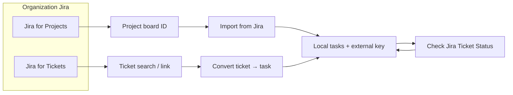
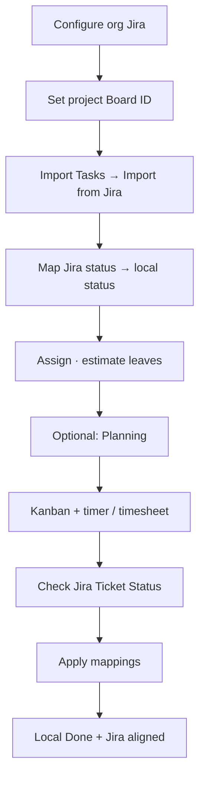

# How to: Jira boards and Jira tickets

**Audience:** Manager, Support, Admin
**Access:** Organization → Jira integration; Project → Import Tasks / Mappings / Board; Ticket search
**Requires:** Organization Jira integration enabled with credentials. Board import prefers **Jira for Projects** credentials (falls back to Tickets credentials). Internal Tickets menu needs `internalTicketsEnabled` for the Tickets nav — task/Jira links can still exist when that flag is off.
**When disabled / missing:** Import from Jira / Check Jira status menus missing until org integration is configured.

Myelin has a **two-tier** Jira setup per organization. Both tiers can point at the same Jira site.

| Tier | Used for |
|------|----------|
| **Jira for Tickets** | Ticket search, linking issues while editing tickets, status sync roots |
| **Jira for Projects** | Project **board** issue import / board views (preferred for import) |

## 1 — Configure (once per organization)

1. Open the **organization** → Jira integration.
2. Enable integration.
3. Enter **Tickets** URL, email, API token, project key; **Test connection**.
4. Optionally enter **Projects** credentials (board import).
5. Save (tokens are stored encrypted; not shown again in full).

> **SCREENSHOT** — Capture Jira integration form with Tickets/Projects sections (redact tokens).
> File to add: `media/docs-howto-jira-org-settings.png`

## 2 — Link a project to a board

1. Open **Project → Settings** (needs manage permission).
2. Set **Jira Board ID** / board URL field (visible when Projects Jira is configured).
3. Save. Import and board views use this association.

## 3 — Import tasks from a Jira board (main path)

1. Open the project → **Kanban** (or Tasks import menu).
2. **Import Tasks → Import from Jira**.
3. Issues are fetched for the configured board/instance.
4. Review the list; select issues to import (avoid duplicates — already linked keys stay linked).
5. Use the **status mapping** panel: map each Jira status → a local **task** status.
6. Confirm import → local tasks are created with external key linkage (`ExternalTicketId` / ticket chain as implemented).
7. Open a task: Jira badge should open the issue in Jira.

> **SCREENSHOT** — Capture issue list + status mapping before confirm.
> File to add: `media/docs-howto-jira-board-import.png`

## 4 — Check Jira ticket status (batch sync)

Use this after import, or regularly, so local boards match Jira.

1. Project Kanban → **Import Tasks → Check Jira Ticket Status**.
2. System loads current Jira status for tasks that already have a Jira key.
3. Optionally filter **Show only changed**.
4. **Nothing is selected by default** — select rows (or Select all).
5. Set a **global** Jira→local status mapping for the batch.
6. Override per row if one ticket needs a different local status.
7. **Apply updates**.

> **SCREENSHOT** — Capture changed filter, mapping, and per-row override.
> File to add: `media/docs-howto-jira-check-status.png`

## 5 — Jira while working with tickets (support path)

When the **internal ticket system** is on:

1. Create/edit a **ticket**; search Jira issues (Tickets tier + org JQL filter; typed search can prioritize direct lookup).
2. Link the external key; comments/@mentions stay in Myelin.
3. **Convert to task** when delivery work starts: pick project, confirm fields → task linked to ticket.
4. Continue execution like [[03-modules/create-and-complete-task]].

Portal customers create tickets without a project; staff assign project/task later.

## 6 — Typical end-to-end (board → done)

1. Org Jira configured; project board ID set.
2. Import selected board issues → map statuses.
3. Assign owners; set estimates on leaf tasks.
4. Plan on [[03-modules/planning]] if you use capacity planning.
5. Execute with Kanban + timer/timesheet.
6. Periodically **Check Jira Ticket Status** and apply agreed mappings.
7. Move local task to Done; confirm Jira side matches your process (via sync or in Jira).

## Done criteria

- Imported issues have stable external keys (no duplicate active tasks for the same key).
- Status mapping matches the team’s local workflow.
- Check-status runs leave only intentional differences.

## Related playbooks

- [[04-workflows/jira-sync]] (short checklist)
- [[04-workflows/import-first-delivery]]
- [[04-workflows/ticket-to-delivery]]
