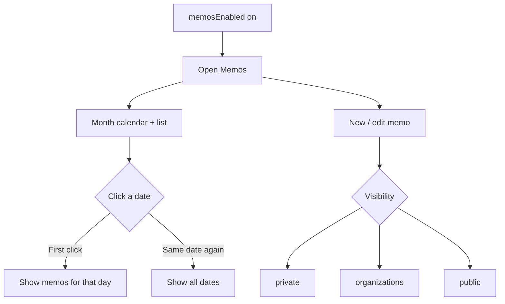
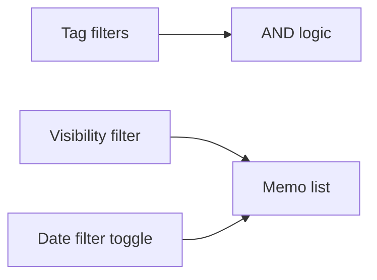

# Memos — complete guide

**Audience:** End user, Manager, Admin
**Access:** Sidebar → Memos
**Requires:** Feature flag **`memosEnabled`** (typical default **on**). Internal users only (not customer portal).
**When disabled / missing:** Memos disappears from the navbar when the flag is off. There is no separate “memo permissions” marketplace flag — ask an admin to re-enable Features → Memos.

Calendar-oriented notes for yourself or the team. Memos are **not** tasks — no estimates, assignees, Planning bars, or timesheet hours.

## 1 — Open and orient

1. Open **Memos**.
2. Main area: memo list; calendar grid highlights days that have memos (**bold** dates).
3. **Today** is highlighted; a **selected** date (when the date filter is on) uses a stronger highlight.
4. On phone, toolbars stack like other ops pages.

> **SCREENSHOT** — Capture memo calendar with an open memo.
> File to add: `media/docs-memos-calendar.png`

## 2 — Create or edit a memo

1. Create a new memo (or open an existing one to edit).
2. Fill fields:

| Field | Notes |
|-------|--------|
| Title | Short label in the list |
| Content | Rich text; images allowed |
| Visibility | See table below |
| Tags | Comma-separated; used for filtering |
| Date / CreatedAt | Calendar placement uses the memo’s date/created timestamp |

### Visibility

| Value | Who can see it |
|-------|----------------|
| `private` | Creator only |
| `organizations` | Members of the creator’s organizations |
| `public` | All signed-in users (internal) |

3. Attach files if the UI offers attachments on memos in your build.
4. Save — bold calendar dates update for days that have memos.

## 3 — Date filter (toggle behaviour)

This behaviour is intentional:

| Action | Result |
|--------|--------|
| Default | Date filter **off** — all memos across dates |
| Click a date | Filter **on** — only that day; date highlighted |
| Click the **same** date again | Filter **off** — all memos again |
| Clear Date Filter | Same as turning the filter off |

When a date filter returns no rows, a **Show All Memos** shortcut may appear.

## 4 — Other filters

| Filter | Behaviour |
|--------|-----------|
| Visibility | All / Private / Organizations / Public |
| Tags | Click to activate; click again to remove; multiple tags = **AND** |
| Clear All Filters | Resets every active filter |

> **SCREENSHOT** — Capture visibility + tag filters with Clear All.
> File to add: `media/docs-memos-filters.png`

## 5 — What memos are not

| Need | Use instead |
|------|-------------|
| Scheduled work with estimates | [[03-modules/projects-and-tasks]] + [[03-modules/planning]] |
| Billable / logged hours | [[03-modules/timesheet-and-timers]] |
| Support conversation with SLA | [[03-modules/tickets]] |
| Meeting duration log | [[03-modules/call-records]] |
| Dashboard month events | Dashboard Calendar (separate from Memos) |

## 6 — Tips and mistakes

- Use **private** for personal scratch notes; **organizations** for team stand-up notes; **public** sparingly.
- Do not put delivery work only in memos — create a **task** so Planning and Timesheet can track it.
- Tag consistently (`standup`, `retro`, client short codes) so AND filters stay useful.
- If Memos vanished from the menu, ask an admin about **`memosEnabled`** under [[02-settings/feature-toggles-overview]].
- `frontpageEnabled` does **not** control Memos.

## Related

- [[03-modules/dashboard]]
- [[03-modules/projects-and-tasks]]
- [[03-modules/call-records]]
- [[02-settings/feature-toggles-overview]]
