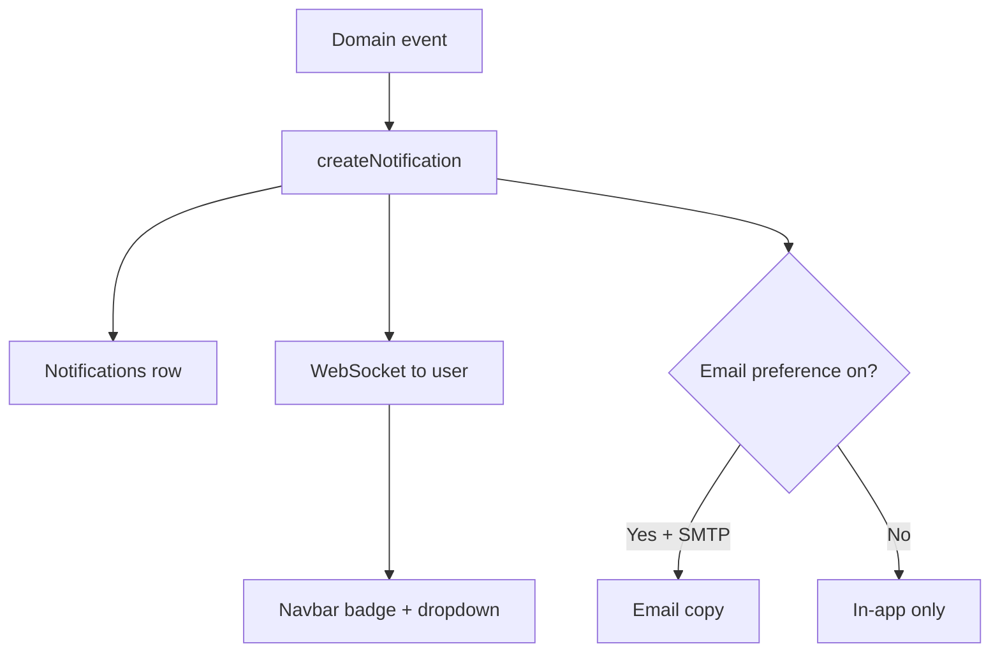
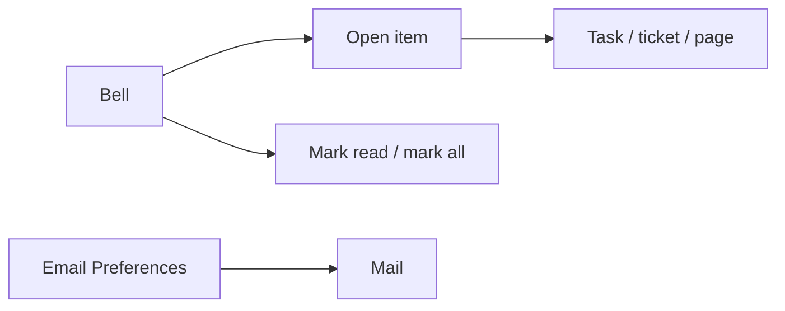

# Notifications — complete guide

**Audience:** End user, Manager, Admin; Customer portal users (header bell)
**Access:** Header → notification bell (dropdown / panel). Full list surfaces may open from the same control depending on build.
**Requires:** Signed-in user. **Not** a Features flag. Email copies need SMTP + Profile email preferences. Real-time badge uses WebSocket when connected.
**When disabled / missing:** Bell always exists for eligible shells. Missing **email** copies = SMTP or opted-out preferences — in-app notifications still fire.

In-app alerts for assignments, mentions, status changes, and reminders. Email is optional per preference type.

## 1 — Open the notification panel

1. Click the **bell** in the header.
2. Badge count shows unread items; new events prepend without a full page refresh when the socket is connected.
3. Click a notification to open the related task, ticket, or page.
4. Mark individual items read, or **Mark all read** when cleared.
5. On phone, the notifications surface stacks like other ops pages.
6. Customer portal users still see Notifications in the header even though their sidebar is only Dashboard + Tickets.

> **SCREENSHOT** — Capture notification list with unread badge.
> File to add: `media/docs-notifications-panel.png`

## 2 — Notification types

| Event | Trigger | Typical recipient |
|-------|---------|-------------------|
| Task assigned | `AssignedTo` / assignees changed | New assignee |
| Task priority changed | Priority updated | Task assignee |
| Task status changed | Status updated | Task assignee |
| Ticket assigned | Support / developer field changed | Newly assigned user |
| @mention in comment | `@username` after comment save | Mentioned user |
| Due date reminder | ~1 day before `DueDate` | Task assignee |
| Work summary | Daily / weekly schedule | Each user (email preference) |
| Project PDF report | Scheduled weekly/monthly | Configured recipients |

Exact labels in the UI may vary; the table matches product behaviour in FEATURES.

## 3 — Mentions

1. In a task or ticket **comment**, type `@` and pick a username.
2. On save, the mentioned user gets an in-app notification.
3. An email is sent when their mention preference allows it and SMTP works.
4. Mentions do **not** grant access — the user still needs permission to open the entity.
5. Prefer mentions for “please look” pings; use assignment when ownership must change.

## 4 — Email vs in-app

| Channel | Behaviour |
|---------|-----------|
| In-app | Always created for supported events; badge updates live |
| Email | Skipped when the user opts out of that type in Profile → Email Preferences |
| SMTP down | In-app still works; emails fail until Email settings are fixed |
| Empty SMTP password save | Clears stored password (admin Email settings) |

Tune preferences in [[02-settings/email-preferences]]. Screenshot checklist: `docs-profile-email-prefs.png`.

## 5 — Due date reminders

1. Tasks with a hard **Due Date** can generate a reminder about one day before.
2. Server deduplicates reminder sends so restarts do not spam the same due date.
3. Assignee (or the user the product targets for that task) receives the alert.
4. If you rely on reminders, keep Due Date filled — Planning planned-end alone may not drive this event.

## 6 — Digests and scheduled mail (related, not always in the bell)

| Mail | Where it is configured | Preference / recipients |
|------|------------------------|-------------------------|
| Work summary daily/weekly | Scheduler + user work day | Profile → `work_summary` |
| Project PDF reports | Project Reporting → Scheduled Reports | Recipient list on the schedule |
| Organization report digests | Reporting hub Organization pack | Configured recipients |

See [[03-modules/reporting]] · [[03-modules/projects-and-tasks]].

## 7 — Real-time behaviour

1. Connected browsers receive a `notification` WebSocket event and update the badge/dropdown.
2. Multi-tab: each connected tab should reflect new items; a hard refresh always reloads from the server.
3. Live notification counts are **not** Redis-cached (operators: cache outages should not invent ghost badges).

## 8 — Portal vs internal

| | Internal | Customer portal |
|--|----------|-----------------|
| Bell | Yes | Yes |
| Typical events | Tasks, tickets, mentions, due dates | Ticket/assignment style within customer scope |
| Email prefs | Full Profile panel | As offered for that account type |
| Expect Planning noise? | Possible if assigned | No |

## 9 — Tips and mistakes

- Opting out of email does **not** silence the bell — clear unread in-app.
- If the badge never updates live, refresh once; offline tabs catch up on reconnect.
- Mentions without permission look like broken links — assign or share access first.
- Do not look for a `notificationsEnabled` flag — only email SMTP and preferences gate mail.
- `frontpageEnabled`, `memosEnabled`, and `aiAssistantEnabled` do not control the bell.

## Related

- [[02-settings/email-preferences]]
- [[02-settings/profile]]
- [[03-modules/tickets]]
- [[03-modules/projects-and-tasks]]
- [[03-modules/reporting]]
- [[03-modules/customers-and-portal]]
- [[02-settings/feature-toggles-overview]]
