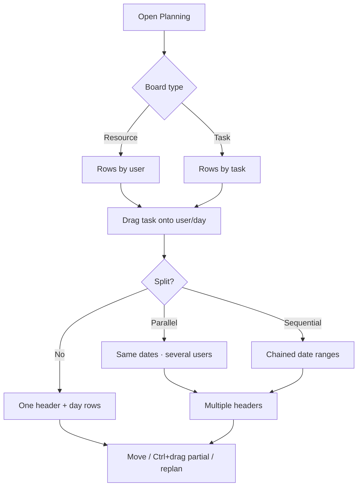
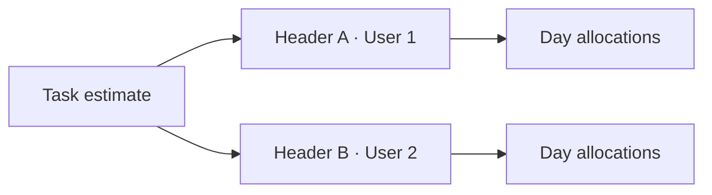

# Planning (resource Gantt) — complete guide

**Audience:** Manager, planners with permission
**Access:** Sidebar → Planning (`/planning`)
**Requires:** `CanViewPlanning` to open; edit needs plan permissions (e.g. `CanPlanTasks`). **Not** a System Settings feature flag. On phones (≤767px) Planning is **read-only** even if you can plan on desktop.
**When disabled / missing:** Missing nav = missing `CanViewPlanning`. On mobile you can view but not drag/edit.

Planning is header-driven: every bar is a **TaskAllocationHeader** (slice) with day rows in `TaskAllocations`. Multiple headers on one task = **split / multiple allocations**.

## 1 — Open and orient

1. Open **Planning**.
2. Choose timeline mode:

| Mode | Window | Step when navigating |
|------|--------|----------------------|
| Week | 28 days | ±28 days |
| Month | 90 days | ±90 days |
| Year | 365 days | ±365 days |

3. Choose board type:
   - **Resource view** — rows by **user** (capacity balancing).
   - **Task view** — rows by **task** (who is on what).
4. Filter by organization / project / user; optional **Show only my tasks**.
5. View options (often persisted locally): dependencies, critical path, baseline, daily totals, bar hours, time entries overlay, user visibility, hide not-planned without hours.

> **SCREENSHOT** — Capture Week/Month/Year, Resource/Task, filters.
> File to add: `media/docs-planning-toolbar.png`

> **SCREENSHOT** — Capture multi-user rows with allocation bars.
> File to add: `media/docs-planning-resource-view.png`

## 2 — Create an allocation (single user)

1. Find an unscheduled / not-planned task in the sidebar or task list.
2. **Drag** it onto a **user row** on the target start date.
3. In the dialog, set hours per day or total hours and mode.
4. Confirm. The system checks for each day:
   - Profile work hours for that weekday
   - Existing task allocations
   - Child allocations
   - Recurring task blocks
5. A **header + day allocations** are created; task planned start/end update from the range.

> **SCREENSHOT** — Capture drop + hours dialog on a user/day.
> File to add: `media/docs-detail-planning-allocation-interaction.png`

## 3 — Multiple allocations on one task

A task can have **several headers** (several bars):

- Different users
- Different date ranges
- Split pieces of the same estimate

Each header has its own `SplitOrder` / identity — bars are **not** merged just because dates touch.

### From Planning (Enable Split)

1. Start an allocation and turn on **split** in the allocation dialog (when offered).
2. Choose **Parallel** or **Sequential** (see below).
3. Add per-user lines: user, hours, hours/day.
4. Confirm → multiple headers appear on the Gantt.

### From Task detail → Allocations → Split

1. Open the task → **Allocations**.
2. On an existing slice, click **Split**.
3. Choose **Parallel** or **Sequential**.
4. Define per-user entries; confirm.
5. Original header is replaced by multiple headers with incrementing split order.

| Split mode | Behaviour |
|------------|-----------|
| **Parallel** | Users share the same date range (work at the same time) |
| **Sequential** | User N+1 starts after user N finishes (chained) |

> **SCREENSHOT** — Capture one task with multiple user bars; note parallel vs sequential.
> File to add: `media/docs-detail-planning-split-allocation.png`

> **SCREENSHOT** — Capture Split on Allocations tab and split dialog.
> File to add: `media/docs-task-split-allocation-button.png`

## 4 — Move and partial move

| Action | Result |
|--------|--------|
| **Normal drag** | Moves the **entire** allocation slice (whole header) to a new start date |
| **Ctrl + drag** | **Partial hours** — enter how many hours to move; source shrinks; new slice created at the target |

For split tasks: drop on a **specific user’s** row to replan that user’s slice. Dropping on a generic task header may warn you to pick a user.

> **SCREENSHOT** — Capture partial-hours move dialog.
> File to add: `media/docs-detail-planning-ctrl-drag-partial.png`

## 5 — Replan with remaining hours

1. Trigger replan on an existing allocation.
2. System loads **time entries** already logged on the task.
3. `remaining = estimated − worked`.
4. Confirmation shows remaining hours.
5. **Blocked if remaining ≤ 0** (nothing left to schedule).
6. Only remaining hours are re-laid out.

> **SCREENSHOT** — Capture remaining-hours confirmation.
> File to add: `media/docs-detail-planning-replan-confirmation.png`

## 6 — Allocation detail modal

Open a bar/header for controlled edits:

- Adjust hours / dates
- Move / recalculate actions
- Delete a **slice/header** (preferred) so you do not wipe unrelated slices

## 7 — Unscheduled work

Leaf tasks marked **unscheduled** do not get normal bars. They show as **ghost markers**:

- On the date they moved to a closed status, or
- On **today** if still open  

Click marker → task detail. Parents with unscheduled children get an indicator.

> **SCREENSHOT** — Capture ghost markers on a user row.
> File to add: `media/docs-detail-planning-unscheduled-markers.png`

## 8 — Capacity overlays (optional)

| Overlay | Source | Capacity effect |
|---------|--------|-----------------|
| Vacations / OOO | Profile requests (+ approvals) | Reduces availability |
| Holidays | Administration → Holidays | Calendar / capacity |
| Recurring tasks | Profile → recurring | Pink 🔄 blocks; hours reserved |
| Outlook events | System Settings → Email → Outlook calendar enabled | Busy blocks; others show as Busy |
| Dev Support | Management → Dev Support (leaders/admins) | **Informational only** — does not cut capacity |

## 9 — Tips and mistakes

- Prefer estimates on **leaf** tasks before heavy planning.
- Use Resource view to fix overbooking; Task view to sequence delivery.
- Delete wrong slices; do not “fix” with fake negative hours.
- On mobile, plan is read-only — use a larger screen to edit.

## Related

- [[04-workflows/planned-vs-actual]]
- [[03-modules/create-and-complete-task]]
- [[02-settings/profile]] (work hours)
