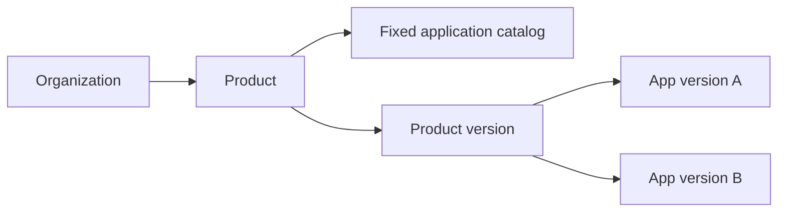

# Products — complete guide

**Audience:** Managers, release owners, admins  
**Access:** Sidebar / nav → **Products** (`/products`, detail `/products/:id?tab=…`)  
**Requires:** Product permissions (`CanViewProducts`, create/manage/delete/release as needed). **Not** the same flags as Applications.  
**When missing:** Nav hidden without `CanViewProducts`. Customer portal users do not manage products.

Products are **org-scoped bundles** over a fixed catalog of Applications. A product version picks specific application versions so you can ship a combined release story.

## 1 — Open and list

1. Open **Products**.
2. On phone, grid layout is forced; use search/filters when offered.
3. Open a product for overview, versions, and settings tabs (`?tab=` restores the panel).

## 2 — Create / edit a product

1. Create with **name**, optional description, organization, optional image.
2. Flags typically include **customer-specific** and **active**.
3. Attach the **application catalog** the product may release (fixed set for this product).
4. Save. Managing the catalog needs `CanManageProducts` (or equivalent).

## 3 — Product versions

1. Open the product → **Versions**.
2. Click **New version** — choose **Use wizard** or **Normal form**.
3. Wizard flow (full product ship):
   1. Enter product version metadata and optionally filter by **projects** (uses each project’s linked apps to narrow tasks).
   2. For each catalog application: include it, **create a new** application version or **link an existing** one.
   3. Select tasks; each task card has checkboxes for the included apps (a task can ship in more than one app). Linking an existing app version pre-selects its current tasks.
   4. Review product patch notes (Related application versions + per-app sections). Use **Reset** to rebuild from the associated apps, or **Improve with AI** when configured, then create.
4. Normal form keeps the previous single modal (metadata + pick existing application versions).
5. Versions created via the wizard show a **Wizard** badge. Editing one asks whether to reopen the wizard (prefilled) or use normal edit.
6. Export / print product-level release PDFs when needed (see Applications for single-app patch notes).

## 4 — Permissions (summary)

| Capability | Typical use |
|------------|-------------|
| `CanViewProducts` | See Products nav and read |
| `CanCreateProducts` | Create products |
| `CanManageProducts` | Edit catalog / metadata |
| `CanDeleteProducts` | Delete products |
| `CanManageProductReleases` | Product versions / releases |

Exact matrix: [[05-reference/permissions-matrix]] · `docs/ROLE_PERMISSIONS.md`.

## Tips

- Prefer Applications for single-repo releases; use Products when several apps ship together.
- Agent docs / MCP stay on **Organization** and **Application**, not on the product entity.

## Related

- [[03-modules/applications-and-releases]]
- [[04-workflows/release-readiness]]
- [[05-reference/glossary]]
