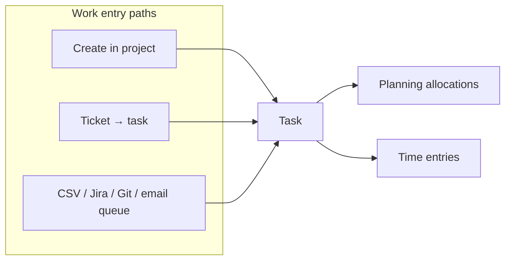

# Projects and tasks — complete guide

**Audience:** End user, Manager, Admin
**Access:** Sidebar → Projects (`/projects`); project detail `/projects/:id?tab=…`
**Requires:** Org membership + project access. Create/edit/delete gated by `CanCreateProjects` / `CanManageProjects` / `CanDeleteProjects` and task permissions (`CanCreateTasks`, `CanManageTasks`, …). **Not** a Features flag.
**When disabled / missing:** Missing Projects = permissions or customer-portal role. Customer users never manage internal project tabs.


**How-tos (start here for step-by-step create flows):**

- [[03-modules/create-project]]
- [[03-modules/create-and-complete-task]]
- [[03-modules/create-customer]]
- [[03-modules/jira-boards-and-tickets]]
- [[03-modules/planning]] (resource Gantt — separate sidebar page, not a project tab)

A **task does not have to come from a ticket**. Many teams create tasks directly or via import.

```mermaid
flowchart TD
  List[/projects] --> Open[Open project]
  Open --> Tabs[Project tabs]
  Tabs --> OV[Overview]
  Tabs --> TK[Tasks]
  Tabs --> KB[Kanban]
  Tabs --> GN[Gantt]
  Tabs --> BD[Burndown]
  Tabs --> SP[Sprints]
  Tabs --> MS[Milestones]
  Tabs --> AT[Attachments]
  Tabs --> DP[Dependencies]
  Tabs --> UT[Utilities]
  Tabs --> RP[Reporting]
  Tabs --> ST[Settings]
  Tabs --> MP[Mappings]
  Tabs --> HI[History]
  TK --> Modal[Task detail modal]
  KB --> Modal
  GN --> Modal
```



## 1 — Projects list

1. Open **Projects**.
2. Filter by organization, status, customer, and search.
3. Open a card/row for detail. On phone, grid view is forced.
4. Create a project only if you have create permission — full field guide: [[03-modules/create-project]].

### Project fields worth knowing (summary)

| Field / flag | Meaning |
|--------------|---------|
| Name, description | Identity + rich text |
| Organization, status | Org vocabulary |
| Start / end dates | Schedule window |
| Budget + BudgetType | `monetary` or `hours` (needs `CanViewBudgetInfo` to see money rates) |
| Hourly rate | Optional project default rate |
| Customer | Not allowed when **Global** |
| Applications | Linked products |
| Jira Board ID | When Projects Jira integration is configured |
| **Global** | No customer; customer visibility forced off |
| **Hobby** | Time on hobby projects can auto-approve |
| **Visible to customer** | Appears on portal project grid |


> **SCREENSHOT** — Capture project cards/table and filters.
> File to add: `media/docs-projects-list.png`


> **SCREENSHOT** — Capture the full tab row on a project.
> File to add: `media/docs-project-detail-tabs.png`


## 2 — Entry paths (pick one)

| Path | When | Guide |
|------|------|-------|
| Create task in a project | Default delivery | [[04-workflows/task-first-delivery]] · [[03-modules/create-and-complete-task]] |
| Triage ticket then convert/link | Support-led | [[04-workflows/ticket-to-delivery]] |
| CSV / Jira / GitHub / Gitea / Outlook queue | Bulk / external | [[04-workflows/import-first-delivery]] · [[03-modules/integrations]] |

## 3 — Project tabs at a glance

Tabs persist in `?tab=` so refresh keeps the panel. Typical order:

| Tab | Always? | Purpose |
|-----|---------|---------|
| **Overview** | Yes | RAG health, stats, alerts, team, milestones snapshot |
| **Tasks** | Yes | Table/grid of tasks; create, templates, import |
| **Kanban** | Yes | Status columns + drag-and-drop |
| **Gantt** | Yes | Project timeline (task hierarchy) |
| **Burndown** | Yes | Burndown / burnup chart |
| **Sprints** | Yes | Iterations, backlog, sprint cards |
| **Milestones** | Yes | Dated milestones + types |
| **Attachments** | Yes | Project-level files |
| **Dependencies** | Yes | SVG dependency graph |
| **Utilities** | Yes | Bulk consistency tools |
| **Reporting** | If `CanViewReports` | Summary / by user / allocations / time / schedules |
| **Settings** | If `CanManageProjects` | Edit fields, danger zone |
| **Mappings** | Manage projects **and** Projects Jira URL enabled | Jira → local status/priority/type maps |
| **History** | Yes | Project field change log |

Global **Planning** (resource Gantt) is **not** a project tab — [[03-modules/planning]].


## 4 — Overview

1. Open **Overview**.
2. Read the **RAG** banner (Red / Amber / Green) from overdue work, unassigned work, and budget burn.
3. Quick stats: dates, **estimated hours (leaf tasks only)**, open tickets (if tickets enabled), team size.
4. Task analytics widgets: priority breakdown, types of work %, team workload (open by assignee), parent-task progress (Done / In progress / To do).
5. **Requires attention**: overdue, due this week, unassigned chips.
6. Alerts lists + **team members grid** (progress, task counts, hours).
7. Milestone snippets: overdue / upcoming / all completed.
8. When expenses are enabled (`expensesEnabled`), approved expense totals may appear for the project.


> **SCREENSHOT** — Capture RAG banner, stats, and attention chips.
> File to add: `media/docs-project-overview.png`


## 5 — Tasks tab

1. Open **Tasks**.
2. Browse the grid; columns can be resized/reordered when the UI offers it.
3. **New task** → task detail modal — [[03-modules/create-and-complete-task]].
4. Apply a **task template** when your project uses templates (copies predefined items).
5. **Import Tasks** (from this tab or Kanban, depending on build): CSV, Jira, GitHub, Gitea, Outlook queue — [[03-modules/integrations]].

### Hour and count rules

- Aggregated **hours** (estimates, worked, planned totals) use **leaf tasks only** — parents with children are excluded to avoid double-counting.
- **Task counts** include all tasks and subtasks.
- Time display is `hh:MM:ss`, never decimal like `1.5h`.


## 6 — Kanban

1. Open **Kanban Board**.
2. Columns = organization **task statuses**.
3. Drag cards within/between columns → status + `DisplayOrder` update.
4. Cards show name, priority, assignee avatar, completion %, type icon, Jira badge when linked.
5. Parent/child hierarchy may collapse/expand.
6. **Import Tasks** dropdown often lives here: CSV, Import from Jira, Check Jira Ticket Status, GitHub/Gitea/Outlook when configured.


> **SCREENSHOT** — Capture status columns with cards and Import menu.
> File to add: `media/docs-project-kanban.png`


## 7 — Gantt (project chart)

This is the **project** Gantt (task rows), not the resource Planning page.

1. Open **Gantt Chart**.
2. Choose Week (28 days) / Month (90) / Year (365); navigate ± that step.
3. Hierarchy: parents with indented children.
4. Optional overlays: dependencies (arrows), critical path (red ring), baseline drift bars.
5. Click a bar → task detail.

For capacity planning across users, use [[03-modules/planning]].


## 8 — Burndown

1. Open **Burndown**.
2. Toggle **Burndown** vs **Burnup**.
3. Chart shows ideal remaining, actual remaining, and cumulative worked over dates.
4. Use with sprints/dates that match how the team estimates leaf hours.


## 9 — Sprints

1. Open **Sprints**.
2. Create / edit / delete sprints (name, dates, status).
3. Sprint cards: progress bars, date range, task counts.
4. **Backlog** panel: multi-select tasks and move them into/out of sprints.
5. Manage task status inline on sprint cards when offered.
6. Sub-panels may include planning helpers or retrospective actions depending on your process.


## 10 — Milestones

1. Open **Milestones**.
2. Create a milestone: **name**, **description**, **due date**, **milestone type** (org vocabulary), **completed** flag, **sort order**.
3. Edit / delete with manage permission.
4. Overview surfaces overdue and upcoming milestones automatically.


## 11 — Attachments (project)

1. Open **Attachments**.
2. Upload project-level files (separate from task attachments).
3. Download or delete per permission.


## 12 — Dependencies

1. Open **Dependencies**.
2. SVG DAG of task **Depends On** links; colour by status; Bézier arrows.
3. Click a node → task detail.
4. Keep dependency chains acyclic; fix cycles in the task modal before trusting the graph.


## 13 — Utilities

Bulk operations that rewrite task data. Review the result panel after each run.

| Utility | Effect |
|---------|--------|
| **Recalculate parent hours** | Parent estimated hours = sum of children |
| **Reassign from planning** | `AssignedTo` matches planned allocation user |
| **Update due dates from planning** | Due date ← planned end date |
| **Sync parent status from children** | Parent status from child completion mix |
| **Clear all planning** | Removes allocations, child allocations, planned dates, and related assignments — **confirm**; cannot undo |


> **SCREENSHOT** — Capture utilities cards and a result summary.
> File to add: `media/docs-project-utilities.png`


## 14 — Reporting (project)

Visible with `CanViewReports`. Sub-tabs:

| Sub-tab | Contents |
|---------|----------|
| **Summary** | Task table: estimated / allocated / worked; **leaf totals**; CSV export |
| **By User** | Per-user allocated, worked, task count |
| **Allocations** | Allocation rows with dates, users, split / header ids |
| **Time Entries** | Logged entries + descriptions |
| **Scheduled Reports** | Weekly/monthly auto-email PDF to recipients (needs SMTP) |

Cross-project packs live in [[03-modules/reporting]], not here.


## 15 — Settings

Requires `CanManageProjects`.

1. Edit name, description, dates, budget, status, applications, customer, Jira Board ID, Global / Hobby / visible-to-customer flags.
2. **Global** projects cannot keep a customer association.
3. Danger zone: archive or delete (delete needs delete permission).
4. Full create/edit walkthrough: [[03-modules/create-project]].


## 16 — Mappings

Shown when you can manage the project **and** organization **Jira for Projects** is enabled (`JiraProjectsUrl`).

1. Open **Mappings**.
2. Map external Jira **status**, **priority**, and **issue type** → local task status / priority / type.
3. Save mappings. These apply to **Jira board issue imports**; ticket-level Jira import uses its own mapping flow.
4. Deep Jira ops: [[03-modules/jira-boards-and-tickets]] · [[04-workflows/jira-sync]].


## 17 — History (project)

1. Open **History**.
2. Review field-level changes (who / when / old → new).
3. Use when auditing settings or ownership changes.


## 18 — Task detail modal

Opened from Tasks, Kanban, Gantt, Dashboard, search, etc. Field/tab visibility can be trimmed by Task Form Visibility (personal → org → global) — [[02-settings/task-form-visibility]]. That is **UI only**; API/imports can still set values.

### Header

- Name, status, priority, Synapse chip (when linked), project/customer pills, optional timer and hours summary cards.

### Details

- Task type, assignees (primary + multi), due date flags, estimates, story points, application/release, ticket/Jira/GitHub/Gitea refs, custom fields (when visible).
- Planned start/end are planning-managed (often read-only here).
- Budget hourly rate override only when project has Budget and you have `CanViewBudgetInfo`.

### Tabs (optional ones may be hidden)

| Tab | Use |
|-----|-----|
| **Checklist** | Ordered items + progress |
| **Comments** | Rich text + `@mention` + comment attachments |
| **Hours** | Parent / Depends On, children, planned allocations, time entries; **Split** on a slice |
| **Attachments** | Files (max size per server rules, typically 5 MB) |
| **History** | Task change log |

### Split allocations

On Hours → Allocations, **Split** a slice into **Parallel** (same dates, several users) or **Sequential** (chained ranges). Details: [[03-modules/planning]].


> **SCREENSHOT** — Capture status, assignees, due date, comments.
> File to add: `media/docs-task-detail-modal.png`


> **SCREENSHOT** — Capture Split on Allocations tab and dialog.
> File to add: `media/docs-task-split-allocation-button.png`


## 19 — Imports (when enabled)

From project Import menu / Kanban:

| Source | Notes |
|--------|-------|
| CSV | Template → fill → preview → confirm; parent/child/deps from columns |
| Jira | Board issues; status mapping; Check Jira Ticket Status for batch local updates |
| GitHub / Gitea | When org integration enabled; duplicate issue numbers blocked |
| Outlook queue | Pending emails for your address; subject → name, body → description |

See [[03-modules/integrations]] and [[04-workflows/import-first-delivery]].


## 20 — Tips and mistakes

- Put estimates on **leaf** tasks before Planning and Reporting.
- Prefer deleting wrong allocation **slices** over inventing negative hours.
- Align ticket and task statuses when both exist.
- Do not clear planning utilities unless you mean to wipe the schedule.
- Global projects are shared internal work — not portal-visible by design.

## Related

- [[03-modules/create-project]]
- [[03-modules/create-and-complete-task]]
- [[03-modules/planning]]
- [[03-modules/tickets]]
- [[03-modules/applications-and-releases]]
- [[03-modules/timesheet-and-timers]]
- [[03-modules/integrations]]
- [[04-workflows/task-first-delivery]]
- [[04-workflows/ticket-to-delivery]]
- [[04-workflows/import-first-delivery]]
- [[02-settings/task-form-visibility]]
