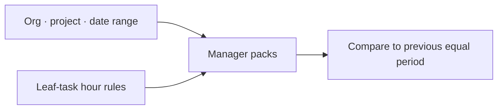

# Reporting — complete guide

**Audience:** Manager, Admin; Extract for internal users with `CanViewReports`; Work Summary for internal users
**Access:** Sidebar → **Reporting** (`/reporting`); Work Summary (`/work-summary`); Explore also at `/web-reports` for managers/admins. Legacy `/reports` redirects into the hub (Extract).
**Requires:** Manager packs need admin/manager (+ org membership). Capacity also allows `CanViewOthersPlanning`. Extract needs `CanViewReports`. Explore is admins/managers only. **Not** a Features module flag. Expenses pack/CSV only when **`expensesEnabled`**.
**When disabled / missing:** Missing Reporting = permissions or customer-portal role. Do not look for a Work Summary toggle under Features.


Unified reporting for organization health, portfolio, delivery, capacity, data quality, expenses, CSV extract, and advanced explore. Personal open/overdue work stays on the **Dashboard** and Work Summary — Reporting does not duplicate a “My Work” pack.

```mermaid
flowchart TD
  Hub[/reporting] --> Org[Organization]
  Hub --> Port[Portfolio]
  Hub --> Del[Delivery]
  Hub --> Cap[Capacity]
  Hub --> DQ[Data Quality]
  Hub --> Exp[Expenses]
  Hub --> Ext[Extract CSV]
  Hub --> Explore[Explore pivots]
  WS[/work-summary] --> Digests[Daily / weekly emails]
```



## 1 — Open the Reporting hub

1. Open **Reporting**.
2. Use the shared filter bar:
   - **Organization** (required for manager packs)
   - Optional **project**
   - **Date range**
3. Org context sticks across Organization / Portfolio / Delivery / Capacity / Data Quality.
4. Manager packs show metrics vs the **previous period of equal length**.


> **SCREENSHOT** — Capture org pack charts and period selector.
> File to add: `media/docs-reporting-hub.png`


## 2 — Who can see which section

| Section | Who |
|---------|-----|
| **Organization**, **Portfolio**, **Delivery**, **Data Quality**, **Expenses** | Admins or managers (+ org membership) |
| **Capacity** | Admins/managers, or users with `CanViewOthersPlanning` |
| **Extract** | Internal users with `CanViewReports` |
| **Explore** | Admins and managers only |
| Customer portal | Never — org-wide packs and Explore blocked |

APIs under `/api/reporting/*`, `/api/reports`, `/api/saved-reports`, and `/api/dynamic-reports` enforce the same rules.


## 3 — Organization pack

1. Open **Organization**.
2. Review health (RAG counts), effort (leaf estimated, **planned**, logged, leaf with/without hours, unscheduled), delivery throughput, and risk signals.
3. Charts typically include: RAG donut, planned vs logged, top projects, throughput, open vs overdue, estimate/schedule mix, optional RAG snapshot trend.
4. **Task analytics** widgets: priority, type, assignee workload, parent progress.
5. Drill into other packs; task/project rows link for navigation.
6. Optional **email digest** schedule (structured metrics, weekly/monthly) — needs SMTP.

Hour totals follow **leaf tasks only** (no parent + child double-count).


## 4 — Portfolio pack

1. Open **Portfolio**.
2. Projects in the org with RAG, progress, overdue, and budget (if `CanViewBudgetInfo`).
3. Expand leaf tasks when offered.
4. Monetary spend uses the rate cascade (task → project → user); shows spent / remaining / burn % and flags hours without an effective rate.
5. Project name opens `/projects/:id`.

There is **no** separate “Portfolio enabled” feature flag — access is permission/role based.


## 5 — Delivery pack

1. Open **Delivery**.
2. Throughput / active sprints / recently closed for the org period.
3. Use project and task links to jump into delivery work.


## 6 — Capacity pack

1. Open **Capacity**.
2. Planned vs logged by org member.
3. Pending time approvals summary.
4. Cross-check with [[03-modules/planning]] and [[03-modules/approvals]].


## 7 — Data Quality pack

1. Open **Data Quality**.
2. Typical signals: unestimated leaf tasks, unassigned, no sprint (when the project has sprints), stale overdue, pending approvals.
3. **CSV export** of the quality set when offered.
4. Project/task links for quick fixes.


## 8 — Expenses pack

Only when **`expensesEnabled`**.

1. Open **Expenses**.
2. Approved expense lines with category/group/submitter filters.
3. Reimbursable cap and reimbursement status.
4. Expense money stays out of hourly `CostSpent` — see [[03-modules/expenses]].


## 9 — Extract (CSV)

1. Open **Extract**.
2. Choose a dataset and export CSV (respects filters where applicable).

| Dataset | Notes |
|---------|--------|
| Projects, tasks | Delivery backbone |
| Time entries | Actuals |
| Calls | Call records |
| Customers, applications, releases | CRM / product |
| Tickets | When tickets exist / `internalTicketsEnabled` for nav |
| Planning allocations | Header-driven slices |
| Vacations, out-of-office | Leave |
| Memos | When memos are used |
| Expenses | Only when `expensesEnabled` |


## 10 — Explore (advanced)

1. Open **Explore** (or `/web-reports`).
2. Build pivots / saved advanced reports (former Advanced Reports).
3. Admins and managers only — not a substitute for Extract for every internal user.


## 11 — Work Summary

Personal (or scoped) digest at `/work-summary` — separate from hub packs.

1. Open **Work Summary**.
2. Choose period: last 7 / 30 / 90 days or custom range.
3. **Entries**: chronological mix of time entries + call records.
4. **Stats**: total hours, tasks touched, calls made.
5. **By project**: hours grouped by project.

### Scheduled emails

- Daily summary at end of the user’s configured work day
- Weekly summary (typically Friday end of day, configurable)
- Respects Profile → Email Preferences → `work_summary`
- Needs SMTP configured under System Settings → Email

See [[02-settings/email-preferences]].


## 12 — Project-level reporting (not the hub)

Project detail → **Reporting** tab still owns Summary / By User / Allocations / Time Entries / **Scheduled PDF** reports for that project. The hub does not replace those schedules.

See [[03-modules/projects-and-tasks]].


## 13 — History and digests

| Mechanism | Purpose |
|-----------|---------|
| Project health snapshots | Daily job for trend charts |
| Organization report digests | Weekly/monthly overview email to configured recipients (no LLM narrative) |

AI narrative summaries are **out of scope** here. Floating AI answers use **`aiAssistantEnabled`** separately — [[08-ai-assistant/widget-usage]].


## 14 — Tips and mistakes

- Set **organization + date range** before comparing period-over-period numbers.
- Trust leaf-hour rules; parent estimates are not double-counted in packs.
- Empty Expenses pack usually means `expensesEnabled` is off — not a Reporting bug.
- Customer users never see hub packs; do not troubleshoot portal with Reporting links.
- Outlook calendar (`outlookCalendarEnabled`) does not gate Reporting.

## Related

- [[03-modules/dashboard]]
- [[03-modules/projects-and-tasks]]
- [[03-modules/planning]]
- [[03-modules/timesheet-and-timers]]
- [[03-modules/call-records]]
- [[03-modules/expenses]]
- [[03-modules/approvals]]
- [[05-reference/exports-summary]]
- [[02-settings/email-preferences]]
- [[02-settings/feature-toggles-overview]]
