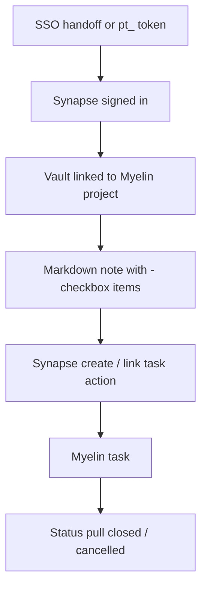
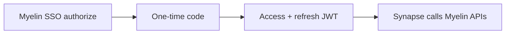

# Synapse bridge — complete guide

**Audience:** End user (writers), Admin / Operator (SSO)
**Access:** Synapse companion app → Profile / vault Myelin link settings. Myelin side: SSO env + optional Profile **API Tokens**.
**Requires:** Synapse companion + Myelin SSO (`ALLOWED_SSO_REDIRECTS`, `SSO_CLIENT_*`) and/or a personal `pt_` API token. **Not** a Features-tab module flag.
**When disabled / missing:** Without SSO or token, Synapse cannot call Myelin. Tasks are never auto-created on note save — missing checkboxes in Myelin usually means you have not run a Synapse create/link action.


Keep Markdown vaults in **Synapse** while optionally pushing checklist items to Myelin tasks **manually**. Synapse is the writing surface; Myelin remains the planner of record for estimates, Planning, and timesheets.





## 1 — Purpose and non-goals

| Synapse does | Synapse does **not** |
|--------------|----------------------|
| Store Markdown vaults / notes | Replace Planning Gantt |
| Manually create/link tasks from `- [ ]` items | Auto-create tasks on every note save |
| Pull closed/cancelled status when configured | Sync every field both ways live |
| Use SSO or `pt_` for auth | Use Features flags for enablement |

Related companions: [[07-companions/ide-extensions]] · [[07-companions/desktop-app]] · [[07-companions/tampermonkey]].


## 2 — Sign in (SSO preferred)

Operators configure Myelin SSO first — [[06-install-and-ops/sso-for-companions]].

Typical env on Myelin:

```env
ALLOWED_SSO_REDIRECTS=https://synapse.example.com/api/auth/sso/callback
SSO_CLIENT_ID=synapse
SSO_CLIENT_SECRET=long-random-secret
```

### User flow

1. In Synapse, start **Sign in with Myelin** (or equivalent SSO action).
2. Browser opens Myelin `/sso/authorize` (login if needed; `returnUrl` supported).
3. Myelin issues a one-time code; Synapse exchanges it at `/api/sso/token` for:
   - Short-lived **access** JWT (~8h)
   - Longer **refresh** JWT (~30 days)
4. Synapse refreshes before access expiry (`grant_type=refresh_token`) without another browser login.

No Navbar deep links are required on Myelin for SSO itself.


## 3 — API token fallback

When SSO is unavailable:

1. In Myelin: **My Profile → API Tokens** → create → copy `pt_...` once.
2. In Synapse Profile, paste the token (and Myelin base URL if prompted).
3. Synapse sends `Authorization: Bearer pt_...` on API calls (same effective access as you).

Admins can revoke stolen tokens under Administration → API Tokens. See [[03-modules/integrations]] § API tokens.


> **SCREENSHOT** — Capture vault Myelin link / token settings (no secrets).
> File to add: `media/docs-synapse-bridge.png`


## 4 — Link a vault to a project

1. Open Synapse Profile / vault settings for Myelin.
2. Confirm SSO session or `pt_` token is valid.
3. Link the vault (or note collection) to a **Myelin project** when you want create/link actions scoped there.
4. Open the project in Myelin to verify you can create tasks in that org.


## 5 — Create and link tasks from checkboxes

1. Write checklist items in Markdown, e.g. `- [ ] Implement login redirect`.
2. Use the Synapse action to **create** or **link** a Myelin task — **never** auto-created on note save alone.
3. Task appears in the Myelin project; open it from Myelin for estimates, assignees, Planning, and timers.
4. Synapse may show a **Synapse chip** on the task header when linked.

| Step | Owner |
|------|-------|
| Write note / checkbox | Synapse |
| Explicit create/link | Synapse action |
| Estimate / plan / log time | Myelin |


## 6 — Status sync

1. When configured, Synapse can **pull** closed/cancelled (and similar terminal) status from Myelin.
2. Treat Myelin status as authoritative for delivery boards.
3. Do not expect every Myelin field (story points, allocations, SLA) to round-trip into Markdown.


## 7 — Tips and mistakes

- Prefer SSO for people; reserve long-lived `pt_` tokens for automation and break-glass.
- If checkboxes never become tasks, you skipped the Synapse create/link action — that is by design.
- Link the correct **project** before bulk-creating tasks from a vault.
- Rotate tokens and keep `SSO_CLIENT_SECRET` out of git and screenshots.
- `aiAssistantEnabled` / `frontpageEnabled` do not control the Synapse bridge.

## Related

- [[06-install-and-ops/sso-for-companions]]
- [[03-modules/integrations]]
- [[03-modules/projects-and-tasks]]
- [[03-modules/create-and-complete-task]]
- [[07-companions/ide-extensions]]
- [[02-settings/profile]]
