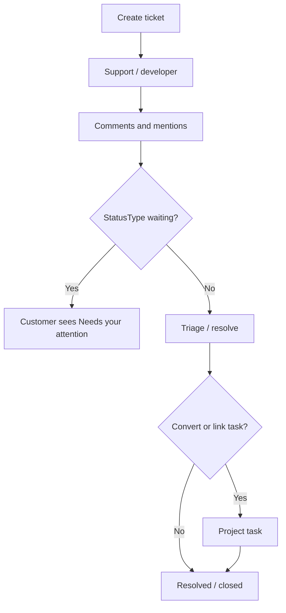
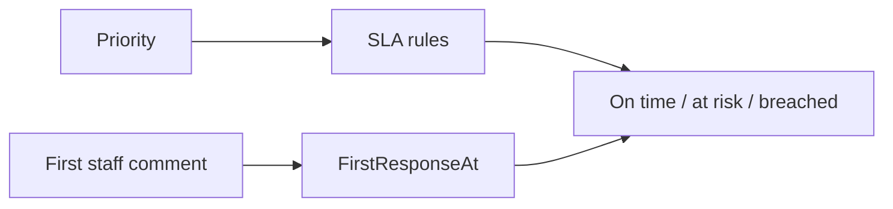

# Tickets — complete guide

**Audience:** Support, Developer, Manager, Admin; Customer portal users (their customer only)
**Access:** Sidebar → Tickets (`/tickets`)
**Requires:** Feature flag **`internalTicketsEnabled`** (default **on**) **and** Support role or ticket create/manage permissions (portal: customer scope).
**When disabled / missing:** Tickets nav hidden when `internalTicketsEnabled` is off. Task detail can still hold ticket/Jira **reference** fields. Delivery can continue task-first or via import.

Tickets track support and service requests. They are **optional** for delivery — many teams never open this menu and still ship via tasks.

## 1 — Open and filter

1. Open **Tickets**.
2. Filter by status, priority, customer, project, assignee, search text, and SLA state when shown.
3. Status filtering prefers **StatusType** (`open`, `in_progress`, `waiting`, `resolved`, `closed`, `other`) so custom names still report correctly.
4. Closed/cancelled statuses (`IsClosed`) drop out of open counts.
5. On phone, toolbars stack and action buttons wrap.

> **SCREENSHOT** — Capture filters and status chips.
> File to add: `media/docs-tickets-list.png`

## 2 — Create a ticket (internal)

1. Click **New** / create ticket.
2. Fill fields:

| Field | Notes |
|-------|--------|
| Title, description | Rich text description |
| Customer | Required for client work; drives default support user |
| Project | Optional until delivery; portal users **cannot** set this |
| Status, priority | From org ticket vocabularies |
| Category | Free/org category as configured |
| Assigned support / developer | Auto-filled when customer has **Default support user** |
| External / Jira key | When searching Jira for Tickets instance |

3. Ticket number is auto-generated (`TKT-ORG-NNN` style).
4. Save → open detail.

### Auto-assignment

When the customer has a **Default support user**, that user is assigned on create without manual selection.

Portal create: minimal form, **no project picker** — internals assign project later. See [[03-modules/customers-and-portal]].

## 3 — Ticket detail tabs

| Tab | Purpose |
|-----|---------|
| **Details** | Fields, assign, edit, SLA indicators |
| **Comments** | Thread with rich text, attachments, `@mention` |
| **Attachments** | Files on the ticket |
| **History** | Status, priority, assignment change log |

> **SCREENSHOT** — Capture comments and Convert to Task action.
> File to add: `media/docs-tickets-detail.png`

## 4 — Comments, mentions, first response

1. Add a comment; `@username` notifies in-app and can email (respects email preferences) — [[03-modules/notifications]].
2. First **staff** comment sets `FirstResponseAt` for SLA.
3. Move status to **waiting** when you need customer input — portal Dashboard lists those under **Needs your attention**.
4. Keep the thread on the ticket; put delivery estimates on the **task** after convert/link.

## 5 — Status system

| Concept | Behaviour |
|---------|-----------|
| Custom names | Per org (`TicketStatusValues`) |
| StatusType | `open`, `in_progress`, `waiting`, `resolved`, `closed`, `other` |
| Filtering / KPIs | Prefer StatusType, not hard-coded English labels |
| IsClosed | Excludes from open counts |

Prefer StatusType-aware statuses over renaming “Closed” into something ambiguous.

## 6 — SLA

1. Org admins define SLA rules per priority (`FirstResponseHours`, `ResolutionHours`).
2. List badges: on time / at risk / breached (colour-coded).
3. If no rules exist, badges may be absent — process still works without SLA.
4. First response clock starts on the first staff comment, not on customer replies.

## 7 — Convert / link to a task

Tickets are not required for tasks. When you do deliver from a ticket:

1. Open ticket → **Convert to Task** (or equivalent link action).
2. Choose project (required if the ticket has none); task name/description prefill from the ticket.
3. Uses the same task detail modal as normal create (`ticketId` prefilled).
4. Task links back (`Tickets.TaskId` ↔ task); ticket shows a badge to the task.
5. Keep statuses aligned manually when both stay open.

Playbook: [[04-workflows/ticket-to-delivery]]. Task how-to: [[03-modules/create-and-complete-task]].

## 8 — Jira on tickets (summary)

When organization **Jira for Tickets** is configured:

1. Search Jira issues while creating/editing a ticket.
2. Store the issue key on `ExternalTicketId`.
3. Linked tasks can show a Jira badge that opens the correct Jira URL.

Deep board import, mappings, and batch status check live in [[03-modules/jira-boards-and-tickets]] — not duplicated here.

## 9 — Customer portal behaviour

| Topic | Behaviour |
|-------|-----------|
| Nav | Dashboard + Tickets (when `internalTicketsEnabled`) |
| Create | No `projectId` |
| Waiting | Highlighted on portal Dashboard |
| Scope | Own customer only; internal pages blocked |
| Notifications | Header bell still available |

Full portal guide: [[03-modules/customers-and-portal]].

## 10 — Tips and mistakes

- Prefer StatusType-aware statuses over renaming “Closed” into something ambiguous.
- Do not expect Planning to schedule a ticket — schedule the **task**.
- When `internalTicketsEnabled` is off, use task-first or import workflows instead of hunting for a Tickets menu.
- Task Jira/ticket **reference fields** can remain even when the Tickets module nav is hidden.
- `frontpageEnabled` does not control Tickets.

## Related

- [[03-modules/customers-and-portal]]
- [[03-modules/projects-and-tasks]]
- [[03-modules/create-and-complete-task]]
- [[03-modules/jira-boards-and-tickets]]
- [[03-modules/notifications]]
- [[04-workflows/ticket-to-delivery]]
- [[02-settings/feature-toggles-overview]]
