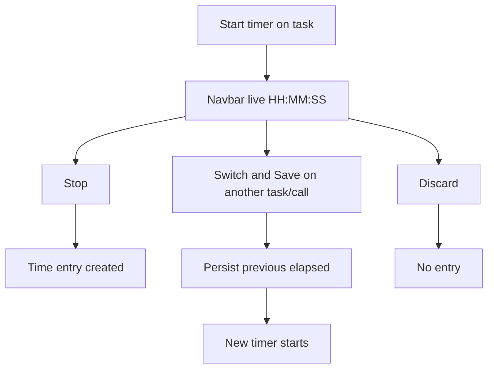
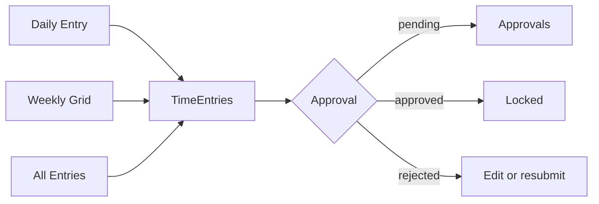

# Timesheet and timers — complete guide

**Audience:** End user, Manager, Admin (approvers)
**Access:** Sidebar → Timesheet (`/timesheet`); timer controls on task detail, call records, and the navbar indicator
**Requires:** Time permissions (e.g. `CanManageTimeEntries`). Viewing others’ entries may need manager/admin scope. Approval queues use Approvals + optional auto-approve flags. There is **no** “Timers enabled” feature flag.
**When disabled / missing:** Missing Timesheet usually means permissions or customer-portal role — not a System Settings module toggle. Customer users never use Timesheet.

Log work against tasks, review history, and run at most **one active timer** per user. Timesheet stores entries; the navbar timer is how you switch live context.

## 1 — Open Timesheet

1. Open **Timesheet**.
2. Tabs:

| Tab | Label in UI | Purpose |
|-----|-------------|---------|
| Daily | 📅 Daily Entry | One date, one task, hours + description |
| Weekly | 🗓️ Weekly Grid | Mon–Sun cells per task; save all |
| All entries | History-style table | Filter, totals, CSV, optional group by days |
| Resume | Period summary | Aggregated hours by user/project/task for a period |

> **SCREENSHOT** — Capture Daily Entry with task picker and hours.
> File to add: `media/docs-timesheet-daily.png`

## 2 — Daily Entry

1. Select a **date**.
2. Pick a **task** from the searchable dropdown (scoped to projects you can access).
3. Enter **hours** and an optional **description**.
4. Click **Save Entry**.
5. Hours display as `hh:MM:ss` in summaries elsewhere; entry forms may accept decimal hours that convert for display.

### Approval behaviour

- New entries are usually `pending` unless:
  - System Settings → Features → **`autoApproveTimeEntries`** is on, or
  - The project is marked **Hobby** (hobby time can auto-approve).
- **Approved** entries are locked (cannot edit).
- **Rejected** entries show the rejection comment; fix via Daily or manager guidance.

Approvers work queues in [[03-modules/approvals]].

## 3 — Weekly Grid

1. Open **Weekly Grid**.
2. Use **Previous / Current / Next week**.
3. Rows = tasks that already have entries (or editable rows your UI loads for the week).
4. Edit cells inline; set a cell to **0** to delete that day’s entry when allowed.
5. Click **Save All Changes**.
6. Cells with **multiple entries** for the same task/day are **read-only** on the grid — edit those on **Daily**.
7. Approved cells stay locked.

> **SCREENSHOT** — Capture weekly grid with day columns.
> File to add: `media/docs-timesheet-weekly.png`

## 4 — All Entries

1. Open the All Entries / history view.
2. Filter by date range, project, task, and **user** (user filter for managers/admins).
3. Optional **Group by days** collapses the list for scanning.
4. Footer totals: total hours, billable when applicable, entry count.
5. **CSV export** respects current filters.

> **SCREENSHOT** — Capture filters, group-by-days, and totals footer.
> File to add: `media/docs-timesheet-all-entries.png`

## 5 — Resume

1. Open **Resume**.
2. Choose period: this week, last week, this month, last month, all time (labels match the UI).
3. Review aggregated rows (by user when you can see others, then project/task breakdown).
4. Use for personal or team stand-up digests; cross-org packs also live in [[03-modules/reporting]] and Work Summary.

## 6 — Active timers (task)

At most **one** active timer per user (`task` or `call`).

### Start

1. Open a task → **Timer** section → **Start Timer**.
2. Live counter shows `HH:MM:SS` (updates every second).
3. Navbar shows the same elapsed time and task name.

### Stop

1. Click the navbar timer (or stop in the modal) → **Stop Timer**.
2. Confirm/adjust description if prompted.
3. A **time entry** is created for the elapsed duration.
4. Timer record is cleared; navbar indicator disappears.

### Discard

- **Discard Timer** deletes the active timer **without** creating a time entry.

### Switch & Save

1. While a timer runs, open another task (or start a call timer).
2. Choose **Switch & Save** (task context).
3. Previous elapsed work is persisted first; then the new timer starts.
4. **Timesheet is not a switch surface** — it only shows entries after stop/switch.

See [[04-workflows/timer-context-switch]].

> **SCREENSHOT** — Capture running timer indicator and Timer Start Modal.
> File to add: `media/docs-timer-navbar.png`

## 7 — Call timers (difference)

| | Task timer | Call timer |
|---|------------|------------|
| Start | Task detail | Call record timer button |
| On stop | Creates **time entry** | Updates call **Duration (minutes)** only |
| TimeEntries | Yes | No |

Details: [[03-modules/call-records]].

## 8 — Persistence and accuracy

- On reload, navbar polls the active timer API and rebuilds elapsed from server `StartedAt`.
- Client clock drift does not invent hours; server start time is authoritative.
- Multi-tab: poll keeps the badge roughly in sync (~60s).

## 9 — Tips and mistakes

- Prefer Daily for precise descriptions; Weekly for fast week fill.
- Do not fight locked approved cells — ask an approver to reject/revert if a correction is needed (process-dependent).
- One timer only — always Switch & Save rather than starting a second mentally.
- Hobby + auto-approve flags reduce Approvals noise; know which apply before wondering why nothing is pending.

## Related

- [[03-modules/approvals]]
- [[03-modules/call-records]]
- [[03-modules/planning]]
- [[03-modules/reporting]]
- [[04-workflows/timer-context-switch]]
- [[04-workflows/planned-vs-actual]]
- [[02-settings/feature-toggles-overview]]
