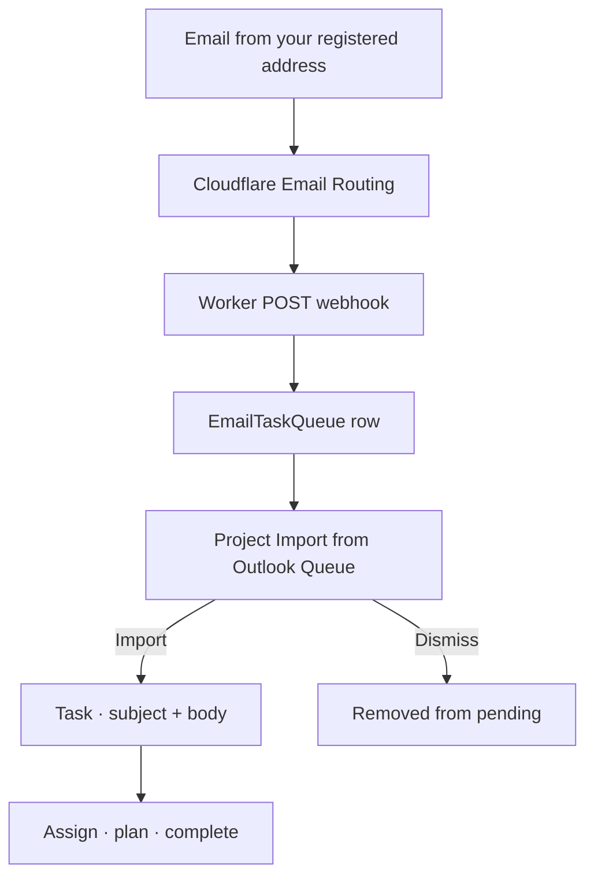

# Workflow: Email to task (Outlook queue)

**Audience:** End user; Operator for Cloudflare setup  
**Access:** Project → Import Tasks → **Import from Outlook Queue** (when pending items exist)  
**Requires:** Cloudflare Email Routing + Worker posting to `/api/webhooks/email-task-queue` with a personal `pt_` API token; sender must match an active `Users.Email`. **Not** a System Settings Features flag.  
**When disabled / missing:** Menu item absent until the queue has pending items for you and the operator pipeline is live — use CSV/Jira/manual create instead.


Turn inbound email into a project task: mail hits a per-user queue, you import (or dismiss) from the project UI.



```mermaid
flowchart LR
  Token[pt_ API token] --> WH[/api/webhooks/email-task-queue]
  MsgId[ExternalMessageId] --> Dedup[Idempotent retries]
```

## 1 — Operator prerequisites (once)

1. Follow `extras/cloudflare/README.md` in the Myelin repo (Email Routing → Worker).
2. Create a **Profile → API Tokens** `pt_...` token for the Worker (copy once).
3. Worker authenticates to the webhook; queue owner is resolved from the email **From** address.
4. Unknown senders may receive HTTP 202 but are **not** queued.
5. `ExternalMessageId` (Message-ID) deduplicates retries.

End users do not configure Cloudflare daily — ask an operator if the import item never appears.

## 2 — Send mail into your queue

1. Send from the **same email** as your Myelin user profile.
2. Address the message to the configured Cloudflare queue address for your deployment.
3. Prefer a clear subject (becomes task name) and a clean body (becomes description after normalization).

## 3 — Import into a project

1. Open the **target project** (import always lands in the open project).
2. When pending items exist: **Import Tasks → Import from Outlook Queue**.
3. Select a queued item → import.
4. Verify **name** (subject) and **description** (body).
5. Dismiss items you do not want — they should leave the pending list.


> **SCREENSHOT** — Capture Import from Outlook Queue list with pending items (redact addresses if needed).
> File to add: `media/docs-workflow-email-queue.png`


## 4 — Finish like task-first delivery

1. Set status, priority, task type, assignees.
2. Add **estimated hours** on leaves.
3. Optional Planning — [[03-modules/planning]].
4. Execute and complete — [[04-workflows/task-first-delivery]] / [[03-modules/create-and-complete-task]].

## Tips and mistakes

- Wrong From address → nothing queued (by design).
- No pending items → menu entry may not appear; that is expected.
- Webhook without a valid `pt_` token fails auth — rotate/revoke tokens under Profile if leaked.
- This path is separate from SMTP notification mail and from `outlookCalendarEnabled` (calendar overlay only).

## Done when

- Task exists in the correct project with usable metadata.
- Queue item is no longer pending (imported or dismissed).
- Owner/status are set for delivery.

## Related

- [[04-workflows/import-first-delivery]]
- [[03-modules/integrations]]
- [[07-companions/ide-extensions]] (also uses `pt_` tokens)
- [[06-install-and-ops/environment-variables]]
- [[03-modules/projects-and-tasks]]
