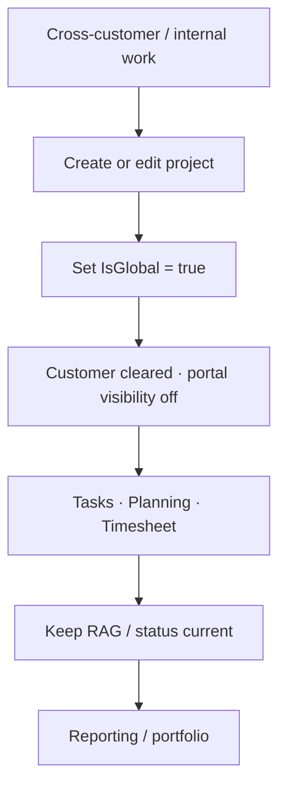
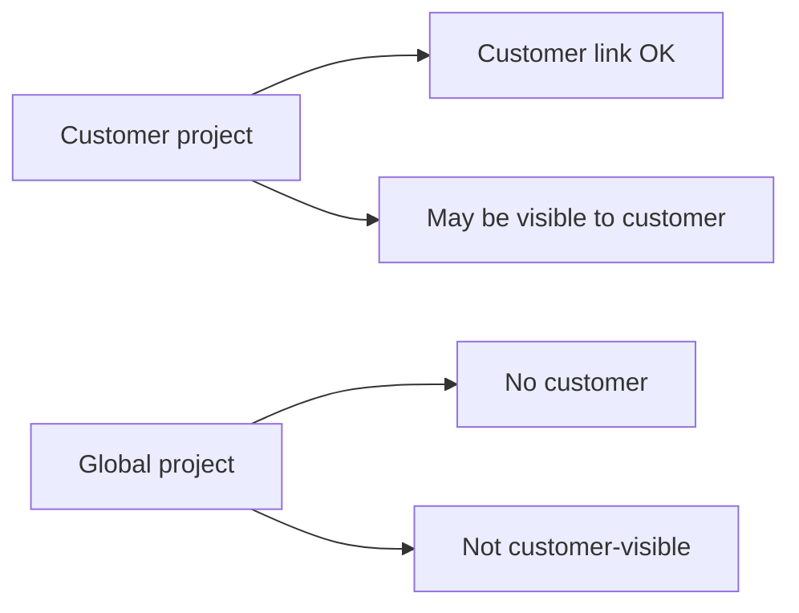

# Workflow: Global project governance

**Audience:** Manager, Admin  
**Access:** Project create/edit → Settings (`IsGlobal` and related fields)  
**Requires:** Project manage/create permissions. Global project rules are **domain constraints**, not a Features flag.  
**When disabled / missing:** If you cannot set Global, you lack project edit rights — there is no “enable global projects” checkbox under Features.

Run cross-customer or internal initiatives as **global** projects: no customer association, not visible on the customer portal, normal task/time/planning flows otherwise.

## 1 — When to use a global project

| Situation | Use global? |
|-----------|-------------|
| Shared platform / R&D across many customers | Yes |
| Internal tooling with no external client | Yes |
| Single customer delivery | No — link the customer |
| Customer should see progress in the portal | No — use a non-global project with `IsVisibleToCustomer` |

Hobby projects (`IsHobby`) are a separate flag for personal/side work; do not confuse them with global governance.

## 2 — Create or convert

1. Open **Projects** → create project, or open Settings on an existing project.
2. Set **Global** (`IsGlobal = true`).
3. System rules:
   - Project **cannot** be associated with a customer.
   - `IsVisibleToCustomer` is forced **off**.
4. Set organization, status, dates, budget type if used, linked applications as needed.
5. Save. Confirm the Overview no longer implies a customer portal surface.

> **SCREENSHOT** — Capture project Settings with Global enabled and customer fields constrained.
> File to add: `media/docs-workflow-global-project-settings.png`

## 3 — Execute like any delivery

1. Create or import tasks — [[04-workflows/task-first-delivery]] / [[04-workflows/import-first-delivery]].
2. Plan capacity — [[03-modules/planning]].
3. Log time and approvals as usual — [[03-modules/timesheet-and-timers]].
4. Optional expenses on the project when `expensesEnabled` + expense permissions — [[03-modules/expenses]].
5. Keep Overview **RAG**, alerts, and status honest for managers watching portfolio health.

## 4 — Governance checklist

| Control | Guidance |
|---------|----------|
| Customer link | Must stay empty while global |
| Portal visibility | Off; customers never see this project grid item |
| Org membership | Only people who need the initiative |
| Permission groups | Org groups still OR with roles — [[05-reference/permissions-matrix]] |
| Budget / rates | Visible only with `CanViewBudgetInfo` |
| Reporting | Include in Reporting hub packs when you have `CanViewReports` |

## Tips and mistakes

- Do not try to “hide” a customer project by clearing the name — use Global or visibility flags correctly.
- Converting a customer project to global requires clearing customer association first (enforced in Settings).
- Portal users never see Planning/Timesheet; global work stays internal by design.

## Done when

- Project remains compliant (no customer, not portal-visible).
- Effort is fully trackable on tasks/time.
- RAG/status reflects reality for leadership review.

## Related

- [[03-modules/projects-and-tasks]]
- [[03-modules/customers-and-portal]]
- [[03-modules/reporting]]
- [[04-workflows/task-first-delivery]]
- [[05-reference/module-relationships]]
