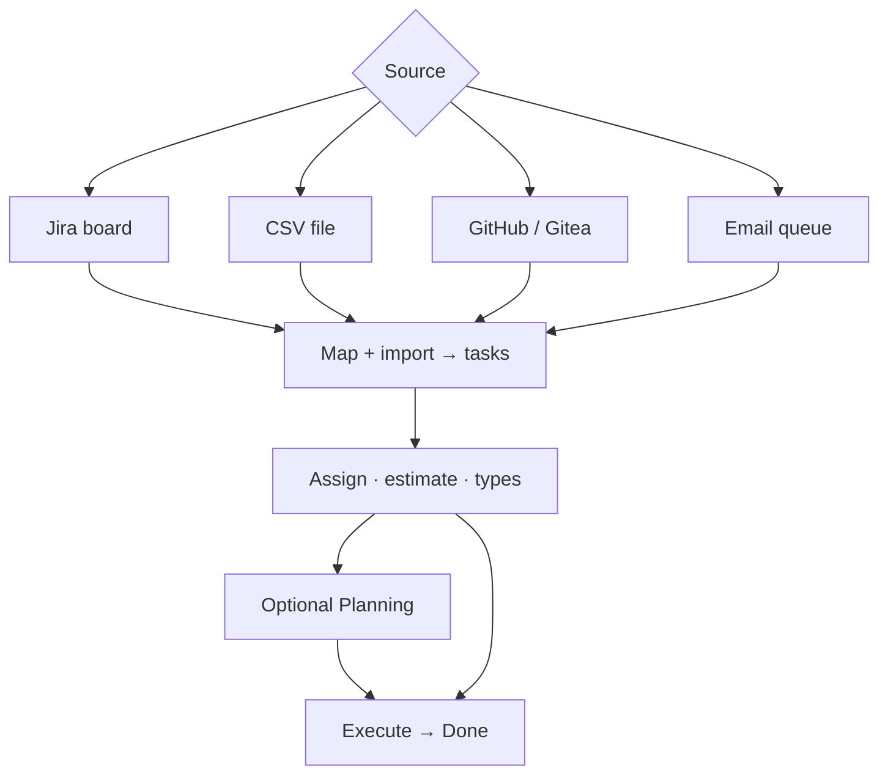
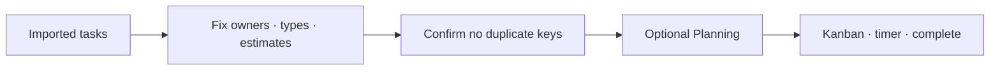

# Workflow: Import-first delivery — complete guide

**Audience:** Manager, End user  
**Access:** Project → Import Tasks (Kanban / task area)  
**Requires:** Import rights on the project; Jira / Git / email queue only if those integrations are configured.  
**When disabled / missing:** Missing import menu items usually mean the **integration is not configured**, not a fictional “import feature flag”. CSV needs no integration.


Land work from an external source into project tasks, then assign, plan, execute, and complete like any other delivery.



## 1 — Paths at a glance

| Source | Where | Guide |
|--------|--------|--------|
| **Jira board / status sync** | Kanban → Import Tasks | [[03-modules/jira-boards-and-tickets]] · [[04-workflows/jira-sync]] |
| **CSV** | Import Tasks → CSV | This page §2 |
| **GitHub / Gitea** | Import menu when org enabled | This page §3 |
| **Outlook email queue** | Import from Outlook Queue | [[04-workflows/email-to-task]] |


> **SCREENSHOT** — Capture CSV or Jira mapping before import.
> File to add: `media/docs-workflow-import-mapping.png`


> **SCREENSHOT** — Capture Import Tasks menu with available sources.
> File to add: `media/docs-integrations-import-menu.png`


## 2 — CSV import

1. Open the **target project** (CSV always imports into the open project — no `ProjectId` column).
2. **Import Tasks → CSV** → download the template.
3. Fill rows (UTF-8, comma-separated). Keep `TaskName` unique in the file if you use parent/dependency columns.
4. Upload → review **preview**.
5. Map **Status** and **Priority** names to org values.
6. Confirm. Parent/dependency links resolve **after** create from matching names in the same file.

| Column | Required | Description |
|--------|----------|-------------|
| **TaskName** | Yes | Title; unique in file if referenced as parent/dependency |
| **Description** | No | Description |
| **Status** / **Priority** | No | Org **names** (mapped in modal) |
| **AssignedToUsername** | No | Exact Myelin username |
| **DueDate** | No | `YYYY-MM-DD` |
| **EstimatedHours** | No | Decimal with dot (e.g. `7.5`) — prefer leaves |
| **ParentTaskName** | No | Must match another `TaskName` in the file |
| **PlannedStartDate** / **PlannedEndDate** | No | `YYYY-MM-DD` |
| **DependsOnTaskName** | No | Must match another `TaskName` in the file |

### Example

```csv
TaskName,Description,Status,Priority,AssignedToUsername,DueDate,EstimatedHours,ParentTaskName,PlannedStartDate,PlannedEndDate,DependsOnTaskName
Platform Setup,Initial setup,To Do,High,john.doe,2026-03-20,8.0,,2026-03-10,2026-03-12,
API Foundation,Core API endpoints,In Progress,Critical,jane.smith,2026-03-28,20.0,,2026-03-13,2026-03-20,Platform Setup
API Validation Tests,Endpoint tests,To Do,Medium,john.doe,2026-03-30,10.0,API Foundation,2026-03-21,2026-03-25,API Foundation
```

| Symptom | Fix |
|---------|-----|
| User not found | Exact `AssignedToUsername` |
| Parent / dependency not found | Typo or missing row |
| Unmapped status/priority | Finish mapping before confirm |
| Ambiguous links | Duplicate `TaskName` in the file |

**Tip:** Import 2–3 rows first, confirm mapping, then run the full file.

## 3 — GitHub / Gitea import

1. Organization settings → enable **GitHub** and/or **Gitea** (URL + token; encrypted at rest).
2. Project → Import Tasks → **Import from GitHub** or **Import from Gitea**.
3. Search issues → select → import.
4. Tasks store `GitHubIssueNumber` or `GiteaIssueNumber`; duplicate imports for the same issue are **prevented**.
5. Set Myelin status / type / assignees / leaf estimates; plan if needed.

## 4 — Jira board import (summary)

Full guide: [[03-modules/jira-boards-and-tickets]]. Checklist: [[04-workflows/jira-sync]].

1. Org Jira enabled (Tickets credentials; optional Projects credentials).
2. Project Settings → **Jira Board ID** when using board import.
3. Kanban → **Import from Jira** → select → map statuses → import.
4. Later: **Check Jira Ticket Status** for batch local updates.

## 5 — Email / Outlook queue (summary)

Full guide: [[04-workflows/email-to-task]].

1. Operator: Cloudflare Email Routing + Worker + `pt_` token on the webhook.
2. Send mail **from your registered user email** to the queue address.
3. When pending: **Import from Outlook Queue**.
4. Import (subject → name, body → description) or dismiss.

## 6 — After any import



1. Fix assignees, task types, and **leaf** estimates.
2. Confirm no duplicate active tasks for the same external key (Jira / Git).
3. Plan if required — [[03-modules/planning]].
4. Complete with [[03-modules/create-and-complete-task]].
5. Optional release linkage — [[04-workflows/release-readiness]].

## Tips and mistakes

- Wrong project open = wrong import target — always open the destination first.
- Integrations are org-scoped; board ID is project-scoped.
- CSV mapping mistakes are the most common failure — preview before confirm.

## Done when

- External items exist as tasks in the correct project.
- No duplicate active tasks for the same Jira/Git key.
- Owners and statuses are sane; active items planned/timed as required.

## Related

- [[03-modules/integrations]]
- [[03-modules/jira-boards-and-tickets]]
- [[04-workflows/email-to-task]]
- [[04-workflows/jira-sync]]
- [[04-workflows/task-first-delivery]]
