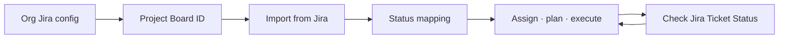
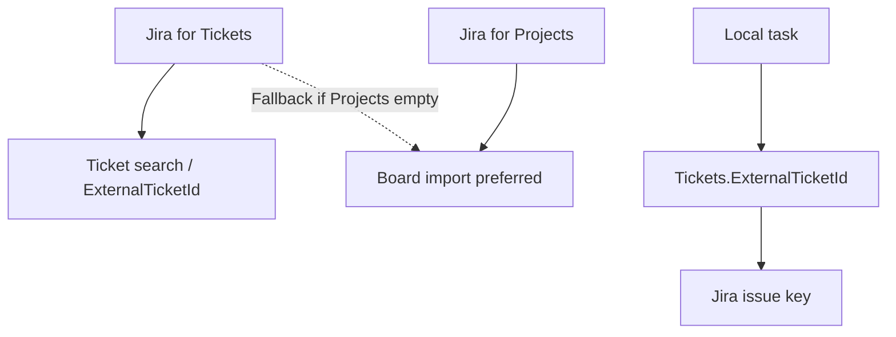

# Workflow: Jira import and status sync

**Audience:** Manager, Admin, delivery leads  
**Access:** Organization → Jira Integration; Project → Settings (Board ID); Project Kanban → Import Tasks  
**Requires:** Organization Jira integration enabled with credentials. Two optional tiers: **Jira for Tickets** and **Jira for Projects**. **Not** a System Settings Features flag (org integration toggle only).  
**When disabled / missing:** Import / check-status menu items absent — use CSV, Git, or manual tasks instead.

Import board issues into Myelin tasks, then periodically align **local task statuses** with Jira using batch check-status (explicit selection — nothing updates by surprise).

## 1 — Configure organization Jira

1. Open the organization → **Jira Integration**.
2. Enable the integration.
3. Enter **Tickets** credentials: URL, email, API token, project key as required; **Test**; save.
4. Optionally enter **Projects** credentials (URL / email / token) for board import preference.
5. Tokens are encrypted at rest (`ENCRYPTION_KEY` or `JWT_SECRET` fallback) and never returned in API responses.

| Tier | Purpose |
|------|---------|
| **Jira for Tickets** | Ticket search, issue linkage, status sync context |
| **Jira for Projects** | Project boards / Kanban import (preferred for import) |

Both can point at the same Jira Cloud/Server instance; they are still configured independently.

> **SCREENSHOT** — Capture Jira Integration tab with enable toggle (redact tokens).
> File to add: `media/docs-workflow-jira-org-settings.png`

## 2 — Link the project board

1. Open Project → **Settings**.
2. Set **Jira Board ID** when the Projects integration is configured (field appears in that case).
3. Save. Board association drives fetch/import for that project.

## 3 — Import issues as tasks

1. Project → **Kanban** → **Import Tasks** → **Import from Jira**.
2. Select issues from the board/search results.
3. Map Jira statuses → local **TaskStatusValues**.
4. Confirm import. Tasks store linkage via ticket / `ExternalTicketId` chain.
5. Fix assignees, types, and **leaf** estimates after import.

Full field walkthrough: [[03-modules/jira-boards-and-tickets]] · path overview: [[04-workflows/import-first-delivery]].

> **SCREENSHOT** — Capture Import from Jira with status mapping panel.
> File to add: `media/docs-workflow-jira-import.png`

## 4 — Check Jira Ticket Status (batch)

Run this when Jira moved and Myelin may be stale — not on every keystroke.

1. Kanban → Import Tasks → **Check Jira Ticket Status**.
2. System queries Jira for linked issue keys.
3. Modal lists Jira status vs local status; optional **Show only changed**.
4. **Nothing is selected by default** — select rows (or Select All).
5. Set a **global** Jira→local status mapping; override per row if needed.
6. **Apply Updates** only for selected rows.

| Rule | Behaviour |
|------|-----------|
| Selection | Explicit; empty selection = no updates |
| Global map | Applies to selected rows without per-row override |
| Per-row override | Wins for that ticket |
| Duplicates | Avoid second active tasks for the same Jira key |

> **SCREENSHOT** — Capture check-status list with mapping and empty default selection.
> File to add: `media/docs-workflow-jira-check-status.png`

## 5 — Day-to-day after sync

1. Execute in Myelin (Kanban, Planning, timers) — [[03-modules/create-and-complete-task]].
2. Task detail Jira badge opens the correct Jira URL when linkage exists.
3. Re-run check-status after major Jira board moves or before release readiness — [[04-workflows/release-readiness]].

## Tips and mistakes

- Missing import usually means **org credentials / board ID**, not a Features flag named “Jira”.
- Import prefers Projects credentials and falls back to Tickets credentials when Projects is empty.
- Do not assume Myelin auto-writes status back to Jira from this checklist — this flow updates **local** statuses from Jira.
- Organization JQL filters apply to ticket search; free-text search can bypass configured JQL for direct lookup.

## Done when

- No duplicate active tasks for the same Jira key.
- Local statuses match the agreed mapping after check-status.
- Owners and leaf estimates are usable for Planning/Reporting.

## Related

- [[03-modules/jira-boards-and-tickets]]
- [[03-modules/integrations]]
- [[04-workflows/import-first-delivery]]
- [[04-workflows/ticket-to-delivery]]
- [[04-workflows/release-readiness]]
