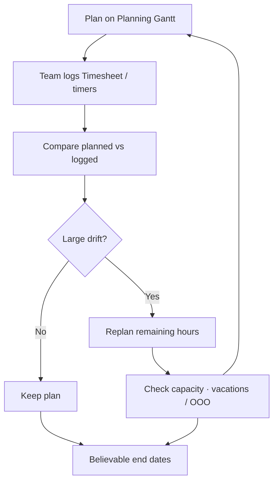
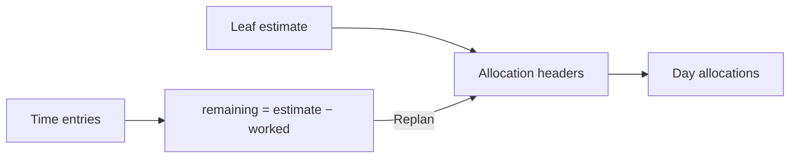

# Workflow: Planned vs actual

**Audience:** Manager, planners with report access  
**Access:** Planning (`/planning`) + project Reporting / Timesheet / Dashboard Analytics  
**Requires:** `CanViewPlanning` (and plan edit rights to replan); Timesheet access for actuals; project/report visibility for comparisons. **Not** a System Settings feature flag.  
**When disabled / missing:** Missing Planning nav = missing `CanViewPlanning`. Missing numbers usually mean filters, leaf-hour rules, or unapproved time — not a fictional “variance module” flag.

Keep schedules honest by comparing **allocations** (planned) with **time entries** (actual), then replanning remaining effort before dates slip.

## 1 — Establish the plan

1. Put **estimated hours** on **leaf** tasks (parents with children are excluded from hour totals).
2. Open [[03-modules/planning]] → Resource or Task view.
3. Allocate (or split Parallel / Sequential) so each critical leaf has headers and day rows.
4. Confirm profile **work hours**, lunch, vacations/OOO, recurring blocks, and (if enabled) Outlook Busy overlays.

> **SCREENSHOT** — Capture Resource view with planned bars and capacity tint.
> File to add: `media/docs-workflow-planned-vs-actual-gantt.png`

## 2 — Capture actuals daily

1. Contributors log time via **timer** (navbar HH:MM:SS) or Timesheet Daily / Weekly — [[03-modules/timesheet-and-timers]].
2. Prefer same-day logging; approved entries may lock for edit.
3. Call timers update call duration only — they do **not** create task time entries.
4. Managers: Approvals queue for pending time when auto-approve is off (`autoApproveTimeEntries` is the real flag).

## 3 — Compare weekly (or per sprint)

| Surface | What to read |
|---------|----------------|
| Project → **Reporting → Summary** | Estimated / allocated / worked; **leaf totals only** |
| Project → **By User** | Per-user allocated vs worked |
| Project → **Allocations** | Header slices, dates, `SplitOrder` |
| Project → **Time Entries** | Raw logged lines |
| Dashboard **Analytics** | Period KPIs (set period first) |
| Reporting hub | Portfolio / capacity packs when `CanViewReports` |

1. Pick a period that matches the plan window (week / sprint / month).
2. For each critical leaf: planned hours vs sum of time entries.
3. Note tasks with plan but no actuals (idle) and actuals with no remaining plan (overrun).

> **SCREENSHOT** — Capture project Reporting Summary with estimate / allocated / worked columns.
> File to add: `media/docs-workflow-planned-vs-actual-report.png`

## 4 — Replan remaining effort

1. On Planning (or task Allocations), trigger **replan** on the affected header.
2. System computes `remaining = estimated − worked` from time entries.
3. Confirmation shows remaining hours; **blocked if remaining ≤ 0**.
4. Only remaining hours are re-laid out — do not invent negative hours.
5. Prefer **Ctrl+drag** partial moves when only part of a slice should shift — [[03-modules/planning]].

| Drift pattern | Typical action |
|---------------|----------------|
| Behind plan, hours left | Replan remaining onto free capacity |
| Ahead / under-used | Shrink or move unused slice; free the person |
| Estimate wrong | Update leaf estimate, then replan |
| Capacity cut (OOO / holiday) | Move work; Dev Support days do **not** cut capacity |

## 5 — Capacity hygiene

- Include vacations, OOO, holidays, recurring pink blocks, and Outlook Busy when enabled (`outlookCalendarEnabled` + Graph credentials).
- **Dev Support** is informational only — do not treat it as free capacity reduction.
- Avoid chronic overbooking: fix Resource view hotspots before promising dates.
- On phones (≤767px) Planning is **read-only** — replan on a larger screen.

## Tips and mistakes

- Always compare **leaves**, not parent rollups that double-count.
- Analytics without an explicit period is easy to misread.
- Replan after leave is approved, not only after it starts.
- Do not “fix” variance by deleting history; adjust plan or estimate with a short comment.

## Done when

- Critical tasks have believable planned end dates.
- Large variances are explained, replanned, or estimate-corrected.
- Capacity overlays match approved leave and holidays.

## Related

- [[03-modules/planning]]
- [[03-modules/timesheet-and-timers]]
- [[03-modules/reporting]]
- [[03-modules/dashboard]]
- [[04-workflows/task-first-delivery]]
- [[02-settings/vacations-ooo-dev-support]]
