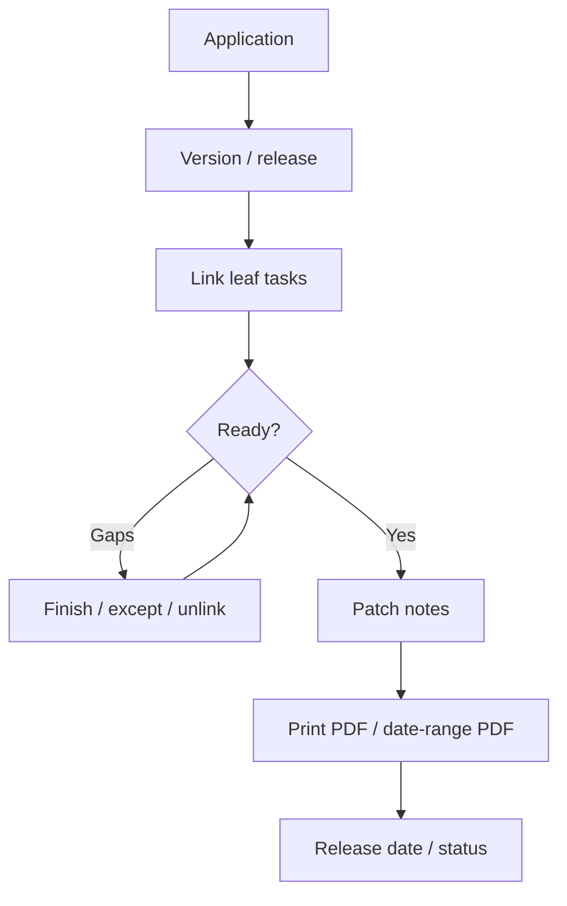
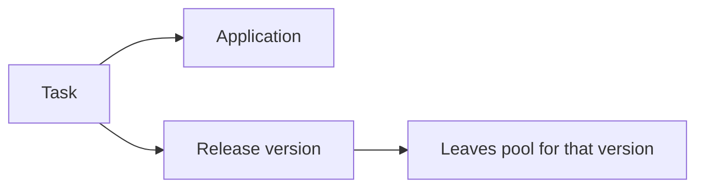

# Workflow: Release readiness

**Audience:** Manager, release owner  
**Access:** Applications (`/applications`) → version detail; project tasks linked to application/version  
**Requires:** `CanViewApplications` / release manage rights as granted (`CanManageReleases` etc.). Application/release modules are **not** a System Settings Features checkbox.  
**When disabled / missing:** Missing Applications nav = missing application permissions — not a feature flag.

Prepare a trustworthy release snapshot: in-scope tasks terminal (or explicitly excepted), tickets aligned, and patch-notes PDF exportable.

## 1 — Define the release container

1. Open **Applications** → select the product (or create it with name, org, optional image upload).
2. Open **Versions** → create or open the target version (number, name, status, release date).
3. Confirm whether the app/version is customer-specific if that matters for your process.
4. Note: a task linked to a version leaves the available pool for other versions.

> **SCREENSHOT** — Capture application detail Versions tab with status and release date.
> File to add: `media/docs-workflow-release-versions.png`

## 2 — Scope tasks into the version

1. On each in-scope task (Task detail), set **Application** and **Version** when those fields are visible (task form visibility may hide them — [[02-settings/task-form-visibility]]).
2. Prefer linking **leaf** delivery tasks that actually ship.
3. Confirm project Reporting / Kanban filters still show the set you expect.
4. Unlink or move tasks that slipped out of scope before export.

| Check | Pass criteria |
|-------|----------------|
| Status | Terminal org status, or listed as known exception |
| Linked ticket | Resolved/closed or exception noted |
| Estimate / actual | Usable for audit on leaves |
| Comments | Handover / risk notes present if needed |
| Assignees | Clear owner for any open exception |

## 3 — Align tickets and externals

1. For tasks born from tickets: ticket status should match delivery acceptance — [[04-workflows/ticket-to-delivery]].
2. For Jira-linked work: run **Check Jira Ticket Status** if you keep local status aligned — [[04-workflows/jira-sync]].
3. Portal customers should not remain on `waiting` after the release is accepted unless you still need a reply.

## 4 — Patch notes and PDF export

1. Edit **Patch notes** on the version (rich text; images supported).
2. Optional: AI-assisted improvement when `aiAssistantEnabled` + provider are configured — [[08-ai-assistant/admin-configuration]].
3. Export:

| Export | Where | Contents |
|--------|-------|----------|
| **Print to PDF** | Version detail | App + version + date, patch notes, linked tasks (status / priority / assignee) |
| **Print Date Range** | Applications / versions tools | Versions in a date window (see product UI) |

> **SCREENSHOT** — Capture version detail with patch notes and Print to PDF (no secrets).
> File to add: `media/docs-workflow-release-pdf.png`

## 5 — Final go / no-go

1. Set version **status** and **release date** to match the real ship decision.
2. Spot-check RAG / project overview if the release rides a single project — [[03-modules/dashboard]] / project Overview.
3. Archive follow-ups as new tasks on the next version rather than silently reopening shipped scope.

## Tips and mistakes

- Linking a task to a version is exclusive for that pool — do not assume it still appears as “available” elsewhere.
- PDF quality depends on completed patch notes and linked-task hygiene, not on inventing a “release flag”.
- Keep estimates on leaves so reporting and the PDF task list stay meaningful.

## Done when

- In-scope work is terminal or explicitly excepted in writing.
- Linked tickets / Jira statuses match the agreed story.
- Patch-notes PDF (or agreed export) matches the period/scope.

## Related

- [[03-modules/applications-and-releases]]
- [[04-workflows/task-first-delivery]]
- [[04-workflows/ticket-to-delivery]]
- [[04-workflows/jira-sync]]
- [[05-reference/exports-summary]]
