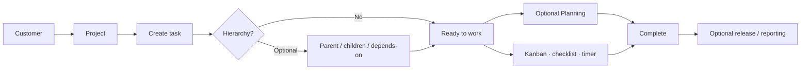
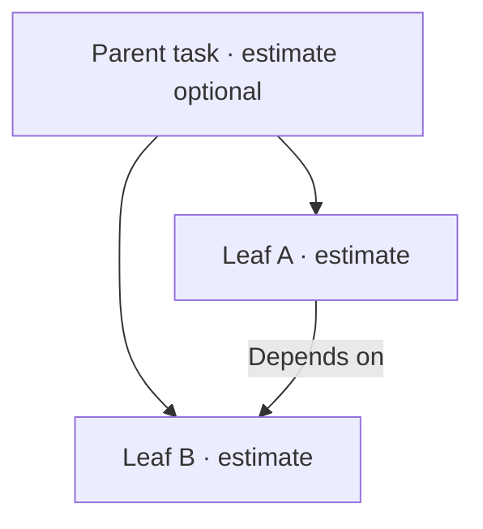

# Workflow: Task-first delivery — complete guide

**Audience:** End user, Manager  
**Access:** Project → Tasks / Kanban; optional Planning and Timesheet  
**Requires:** Project access plus task create/manage permissions. **No** feature flag turns this path on or off.  
**When disabled / missing:** Missing Projects/Tasks = permissions or wrong org — not a Features checkbox.

Deliver work that starts as a **project task** (no ticket or import required). Create in Myelin, optionally plan, execute, and complete with honest status and time.

Detailed create → complete steps: **[[03-modules/create-and-complete-task]]**.  
Container first: **[[03-modules/create-project]]**. Customer first: **[[03-modules/create-customer]]**.  
Capacity: **[[03-modules/planning]]**. Time: **[[03-modules/timesheet-and-timers]]**.

## 1 — When to use this path

| Situation | Use this workflow? | Prefer instead |
|-----------|--------------------|----------------|
| Internal delivery already scoped as project work | Yes | — |
| New customer + first project + first tasks | Yes | — |
| Customer opened a support ticket | No (entry) | [[04-workflows/ticket-to-delivery]] |
| Work already in Jira / CSV / Git / email queue | No (entry) | [[04-workflows/import-first-delivery]] |
| Cross-customer / internal initiative | Yes, on a **global** project | [[04-workflows/global-project-governance]] |

### Pick your path

| Situation | Guide sequence |
|-----------|----------------|
| New customer + project + tasks | [[03-modules/create-customer]] → [[03-modules/create-project]] → [[03-modules/create-and-complete-task]] |
| Project exists; new task | [[03-modules/create-and-complete-task]] |
| Need capacity dates before coding | Create task → [[03-modules/planning]] → execute → complete |
| Work arrived as ticket | [[04-workflows/ticket-to-delivery]] |
| Work arrived from Jira / CSV / Git / email | [[04-workflows/import-first-delivery]] |

## 2 — Confirm the container

1. Open the correct **organization** (top-bar switcher if multi-org).
2. Open the **project** (or create it — [[03-modules/create-project]]).
3. Confirm customer link (or **global** / hobby rules — [[04-workflows/global-project-governance]]).
4. Confirm org vocabularies: statuses, priorities, task types (Organization settings). Defaults use each org’s `IsDefault` values.

## 3 — Create the task

1. Project → **Tasks** or **Kanban** → create task.
2. Set at least:

| Field | Why |
|-------|-----|
| **Name** | Identity on boards and search |
| **Status / Priority / Type** | Type icons appear on boards |
| **Assignee(s)** | Primary + additional via assignees |
| **Estimated hours** | On **leaves** only for totals |
| **Due date** | Hard deadline / reminders |

3. Optional: description, application/version, sprint, checklist starter items.
4. Save — task opens in **Task detail**.

> **SCREENSHOT** — Capture create-task on a project (status, priority, type, estimate, assignees).
> File to add: `media/docs-workflow-task-first.png`

## 4 — Hierarchy and templates (optional)

| Pattern | How | Why |
|---------|-----|-----|
| Parent + children | Set **Parent task** on children | Groups work; estimates on **leaves** |
| Depends on | Set **Depends on** | Sequencing in Gantt / dependency views |
| Template | Project → **Apply template** | Creates a predefined task set |

## 5 — Plan capacity (optional)

If you have Planning access (`CanViewPlanning`; edit needs `CanPlanTasks` / related):

1. Open [[03-modules/planning]].
2. Drag onto a user/day (or split Parallel / Sequential).
3. Confirm remaining hours when replanning (subtracts logged time).
4. Planned start/end update from allocations (often read-only in the modal).

Phone viewports (≤767px): Planning is **read-only** for editing — use a larger screen.

## 6 — Execute

| Tool | What to do |
|------|------------|
| **Kanban** | Drag between status columns; order saved |
| **Completion %** | Optional; independent from status |
| **Checklist** | Sub-steps with progress bar |
| **Timer** | Start on task; navbar HH:MM:SS — [[04-workflows/timer-context-switch]] |
| **Timesheet** | Log/adjust later — [[03-modules/timesheet-and-timers]] |
| **Comments / @mentions** | Decisions and blockers |
| **Attachments** | Specs / screenshots (size limits apply) |

Do **not** use Timesheet to switch an active timer — start on the next task/call and confirm **Switch & Save**.

## 7 — Complete and hand over

1. Move status to a **terminal** org value.
2. Stop any running timer; confirm the time entry description.
3. If a ticket or Jira key is linked, align external status ([[04-workflows/jira-sync]]).
4. If the work ships in a release, link **application version** — [[04-workflows/release-readiness]].
5. Leave a short completion comment when handover matters.

## Condensed checklist

1. Open project → create task (name, status, priority, type, assignees, estimate, due date).
2. Optional hierarchy: parent/children (estimates on leaves), depends-on, checklist, template.
3. If Planning access: allocate / split.
4. Execute: Kanban, timer or Timesheet, comments/attachments.
5. Complete: terminal status, stop timer, sync ticket/Jira if linked, link release if used.

## Tips and mistakes

- Project hour totals sum **leaves** only — do not double-count parents.
- Planned vs logged drift: [[04-workflows/planned-vs-actual]].
- Portfolio packs: [[03-modules/reporting]] when `CanViewReports`.

## Done when

- Task is terminal (or explicitly deferred in writing).
- Leaf estimates/actuals are usable for reporting.
- Handover documented (comment or linked ticket/release).
- No orphan active timer on this task.

## Related

- [[03-modules/projects-and-tasks]]
- [[03-modules/create-and-complete-task]]
- [[04-workflows/ticket-to-delivery]]
- [[04-workflows/import-first-delivery]]
- [[05-reference/best-practices]]
