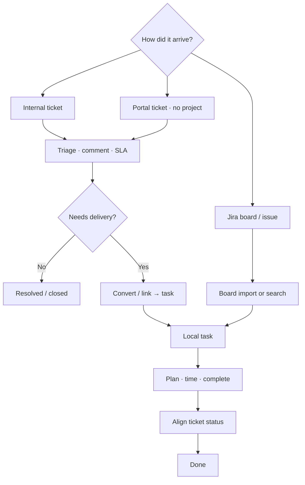
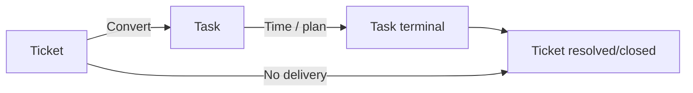

# Workflow: Ticket to delivery — complete guide

**Audience:** End user, Manager, Customer portal (entry only)  
**Access:** Tickets (`/tickets`); portal users via Dashboard + Tickets  
**Requires:** `internalTicketsEnabled` + ticket permissions for the Tickets UI. Convert needs `CanCreateTaskFromTicket` (or equivalent). Jira-linked paths: [[03-modules/jira-boards-and-tickets]].  
**When tickets UI is off:** Use task-first or Jira board import — task-level Jira references may still exist. Turning tickets off is a **real** Features flag; it does not remove Jira fields on tasks.

Turn a support request into tracked implementation — or close it without a task when no delivery work is needed.

## 1 — Prerequisites

| Check | Notes |
|-------|--------|
| `internalTicketsEnabled` | Administration → System Settings → Features — hides **Tickets** nav when off |
| Ticket permissions | Create / manage / assign / convert — [[05-reference/permissions-matrix]] |
| Customer record | Prefer **Default support user** for auto-assignment |
| Org ticket vocabularies | Statuses have `StatusType`: `open`, `in_progress`, `waiting`, `resolved`, `closed`, `other` |
| Project for delivery | Needed when converting to a task |

## 2 — Entry A: Internal ticket → task

1. Open **Tickets** → create or open a ticket.
2. Fill **title**, **description**, **customer**, **priority**, category if used.
3. Assign **support** and/or **developer**. Default support user may auto-assign.
4. Triage:
   - First staff comment can set **First response** for SLA.
   - Use `StatusType = waiting` when blocked on the customer (portal “Needs your attention”).
5. When delivery starts: **Convert to Task**.
   - Choose **project** if the ticket has none.
   - Confirm name/description (prefilled).
   - Result: ticket stores `TaskId`; task can show the linked ticket.
6. Continue with [[03-modules/create-and-complete-task]].
7. Keep **ticket** status aligned until resolved/closed.

> **SCREENSHOT** — Capture ticket detail with Convert to Task / linked task badge.
> File to add: `media/docs-tickets-detail.png`

## 3 — Entry B: Customer portal ticket

1. Customer signs in and creates a ticket (**minimal form — no project selection**).
2. Staff sees it in internal Tickets (when the module is enabled).
3. Triage as in §2; set project when delivery starts.
4. Convert / link the same way.
5. Use `waiting` when you need a customer reply.

Portal orientation: [[03-modules/customers-and-portal]].

## 4 — Entry C: Tickets menu off or Jira-first

If `internalTicketsEnabled` is off:

- Tickets nav / internal UI is hidden.
- Prefer [[04-workflows/task-first-delivery]] or Jira board import.
- Task-level Jira / external keys may still appear when integrations exist.

Jira without Myelin ticket UI: [[03-modules/jira-boards-and-tickets]] → [[04-workflows/jira-sync]].

## 5 — Convert vs close without a task

| Decision | Do this |
|----------|---------|
| Question answered / config only | Comment → **resolved** / **closed** — no task |
| Needs code / project delivery | Convert → plan/execute → close ticket when accepted |
| Duplicate | Reference canonical ticket; close duplicate |
| Waiting on customer | Status type **waiting**; do not convert prematurely |

## 6 — SLA and comments

- Org **SLA rules** per priority: first-response and resolution hours.
- List badges: on time / at risk / breached when SLA is configured.
- Comments: rich text, attachments, `@mentions` (in-app + email if prefs allow).
- History tab: status, priority, assignment changes.

## 7 — After the task exists

1. Assign owners and leaf estimates if missing.
2. Optional Planning — [[03-modules/planning]].
3. Execute and complete — [[03-modules/create-and-complete-task]].
4. Reconcile planned vs actual if scheduled — [[04-workflows/planned-vs-actual]].
5. Resolve/close the ticket; clear accidental `waiting` for portal users.

## Tips and mistakes

- Portal users cannot set `projectId` on create — staff sets project at convert time.
- Closing the task without closing the ticket leaves support metrics dirty.
- `frontpageEnabled` does not affect Tickets — only the public marketing front page.

## Done when

- Ticket is terminal (`resolved` / `closed`) or deferred in writing.
- Linked task (if any) reflects delivery and has usable time/status.
- Portal waiting states are cleared when no reply is needed.

## Related

- [[03-modules/tickets]]
- [[03-modules/create-and-complete-task]]
- [[03-modules/jira-boards-and-tickets]]
- [[04-workflows/task-first-delivery]]
- [[04-workflows/jira-sync]]
