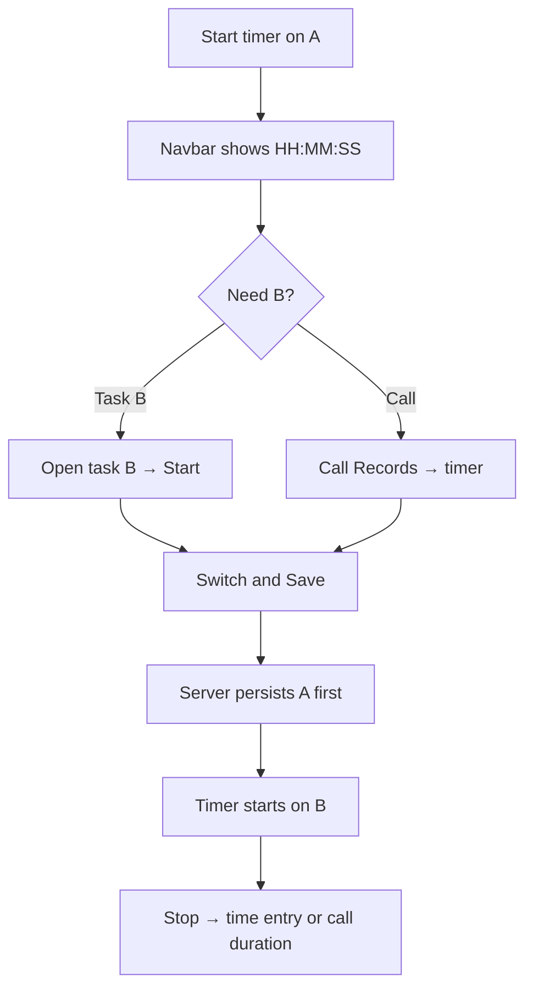
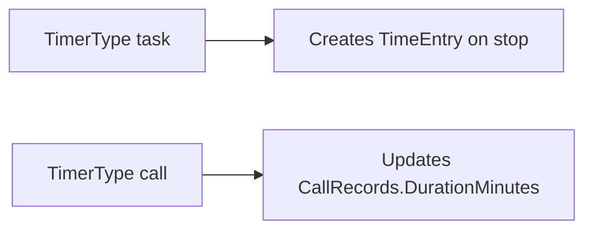

# Workflow: Timer context switch

**Audience:** End user  
**Access:** Task detail timer controls; navbar live timer; Call Records timer  
**Requires:** Ability to open tasks/calls and start timers. **Not** a System Settings feature flag. Timesheet is for persisted entries after stop/switch — not a switch surface.  
**When disabled / missing:** If the timer UI is hidden on a task, check task form visibility (timer header control) — [[02-settings/task-form-visibility]].

Change task or call context without losing elapsed time and without running two timers. Myelin allows **at most one active timer per user**.

## 1 — Start on the current context

### Task timer

1. Open the task detail modal.
2. In **Timer**, click **Start Timer**.
3. Confirm the navbar live indicator (task name + HH:MM:SS).
4. Elapsed time is server-authoritative (`StartedAt`); client refreshes ~every 60s.

### Call timer

1. Open **Call Records**.
2. Click the timer control on the call row.
3. Navbar shows call subject/type. Stopping updates **duration minutes** only — **no** task time entry.

> **SCREENSHOT** — Capture navbar live timer with task name (no secrets).
> File to add: `media/docs-workflow-timer-navbar.png`

## 2 — Switch to another task (Switch & Save)

1. Leave the current timer running.
2. Open the **target** task detail.
3. Start the timer there. UI labels this **Switch & Save**.
4. Backend auto-persists the previous timer as a time entry, then starts the new one.
5. Confirm navbar now shows the new task name and a fresh counter.

Do **not** open Timesheet to switch context — Timesheet only reflects entries after stop/switch.

> **SCREENSHOT** — Capture task timer area offering Switch & Save while another timer runs.
> File to add: `media/docs-workflow-timer-switch.png`

## 3 — Switch to or from a call

1. From a running task timer, start a call timer (or the reverse) from Call Records / task as appropriate.
2. Expect the previous context to persist first (same one-active-timer rule).
3. Remember: call stop ≠ timesheet line.

## 4 — Stop, discard, or adjust

| Action | Result |
|--------|--------|
| **Stop** (navbar or modal) | Task → create/confirm time entry + description; Call → update duration; active row deleted |
| **Discard** | Deletes active timer; **no** time entry / duration update |
| Start from navbar modal while one runs | Preserves previous elapsed work (auto-save), does not discard |

1. At end of a block, **Stop** and confirm the description.
2. Verify the entry on Timesheet Daily / Weekly / All Entries.
3. If approvals are required, wait for manager approval (`autoApproveTimeEntries` only when that real flag is on).

## Tips and mistakes

- Never assume two timers can run — the second start is a switch.
- Discard is permanent for that run; use only when the session was a mistake.
- Completion % and Kanban status are independent of the timer — update them separately.
- Deep link `/dashboard?task=<id>` opens the task modal quickly when switching from chat or commits.

## Done when

- Only one active timer existed at a time.
- Previous duration persisted before the new timer started (or was intentionally discarded).
- Stopped task time appears on Timesheet; call duration updated if it was a call timer.

## Related

- [[03-modules/timesheet-and-timers]]
- [[03-modules/call-records]]
- [[04-workflows/task-first-delivery]]
- [[04-workflows/planned-vs-actual]]
