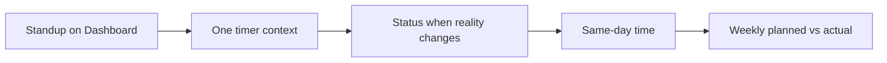

# Daily best practices — complete guide

**Audience:** End user, Manager  
**Access:** Habit guide (no single route)  
**Requires:** None  
**When onboarding:** Pair with [[01-getting-started/choose-your-role]] and one workflow from `04-workflows/`.

Practices that keep boards, plans, and portal SLAs trustworthy without inventing process flags.

## 1 — Daily (contributors)

| Practice | Why |
|----------|-----|
| Start from **Dashboard** Kanban / Overview | Fast path to assigned work |
| Keep **one timer**; use **Switch & Save** | Prevents lost or double time |
| Update **status** when reality changes | Boards stay decision-ready |
| Prefer **leaf** estimates | Totals and planning stay honest |
| Log time the **same day** | Approvals and Resume stay accurate |
| Use `@mentions` for blockers | In-app + email (if prefs allow) |
| Deep link `/dashboard?task=` | Share tasks without hunting lists |

## 2 — Daily (support)

| Practice | Why |
|----------|-----|
| First response sets SLA clock | Badges stay meaningful |
| Use `waiting` only when blocked on customer | Portal “Needs your attention” stays true |
| Convert to task only when delivery starts | Avoid empty delivery noise |
| Close ticket when work is accepted | Metrics match reality |

## 3 — Weekly (managers)

| Practice | Why |
|----------|-----|
| Compare planned vs logged — [[04-workflows/planned-vs-actual]] | Catch drift early |
| Replan after vacations/OOO approve | Capacity overlays matter |
| Run Jira check-status before reviews if you sync | Local status matches board |
| Review RAG / overdue chips on projects | Health without vanity status |
| Confirm Approvals queue (time / leave / expenses) | Auto-approve flags change volume |

## 4 — Release and import hygiene

- Import into the **correct open project**; preview CSV mappings on a tiny batch first.
- Avoid duplicate active tasks for the same Jira/Git key.
- Link **application version** only for in-scope leaves — [[04-workflows/release-readiness]].
- Keep patch notes exportable before the go/no-go meeting.

## 5 — Admin / operator habits

- Document which **real** feature flags your instance uses — [[02-settings/feature-toggles-overview]].
- Prefer SMTP before relying on password recovery or work-summary mail.
- Enable expenses/AI/Outlook only after categories, privacy, and Azure app registration are ready.
- Backup database + uploads; watch `/health` and `/health/live` — [[06-install-and-ops/deploy-checklist]].

> **SCREENSHOT** — Capture a healthy Overview suitable for standup prep.
> File to add: `media/docs-reference-best-practices-dashboard.png`

## Tips and mistakes

- Tidying the board on Friday without updating mid-week teaches everyone to ignore Kanban.
- Parent estimates that mirror children inflate reporting — estimate leaves.
- Dev Support days are not OOO — do not treat them as capacity cuts.
- Personal sidebar hide cannot re-show a flagged-off module.

## Related

- [[04-workflows/task-first-delivery]]
- [[04-workflows/timer-context-switch]]
- [[04-workflows/planned-vs-actual]]
- [[05-reference/troubleshooting]]
- [[03-modules/dashboard]]
