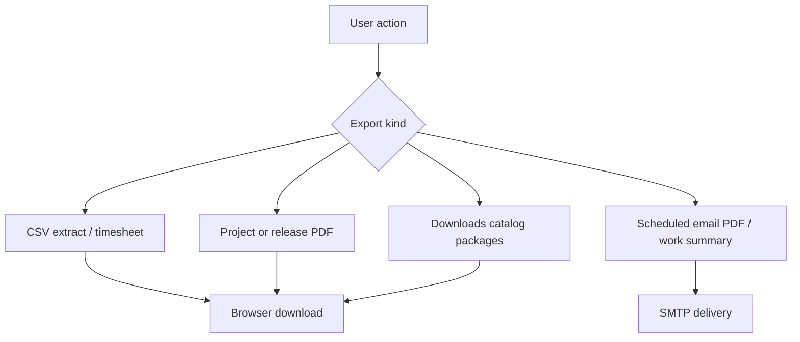

# Reports and exports — complete guide

**Audience:** Manager, End user, Admin (downloads)  
**Access:** Reporting hub, project Reporting, Applications/Versions, Work Summary, Downloads  
**Requires:** Varies — typically `CanViewReports` for hub extracts; project access for project PDFs; app/release permissions for patch-notes PDF. **Not** a single “exports” feature flag.  
**When disabled / missing:** Missing Reporting = `CanViewReports` (or role pack). Missing Expenses analytics = `expensesEnabled` off or no expense perms.

Where data leaves Myelin as CSV, PDF, email, or companion installers. Scope is always **permission-filtered**.

## 1 — Export catalog

| Export | Where | Gate / notes |
|--------|-------|----------------|
| **Reporting Extract CSVs** | `/reporting` → Extract | `CanViewReports`; datasets follow access |
| **Reporting Explore pivots** | Reporting → Explore | Same hub; advanced pivots |
| **Project Summary CSV** | Project → Reporting → Summary | Project access; **leaf** hour totals |
| **Timesheet CSV** | Timesheet → All Entries | Filters applied; user column often admin |
| **Scheduled project PDF** | Project → Reporting → Scheduled Reports | Weekly/monthly; needs SMTP |
| **Release patch-notes PDF** | Application version → Print to PDF | Linked tasks + notes |
| **Date-range release PDF** | Applications tools | Versions in a date window |
| **Work summary** | Work Summary page / email | Page access; email needs SMTP + prefs |
| **Call Records** | Call Records list / imports | Operational export/import as offered in UI |
| **Downloads catalog** | App Downloads | Desktop / IDE / Tampermonkey packages |

> **SCREENSHOT** — Capture Reporting Extract with a dataset selected (no customer secrets).
> File to add: `media/docs-reference-reporting-export.png`

## 2 — Reporting hub packs

When you have access, packs typically cover organization / portfolio / delivery / capacity themes; expense analytics appear only if expenses are enabled and permitted. Legacy `/reports` redirects toward **Reporting → Extract**.

See [[03-modules/reporting]].

## 3 — Scheduled and email exports

1. Configure **SMTP** under Administration → System Settings → Email first.
2. Project scheduled PDFs: frequency, recipients, content toggles (summary / tasks / time entries).
3. Work summary mail respects **Profile → Email preferences**.
4. Auto-approve flags do not create exports — they only change approval status on create.

## 4 — Release PDFs

1. Finish patch notes and linked tasks — [[04-workflows/release-readiness]].
2. **Print to PDF** on the version detail.
3. Optional AI polish of notes when `aiAssistantEnabled` + provider are set.

> **SCREENSHOT** — Reuse release PDF capture if already taken for the release workflow.
> File to add: `media/docs-workflow-release-pdf.png`

## 5 — Companion downloads

Operators publish packages under `extras/release` (and Tampermonkey under `extras/scripts/tampermonkey`). Users install from the in-app Downloads catalog — [[07-companions/desktop-app]], [[07-companions/ide-extensions]], [[07-companions/tampermonkey]].

## Tips and mistakes

- CSV column sets follow **current filters** — clear filters if the file looks “too small”.
- Never email exports that contain secrets or personal API tokens.
- If scheduled PDF never arrives: SMTP test mail, recipient typos, scheduler host clock.
- Redis does not change export contents; stale UI lists are a cache issue, not CSV logic.

## Related

- [[03-modules/reporting]]
- [[03-modules/applications-and-releases]]
- [[03-modules/timesheet-and-timers]]
- [[04-workflows/release-readiness]]
- [[06-install-and-ops/environment-variables]]
