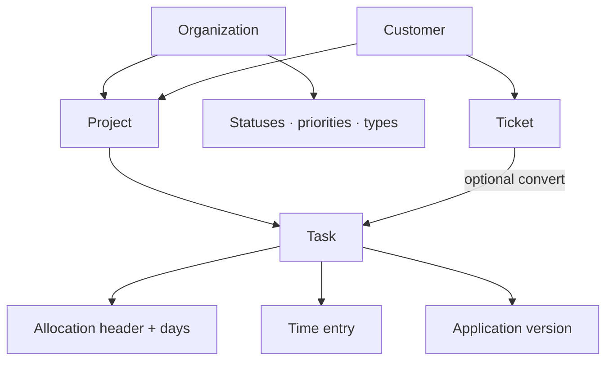

# Glossary — complete guide

**Audience:** Everyone  
**Access:** Reference note (no app route)  
**Requires:** None  
**When confused:** Cross-check [[01-getting-started/what-you-see-depends-on-settings]] before assuming a missing module is a bug.

Shared vocabulary for the Myelin manual. Prefer these terms in tickets and training.

## Core entities

| Term | Meaning |
|------|---------|
| **Organization** | Top-level tenant: projects, members, vocabularies, integrations |
| **Customer** | External client record; optional portal users; default support user |
| **Customer portal** | Constrained login (Dashboard + Tickets when tickets enabled) |
| **Project** | Delivery container for tasks; may be customer-linked, **global**, or **hobby** |
| **Global project** | `IsGlobal`: no customer; portal visibility forced off |
| **Task** | Unit of work; parent or leaf; optional ticket/Jira/Git links |
| **Leaf task** | Task with no children — only leaves count in hour totals |
| **Ticket** | Support request in the **internal ticket system** (`internalTicketsEnabled`) |
| **Application / Version** | Product registry and release; tasks link to a version |
| **Sprint** | Project iteration container for tasks |
| **Allocation** | Planned hours for a user on a task across dates (Planning) |
| **Allocation header** | Logical slice (`TaskAllocationHeader`); one Gantt bar per header |
| **Split (Parallel / Sequential)** | Multiple headers on one task — shared dates or chained |
| **Time entry** | Logged work hours on a task (approval workflow optional) |
| **Active timer** | At most one per user; task or call type |
| **Call record** | Logged meeting/call; optional project/task link |
| **Memo** | Calendar note with visibility (private / organizations / public) |
| **Expense** | Optional cost record (`expensesEnabled`); approval + reimbursement |

## Planning and capacity

| Term | Meaning |
|------|---------|
| **Leaf hours** | Totals that count only tasks without children |
| **Unscheduled work** | Leaf with no normal bars; ghost markers on done date or today |
| **OOO** | Out of office — reduces planning capacity when approved |
| **Vacation** | Leave request — reduces capacity when approved |
| **Dev Support** | Informational overlay; **does not** cut capacity |
| **Recurring task** | Profile pink 🔄 blocks; reserve hours on Planning |
| **Outlook Busy** | Others’ Graph events on Planning when `outlookCalendarEnabled` |
| **RAG** | Red/Amber/Green automatic project health indicator |
| **Baseline / critical path** | Planning overlays for drift and CPM highlight |

## Access and configuration

| Term | Meaning |
|------|---------|
| **Role** | Developer / Support / Manager (flags can combine; OR permissions) |
| **Permission group** | Org-level grants merged with role permissions (**OR**, never reduces) |
| **Admin** | `isAdmin` — all permissions |
| **Feature flag** | Real System Settings Features/AI/Outlook switches only — see [[02-settings/feature-toggles-overview]] |
| **Task form visibility** | UI-only hide of optional task fields/tabs (personal → org → global) |
| **pt_ token** | Personal API token for IDE, scripts, webhooks |
| **SSO companion** | OAuth-style handoff for Synapse and similar apps |
| **StatusType** | Ticket status category: `open`, `in_progress`, `waiting`, `resolved`, `closed`, `other` |
| **SLA** | Per-org first-response / resolution hours by priority |

## Real feature flags (names only)

| Key | Plain meaning |
|-----|---------------|
| `frontpageEnabled` | Public marketing front page |
| `internalTicketsEnabled` | Internal Tickets module nav/UI |
| `memosEnabled` | Memos navbar entry |
| `expensesEnabled` | Expenses module (APIs 403 when off) |
| `autoApproveExpenses` / `autoApproveTimeEntries` / `autoApproveVacations` / `autoApproveOutOfOffice` | Skip pending on create |
| `aiAssistantEnabled` | Floating AI + related AI actions |
| `outlookCalendarEnabled` | Graph calendar overlays |

Planning, Timesheet, Call Records, Work Summary, Reporting, and Dashboard are **not** toggled here — they use permissions (or always appear for eligible users).

## Tips

- “Missing Planning” is almost always `CanViewPlanning`, not a flag.
- Portal “Needs your attention” = tickets with `StatusType = waiting`.
- Time display in product docs: prefer `hh:MM:ss` helpers — avoid inventing `1.5h` as the canonical UI form.

## Related

- [[05-reference/module-relationships]]
- [[05-reference/permissions-matrix]]
- [[02-settings/feature-toggles-overview]]
- [[01-getting-started/what-you-see-depends-on-settings]]
