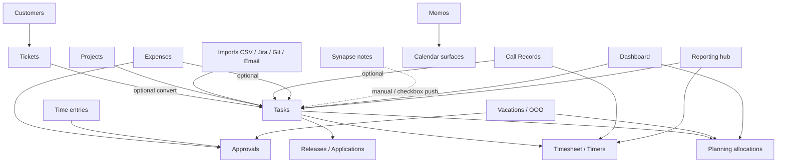
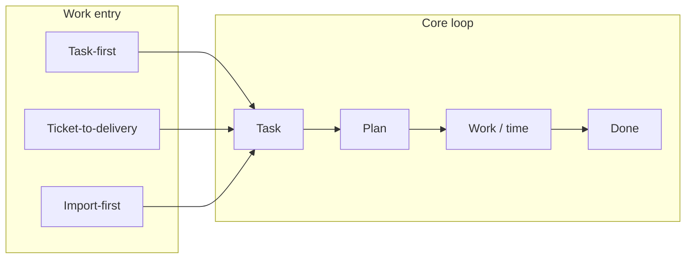

# Module relationships — complete guide

**Audience:** Everyone  
**Access:** Reference note  
**Requires:** None  
**When reading workflows:** `04-workflows` notes pick different arrows as the **start** of delivery.

How Myelin modules connect. Use this map before inventing parallel processes.

## 1 — Entity dependency (read top-down)

| Upstream | Downstream | Rule of thumb |
|----------|------------|---------------|
| Organization | Projects, tickets, vocabularies, integrations | Always pick the right org first |
| Customer | Tickets, optional projects, portal users | Portal create has **no** project picker |
| Project | Tasks, sprints, reporting, imports | Import always targets the open project |
| Task | Allocations, time entries, releases, timers | Leaves own hour totals |
| Ticket | Optional task via convert | Keep statuses aligned after convert |
| Application version | Linked tasks | Task leaves other versions’ pools |
| Approvals | Time / leave / expenses | Real auto-approve flags change create status |

## 2 — Navigation vs permissions vs flags

| Module | Typical gate |
|--------|----------------|
| Dashboard | `CanViewDashboard` (customers always land here) |
| Planning | `CanViewPlanning` / `CanPlanTasks` — **not** a Features flag |
| Timesheet / timers | Internal user + time permissions |
| Tickets | `internalTicketsEnabled` + ticket permissions |
| Memos | `memosEnabled` (navbar) |
| Expenses | `expensesEnabled` + expense permissions |
| Reporting | `CanViewReports` |
| AI widget | `aiAssistantEnabled` + provider |
| Outlook on calendar/Planning | `outlookCalendarEnabled` + Graph credentials |

Details: [[02-settings/feature-toggles-overview]] · [[05-reference/permissions-matrix]].

## 3 — Workflow entry points

| Start here | Follow |
|------------|--------|
| Empty project / internal scope | [[04-workflows/task-first-delivery]] |
| Support request | [[04-workflows/ticket-to-delivery]] |
| External backlog | [[04-workflows/import-first-delivery]] |
| Cross-customer initiative | [[04-workflows/global-project-governance]] |
| Schedule vs reality | [[04-workflows/planned-vs-actual]] |
| Ship a version | [[04-workflows/release-readiness]] |

## 4 — Data that must stay consistent

- **Leaf hours** in project reporting and planning capacity stories.
- **One active timer** per user — [[04-workflows/timer-context-switch]].
- **Ticket StatusType** for portal attention and KPI cards.
- **Jira key uniqueness** for imported tasks — [[04-workflows/jira-sync]].
- **Redis** (optional) caches reads; DB remains source of truth — [[06-install-and-ops/redis]].

> **SCREENSHOT** — Optional: capture a whiteboard or Synapse graph of your instance’s modules.
> File to add: `media/docs-reference-module-map.png`

## Tips

- Synapse vault notes do not replace Myelin tasks unless you push/link deliberately.
- Call timers never create timesheet lines.
- Dev Support days appear on calendars but do not reduce allocation capacity.

## Related

- [[05-reference/glossary]]
- [[04-workflows/task-first-delivery]]
- [[03-modules/projects-and-tasks]]
- [[03-modules/planning]]
- [[start]]
