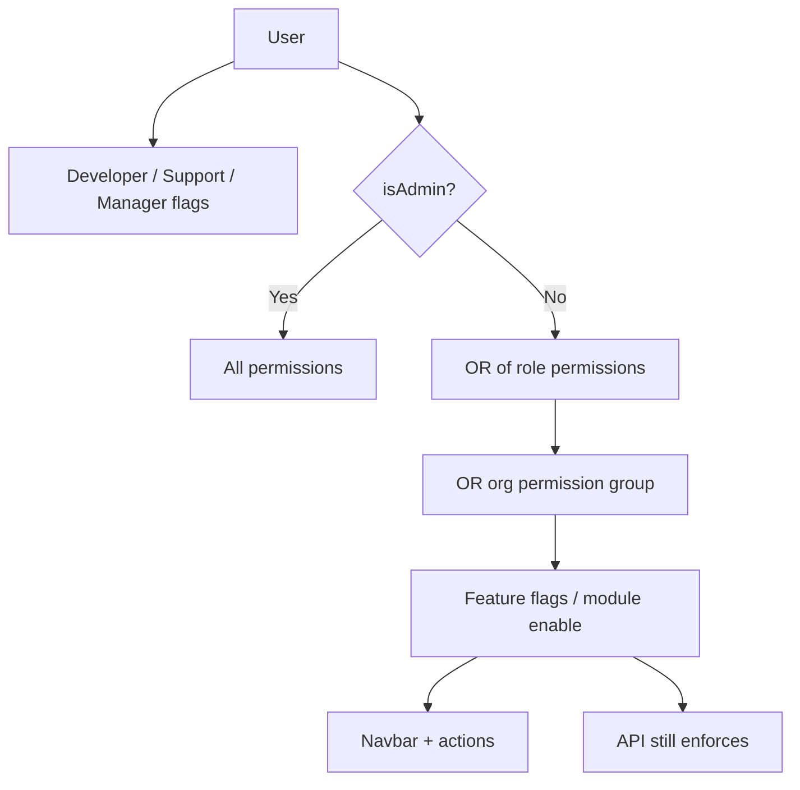

# Permissions matrix — complete guide

**Audience:** Manager, Admin  
**Access:** Administration → Role Permissions; Organization → Permission Groups  
**Requires:** Admin for global role matrix; org settings rights for groups  
**When disabled / missing:** Non-admins do not see Administration. Missing a button is often role/group/flag stacking — not a bug.

Final access ≈ **role permissions OR org permission group**, then apply **real** feature flags (tickets / memos / expenses / AI / Outlook calendar). Groups never revoke a permission the role already grants.

## 1 — Typical matrix (summary)

Roles below are **defaults** from the product’s seeded matrix — your instance may differ after Administration edits. Always verify in **Role Permissions**.

| Area | Developer (typical) | Support (typical) | Manager (typical) | Admin | Customer portal |
|------|---------------------|-------------------|-------------------|-------|-----------------|
| Dashboard | Per `CanViewDashboard` | Often yes | Yes | Yes | Portal layout |
| Own tasks / time | Usually yes | Limited | Yes | Yes | No |
| Planning view/edit | If plan perms | Rare | Usually yes | Yes | No |
| Internal tickets | Create often | Manage/assign | Yes | Yes | Own customer tickets |
| Convert ticket → task | If granted | If granted | Yes | Yes | No |
| Approvals (time/leave) | No | No | If scoped / leader | Yes | No |
| Expenses | View/create if flag+perms | View/create if flag+perms | Manage/approve if perms | Configure + all | No |
| Budget fields | If `CanViewBudgetInfo` | Rare | Often yes | Yes | No |
| Reporting hub | If `CanViewReports` | Rare | Often yes | Yes | No |
| Org settings / groups | No | No | Partial if group | Yes | No |
| Administration / Features | No | No | No | Yes | No |
| Applications / releases | If app perms | Rare | Often yes | Yes | No |

Customer users are gated by `CustomerUserGuard` — internal pages stay blocked even if someone tampers with the URL.

## 2 — Role permission fields (schema names)

| Field | Governs |
|-------|---------|
| `CanViewDashboard` | Dashboard |
| `CanViewPlanning` / `CanPlanTasks` / `CanViewOthersPlanning` | Planning |
| `CanViewProjects` / `CanManageProjects` / `CanCreateProjects` / `CanDeleteProjects` | Projects |
| `CanViewTasks` / `CanManageTasks` / `CanCreateTasks` / `CanDeleteTasks` / `CanAssignTasks` | Tasks |
| `CanManageTimeEntries` | Time entries |
| `CanViewReports` | Reporting hub |
| `CanViewBudgetInfo` | Budget / cost visibility |
| `CanManageOrganizations` | Organizations admin |
| `CanViewCustomers` / `CanManageCustomers` / `CanCreateCustomers` / `CanDeleteCustomers` | Customers |
| `CanManageUsers` | Users admin |
| `CanManageTickets` / `CanCreateTickets` / `CanDeleteTickets` / `CanAssignTickets` / `CanCreateTaskFromTicket` | Tickets |
| `CanViewApplications` / `CanManageApplications` / `CanCreateApplications` / `CanDeleteApplications` / `CanManageReleases` | Apps & releases |
| `CanViewExpenses` / `CanCreateExpenses` / `CanManageExpenses` / `CanApproveExpenses` | Expenses |

## 3 — Organization permission groups

| Group field | Description |
|-------------|-------------|
| `CanManageProjects` / `CanManageTasks` / `CanManageMembers` / `CanManageSettings` | Org-scoped management |
| `CanViewBudgetInfo` | Budget for this org’s projects |
| `CanViewExpenses` / `CanCreateExpenses` / `CanManageExpenses` / `CanApproveExpenses` | Org expense rights |

Rules:

1. Effective = `rolePermission OR groupPermission`.
2. Groups **never reduce** role grants.
3. Groups are **org-scoped** — different orgs can differ.
4. Multiple role flags on one user → **OR** across roles.
5. No roles and not admin → no protected access.

> **SCREENSHOT** — Capture Administration → Role Permissions for one role (no secrets).
> File to add: `media/docs-reference-role-permissions.png`

## 4 — Stack with feature flags

| Flag off | Effect even if permission true |
|----------|--------------------------------|
| `internalTicketsEnabled` | Tickets nav/UI hidden |
| `memosEnabled` | Memos nav hidden |
| `expensesEnabled` | Expenses UI hidden; APIs **403** |
| `aiAssistantEnabled` | Widget/AI actions hidden |
| `outlookCalendarEnabled` | No Graph overlays |

Planning / Timesheet / Call Records / Work Summary are **not** in this table — [[02-settings/feature-toggles-overview]].

## 5 — How to change access

1. **Administration → Role Permissions** — toggle role defaults; Save.
2. **Organization → Permission Groups** — create group; assign on member.
3. Confirm the user refreshes (hard refresh if nav looks stale).
4. Backend still enforces on every mutation — UI hide is not security.

## Tips and mistakes

- “Manager can do everything” is the **seeded** default — verify after custom edits.
- Searching for a Planning feature flag wastes time — grant `CanViewPlanning`.
- Budget missing with reports visible → check `CanViewBudgetInfo` separately.
- Diagnose with [[01-getting-started/what-you-see-depends-on-settings]] before filing bugs.

## Related

- [[02-settings/organization-settings]]
- [[02-settings/feature-toggles-overview]]
- [[05-reference/troubleshooting]]
- [[03-modules/approvals]]
- [[03-modules/expenses]]
