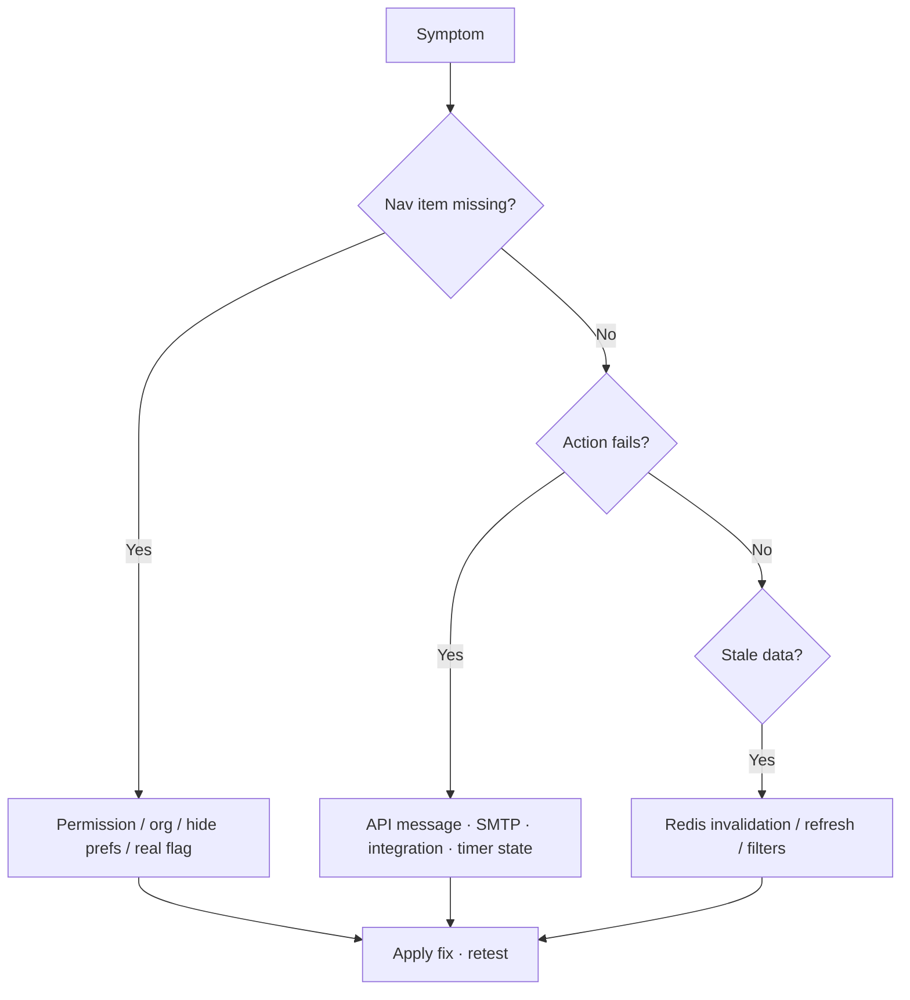

# Troubleshooting and FAQ — complete guide

**Audience:** Everyone (operators see infra rows)  
**Access:** Reference note  
**Requires:** None  
**When stuck:** Reproduce with one user, one org, hard refresh; then walk this table top-down.

Fast diagnosis for “missing UI”, integrations, timers, mail, Docker health, and AI. Prefer permissions and **real** flags over inventing new toggles.

## 1 — Navigation and visibility

| Symptom | Check |
|---------|--------|
| Menu item missing | Role/group permission; wrong org switcher; personal sidebar hide; **real** flag (tickets/memos/expenses/AI) |
| Planning missing | `CanViewPlanning` — **no** Planning feature flag |
| Timesheet / Call Records / Work Summary missing | Permissions / internal role — not Features checkboxes |
| Tickets missing | `internalTicketsEnabled` + ticket permissions |
| Expenses missing | `expensesEnabled` + expense permissions (API 403 when off) |
| Dashboard missing | `CanViewDashboard` (customers still use portal dashboard) |
| Customer sees internal pages | Should be blocked — report if not; expect Dashboard + Tickets only |
| Task fields missing | Task form visibility cascade — [[02-settings/task-form-visibility]] |

## 2 — Delivery and planning

| Symptom | Check |
|---------|--------|
| Cannot drag Planning | Mobile ≤767px is read-only; need `CanPlanTasks` on desktop |
| Overbooked / no free days | Work hours, lunch, vacation/OOO, recurring blocks, Outlook Busy |
| Replan blocked | `remaining = estimate − worked` ≤ 0 |
| Hour totals look double | You summed parents — use **leaf** hours |
| Unscheduled ghost markers | Expected for unscheduled leaves — click opens task |
| Import menu incomplete | Integration not configured / no pending email queue items |

## 3 — Timers and time

| Symptom | Check |
|---------|--------|
| Timer will not start | Another timer active? Open task/call first? |
| Lost time on switch | Use **Switch & Save** on the target task — not Timesheet |
| Call time not on Timesheet | Call timers only update call duration |
| Cannot edit entry | Already **approved**; need reject/reopen process |
| Approvals empty | Nothing pending; or auto-approve flags on |

## 4 — Mail, Jira, companions

| Symptom | Check |
|---------|--------|
| Email never arrives | SMTP under System Settings → Email; user email prefs; spam |
| Password reset silent | SMTP; responses are generic by design (no email enumeration) |
| Jira/Git import fails | Org credentials, board ID, token validity — [[04-workflows/jira-sync]] |
| Email queue empty | From must match `Users.Email`; Worker + `pt_` token |
| IDE Kanban empty | Base URL + `pt_` token; self-signed HTTPS unsupported in v1 |
| Tampermonkey no links | `PM_BY_HOST` mapping; commit text `Task #N` |

## 5 — AI

| Symptom | Check |
|---------|--------|
| No widget | `aiAssistantEnabled` + provider (OpenAI key or Ollama URL+model) |
| Errors / empty | Key, reachability from **server**, model name |
| Budget omitted | User lacks `CanViewBudgetInfo` — expected |
| Docs mode off-topic | Rephrase with module keywords |

## 6 — Operators (Docker / Redis / health)

| Symptom | Check |
|---------|--------|
| Container unhealthy on upgrade | Probe `/health/live` inside container on `PORT` — [[06-install-and-ops/docker-and-health]] |
| `/health` database error | `DB_*` connectivity; MSSQL encrypt flags |
| `redis: error` but app works | Expected fallback; fix Redis if you want cache |
| Stale lists with Redis | Invalidation on write route; flush `REDIS_KEY_PREFIX*`; restart API |
| Install wizard gone | Normal after first admin — use `/login` |
| Uploads fail in Docker | Writable `public/uploads` / volume ownership (`nodejs` UID 1001) |

> **SCREENSHOT** — Optional: capture `/health` JSON with secrets redacted.
> File to add: `media/docs-reference-health-json.png`

## Tips

- One change at a time: flag **or** permission **or** integration — not all three.
- Admins should verify with a non-admin test user after Role Permissions edits.
- Never paste production secrets into Synapse notes while debugging.

## Related

- [[01-getting-started/what-you-see-depends-on-settings]]
- [[05-reference/best-practices]]
- [[05-reference/permissions-matrix]]
- [[08-ai-assistant/troubleshooting]]
- [[06-install-and-ops/docker-and-health]]
