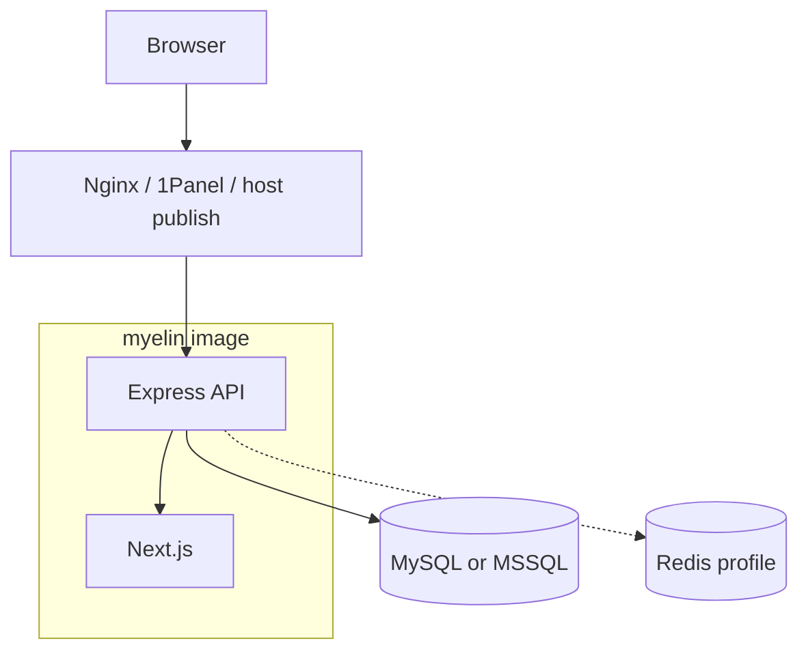

# Docker, health, and reverse proxies — complete guide

**Audience:** Operator  
**Access:** Host with Docker / Compose; image from Docker Hub or local build  
**Requires:** `.env.docker` (or equivalent) with DB + `JWT_SECRET`  
**Sources:** `Dockerfile`, `docker-compose.yml`, `README.md`  
**When disabled / missing:** Without a reachable DB the container may listen (`/health/live`) while `/health` reports database problems.


Myelin ships as a **single container**: Next.js frontend + Express API. MySQL or MSSQL is the system of record. Redis is optional (Compose profile).



## 1 — Image and runtime

| Item | Value |
|------|--------|
| Public image (example) | `tiag0ss/myelin:latest` (or `${DOCKER_USERNAME}/myelin:latest`) |
| Base | `node:20-alpine` (runner); desktop AppImage built on Debian bookworm |
| Process | `node dist/server/index.js` |
| User | Non-root `nodejs` (UID **1001**) |
| Default `PORT` | `3000` |
| Writable paths | `/app/logs`, `public/uploads/...` (branding / applications) |
| Included extras | `extras/release` downloads, Tampermonkey under `extras/scripts/tampermonkey`, lit locales |

Build helpers: `docker-build.sh` / `docker-build.ps1`.

## 2 — Compose services

| Service | Role |
|---------|------|
| `app` | Myelin; `env_file: .env.docker`; depends on `mysql`; publishes `3000:3000` |
| `mysql` | `mysql:8.0`; volume `mysql-data`; optional `./backups` mount |
| `redis` | `redis:7-alpine`; **profile** `redis` only; port `6379` |

```bash
cp .env.docker.example .env.docker
# edit secrets and URLs

docker compose up -d

# with optional Redis:
docker compose --profile redis up -d
```

When using Redis, set in `.env.docker`:

```env
REDIS_ENABLED=true
REDIS_URL=redis://redis:6379
```

Standalone (external DB):

```bash
docker run -d \
  --name myelin \
  -p 3000:3000 \
  --env-file .env.docker \
  tiag0ss/myelin:latest
```

| Volume / path | Purpose |
|---------------|---------|
| `mysql-data` | MySQL data |
| `app-logs` | Application logs → `/app/logs` |
| `./backups` | Host folder mounted into MySQL for dumps |

Compose `app` currently mounts **logs** only; persist uploads if your deployment writes attachments to a volume you control (README notes `/app/uploads`).

## 3 — Ports

| Port | Description |
|------|-------------|
| `3000` | Application (frontend + API) inside the container |
| `3306` | MySQL (Compose default publish) |
| `6379` | Redis (profile only) |
| `3010` | Synapse companion (separate process; not in this compose file) |

### PORT vs host mapping (critical)

- Process listens on env **`PORT`** (default `3000`) **inside** the container.
- Host publish can be anything: `8080:3000`, `3001:3000`, …
- **Host mapping does not change the healthcheck.** Image HEALTHCHECK always hits `127.0.0.1:$PORT` inside the container.
- If you set internal `PORT=4000`, publish `host:4000` **and** keep env `PORT=4000`.

## 4 — Health endpoints

| Path | Use |
|------|-----|
| `GET /health/live` | **Liveness** — process listening. Docker / 1Panel / Portainer HEALTHCHECK. Does **not** probe DB. |
| `GET /health` | **Operator readiness** — database + Redis status |

Example `/health` body:

```json
{
  "status": "healthy",
  "timestamp": "2026-07-02T22:00:00.000Z",
  "uptime": 3600,
  "database": "connected",
  "redis": "disabled"
}
```

`redis` is `connected`, `disabled`, or `error`. Redis failures **do not** fail `/health` when the database is fine.

### Image HEALTHCHECK (Dockerfile)

```text
interval=30s  timeout=8s  start-period=120s  retries=5
GET http://127.0.0.1:$PORT/health/live
```

Compose mirrors the same probe on `app`. Long **start period** avoids false unhealthy during bootstrap / schema sync / upgrades.

## 5 — First boot in Docker

1. Bring the stack up.
2. Open the published URL (e.g. `http://localhost:3000`).
3. Complete [[06-install-and-ops/install-wizard]].
4. Configure System Settings (SMTP, features, AI, integrations).
5. Optionally enable Redis and SSO — [[06-install-and-ops/redis]], [[06-install-and-ops/sso-for-companions]].

## 6 — Updating

```bash
docker compose pull
docker compose up -d
```

Or rebuild from source with repo build scripts, then recreate `app`.

## 7 — Backup / restore (MySQL Compose)

```bash
docker exec myelin-mysql \
  mysqldump -u root -p"$DB_PASSWORD" projectmanagement > backup.sql

docker exec -i myelin-mysql \
  mysql -u root -p"$DB_PASSWORD" projectmanagement < backup.sql
```

For MSSQL, use `BACKUP DATABASE` / `RESTORE DATABASE` with your SQL Server tools.

## 8 — Nginx / panel notes

- Terminate TLS at Nginx; proxy to `http://localhost:3000` (or published host port).
- Enable WebSocket upgrade headers for Socket.io.
- Set `client_max_body_size` (e.g. `50M`).
- Put HTTPS origins in `ALLOWED_ORIGINS`.

If new containers go **unhealthy**:

1. Confirm container env `PORT` equals the listen port.
2. Prefer panel health URL **`/health/live`**, not DB-bound `/health`, unless you want readiness.
3. Check logs for boot / schema errors (`/app/logs`).
4. External panel HTTP checks must use the **host** published port.
5. Wait for `start_period` (120s) on cold start.


> **SCREENSHOT** — Capture healthy container with PORT and healthcheck visible (redact secrets).
> File to add: `media/docs-ops-1panel-health.png`


## Tips and mistakes

- Alpine HEALTHCHECK uses `127.0.0.1` to avoid localhost→`::1` surprises.
- Uploads need writable dirs owned by UID 1001 inside the image design.
- Redis profile is opt-in — env alone without the profile will not start the Redis container.

## Related

- [[06-install-and-ops/environment-variables]]
- [[06-install-and-ops/deploy-checklist]]
- [[06-install-and-ops/schema]]
- [[06-install-and-ops/redis]]
