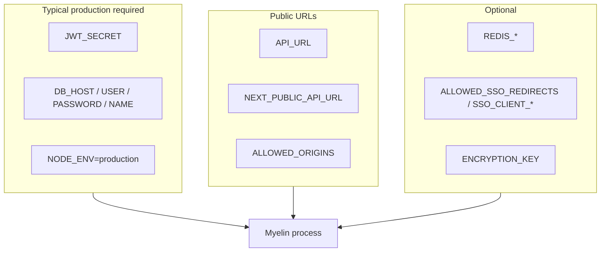

# Environment variables — complete guide

**Audience:** Operator  
**Access:** `.env`, `.env.docker`, or container/panel environment UI  
**Requires:** At least DB credentials + `JWT_SECRET` for a working instance  
**Sources:** `.env.example`, `.env.docker.example`, `README.md`  
**When disabled / missing:** Missing `JWT_SECRET` or DB password prevents a healthy production boot — fix env before debugging UI flags.


Document **names and purposes** only. Never commit real secrets into this vault, git, or screenshots.



## 1 — How to apply

| Context | File / place |
|---------|----------------|
| Local `pnpm run dev` | `.env` from `.env.example` |
| Docker Compose | `.env.docker` from `.env.docker.example` |
| Bare metal / PM2 | `.env.production` or process env (`DEPLOYMENT.md`) |
| 1Panel / Portainer | Container environment UI — same names |

```bash
node -e "console.log(require('crypto').randomBytes(64).toString('hex'))"
# or
openssl rand -hex 64
```

## 2 — Database

| Variable | Required | Default | Description |
|----------|----------|---------|-------------|
| `DB_PROVIDER` | No | `mysql` | `mysql` or `mssql` |
| `DB_HOST` | Yes | `mysql` (Docker example) | Database host |
| `DB_PORT` | No | `3306` / `1433` | MySQL / MSSQL port |
| `DB_USER` | Yes | `appuser` (examples) | Database user |
| `DB_PASSWORD` | **Yes** | — | Database password |
| `DB_NAME` | No | `projectmanagement` | Database name |
| `DB_CONNECTION_LIMIT` | No | `50` (Docker examples) | Pool size |
| `DB_ENCRYPT` | No | `false` | MSSQL TLS encrypt |
| `DB_TRUST_SERVER_CERT` | No | `true` | MSSQL trust server certificate |

Compose MySQL uses `DB_HOST=mysql`. For MSSQL, point `DB_HOST` at SQL Server (`DB_PROVIDER=mssql`); no bundled MSSQL service in compose.

## 3 — Auth and encryption

| Variable | Required | Default | Description |
|----------|----------|---------|-------------|
| `JWT_SECRET` | **Yes** | — | Signs session JWTs; long random string |
| `ENCRYPTION_KEY` | No | falls back to `JWT_SECRET` | 64-char hex for encrypted integration settings |

## 4 — Server and URLs

| Variable | Required | Default | Description |
|----------|----------|---------|-------------|
| `PORT` | No | `3000` | Listen port **inside** process/container; HEALTHCHECK uses this |
| `NODE_ENV` | No | `development` | Set `production` in production |
| `API_URL` | No | `http://localhost:3000` | Internal / server-side API base |
| `NEXT_PUBLIC_API_URL` | No | `http://localhost:3000` | Browser-facing API base |
| `ALLOWED_ORIGINS` | No | — | CORS origins, comma-separated |
| `LOG_LEVEL` | No | `warn` (README) | `debug` / `info` / `warn` / `error` |
| `DEMO` | No | `false` | Demo-mode UI restrictions when `true` |

In production set `API_URL`, `NEXT_PUBLIC_API_URL`, and `ALLOWED_ORIGINS` to **HTTPS** public origins.

## 5 — Redis (optional)

Not a UI feature flag.

| Variable | Required | Default | Description |
|----------|----------|---------|-------------|
| `REDIS_ENABLED` | No | `false` | Enable read-through cache |
| `REDIS_URL` | No | `redis://localhost:6379` | `redis://redis:6379` in Compose profile |
| `REDIS_KEY_PREFIX` | No | `pm:` | Key prefix |
| `REDIS_DEFAULT_TTL_SECONDS` | No | `300` | Safety TTL |

Details: [[06-install-and-ops/redis]].

## 6 — SSO for companions

| Variable | Required | Default | Description |
|----------|----------|---------|-------------|
| `ALLOWED_SSO_REDIRECTS` | No | — | Allowed callback URLs |
| `SSO_CLIENT_ID` | No | `synapse` | Client id |
| `SSO_CLIENT_SECRET` | No | — | Shared secret |
| `SSO_CLIENTS` | No | — | `clientId:secret,...` alternative |
| `SSO_SHARED_SECRET` | No | falls back patterns | Optional secret resolution override |

Details: [[06-install-and-ops/sso-for-companions]].

## 7 — Example snippets

### Local MySQL

```env
DB_PROVIDER=mysql
DB_HOST=localhost
DB_PORT=3306
DB_USER=root
DB_PASSWORD=your_password
DB_NAME=projectmanagement
JWT_SECRET=your-super-secret-jwt-key-change-this-to-something-random
PORT=3000
ALLOWED_ORIGINS=http://localhost:3000,http://127.0.0.1:3000
API_URL=http://localhost:3000
NEXT_PUBLIC_API_URL=http://localhost:3000
REDIS_ENABLED=false
```

### Docker MySQL

```env
DB_PROVIDER=mysql
DB_HOST=mysql
DB_PORT=3306
DB_USER=appuser
DB_PASSWORD=your-strong-password-here
DB_NAME=projectmanagement
DB_CONNECTION_LIMIT=50
JWT_SECRET=your-super-secret-jwt-key-minimum-64-characters
ALLOWED_ORIGINS=http://localhost:3000,https://yourdomain.com
NEXT_PUBLIC_API_URL=http://localhost:3000
API_URL=http://localhost:3000
LOG_LEVEL=warn
```

### Docker + Redis

```env
REDIS_ENABLED=true
REDIS_URL=redis://redis:6379
REDIS_KEY_PREFIX=pm:
REDIS_DEFAULT_TTL_SECONDS=300
```

Then: `docker compose --profile redis up -d`.

### MSSQL

```env
DB_PROVIDER=mssql
DB_HOST=your-sqlserver-host
DB_PORT=1433
DB_USER=sa
DB_PASSWORD=your-strong-password-here
DB_NAME=projectmanagement
DB_ENCRYPT=false
DB_TRUST_SERVER_CERT=true
```


> **SCREENSHOT** — Optional: capture a redacted `.env.docker.example` style list (no secrets).
> File to add: `media/docs-ops-env-template.png`


## 8 — What is **not** an environment variable

Configured in **Administration → System Settings** (UI), not env:

- SMTP / email
- AI provider keys and `aiAssistantEnabled`
- Feature flags (front page, internal tickets, memos, expenses, auto-approves, etc.)
- Outlook Graph credentials / enable
- Branding, timezone, task form visibility template

Redis and SSO remain **env-only**.

## Tips

- Host publish `8080:3000` does not change `PORT` inside the container.
- Lit catalogs: `GET /api/i18n/lit/:locale` from files under `lib/i18n/locales` in the image — no env toggle.
- Prefer a dedicated `ENCRYPTION_KEY` in production when using encrypted integrations.

## Related

- [[06-install-and-ops/docker-and-health]]
- [[06-install-and-ops/deploy-checklist]]
- [[06-install-and-ops/local-development]]
- [[02-settings/feature-toggles-overview]]
