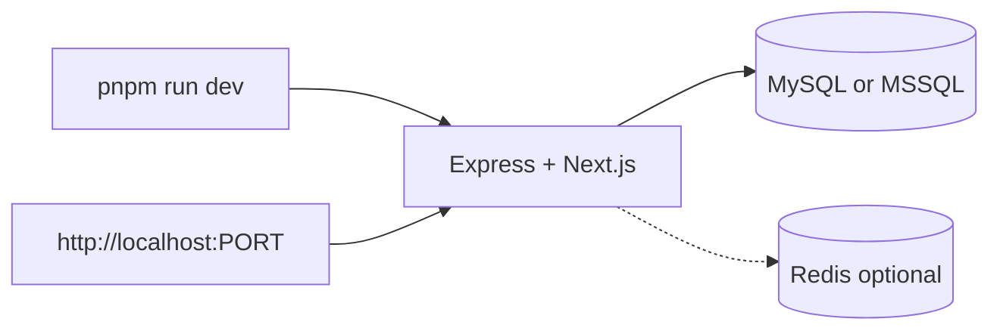

# Local development — complete guide

**Audience:** Operator, contributor  
**Access:** Dev machine with repo clone  
**Requires:** Node.js 20+, pnpm, MySQL 8+ or MSSQL, optional Redis  
**When disabled / missing:** Without DB + `JWT_SECRET` the install wizard and API cannot finish — fix `.env` first.


Local development uses the **same process model as production**: Express embeds Next.js and serves API + UI on one port (`PORT`, default `3000`).



## 1 — Prerequisites

| Tool | Notes |
|------|-------|
| Node.js 20+ | Matches the Docker base image |
| pnpm | Repo lockfile; Corepack can activate |
| MySQL 8+ **or** MSSQL | Set `DB_PROVIDER` |
| Optional Redis 7 | Only if `REDIS_ENABLED=true` |

## 2 — Clone and install

```bash
git clone https://github.com/tiag0ss/myelin.git
cd myelin
pnpm install
```

## 3 — Environment

```bash
cp .env.example .env
```

Edit at least:

| Variable | Local typical value |
|----------|---------------------|
| `DB_PROVIDER` | `mysql` or `mssql` |
| `DB_HOST` | `localhost` |
| `DB_PORT` | `3306` / `1433` |
| `DB_USER` / `DB_PASSWORD` / `DB_NAME` | Local credentials |
| `JWT_SECRET` | Long random string |
| `PORT` | `3000` |
| `ALLOWED_ORIGINS` | `http://localhost:3000,http://127.0.0.1:3000` |
| `API_URL` / `NEXT_PUBLIC_API_URL` | Matching `http://localhost:$PORT` |

```bash
node -e "console.log(require('crypto').randomBytes(64).toString('hex'))"
```

Full reference: [[06-install-and-ops/environment-variables]].

Optional Redis:

```env
REDIS_ENABLED=true
REDIS_URL=redis://localhost:6379
REDIS_KEY_PREFIX=pm:
REDIS_DEFAULT_TTL_SECONDS=300
```

Optional Synapse SSO (companion on 3010):

```env
ALLOWED_SSO_REDIRECTS=http://localhost:3010/api/auth/sso/callback
SSO_CLIENT_ID=synapse
SSO_CLIENT_SECRET=change-me-synapse-sso-secret
```

## 4 — Run

```bash
pnpm run dev
```

Open `http://localhost:3000` (or `http://localhost:$PORT`).

On a **fresh database**, complete [[06-install-and-ops/install-wizard]].

### Production-like local build

```bash
pnpm run build
pnpm start
# same as: pnpm run start:prod
```

Outputs: `.next/` (Next.js) and `dist/server/` (compiled Express).

### Optional desktop shell

```bash
pnpm run desktop:dev
```

See [[07-companions/desktop-app]].

### Tests (developers)

```bash
pnpm test
pnpm run test:unit
pnpm run test:coverage
pnpm run test:integration
```

Manual catalog: repo `TESTING_SCENARIOS.md`.

## 5 — Useful URLs

| URL | Purpose |
|-----|---------|
| `http://localhost:3000` | App UI + API |
| `http://localhost:3000/api-docs` | Swagger |
| `http://localhost:3000/health` | Readiness (DB + Redis status) |
| `http://localhost:3000/health/live` | Liveness |
| `GET /api/i18n/lit/:locale` | Lit i18n catalogs |

## 6 — Schema on startup

Tables from JSON under `server/database/structure/systemtables/`. AI views via `ensureAiAssistantViews`. See [[06-install-and-ops/schema]].


> **SCREENSHOT** — Optional: capture browser on local login/install (no secrets).
> File to add: `media/docs-ops-local-dev.png`


## Tips and common issues

| Symptom | Check |
|---------|--------|
| Cannot connect to DB | `DB_*`, provider, DB listening |
| CORS errors | `ALLOWED_ORIGINS` includes browser origin |
| Install wizard fails | `JWT_SECRET` set; DB writable; restart after env fix |
| Wrong port | App listens on `PORT`; browser must match |
| Stale lists with Redis | Flush `pm:*` or restart — [[06-install-and-ops/redis]] |

## Related

- [[06-install-and-ops/docker-and-health]]
- [[06-install-and-ops/deploy-checklist]]
- Repo: `README.md`, `DEPLOYMENT.md`
