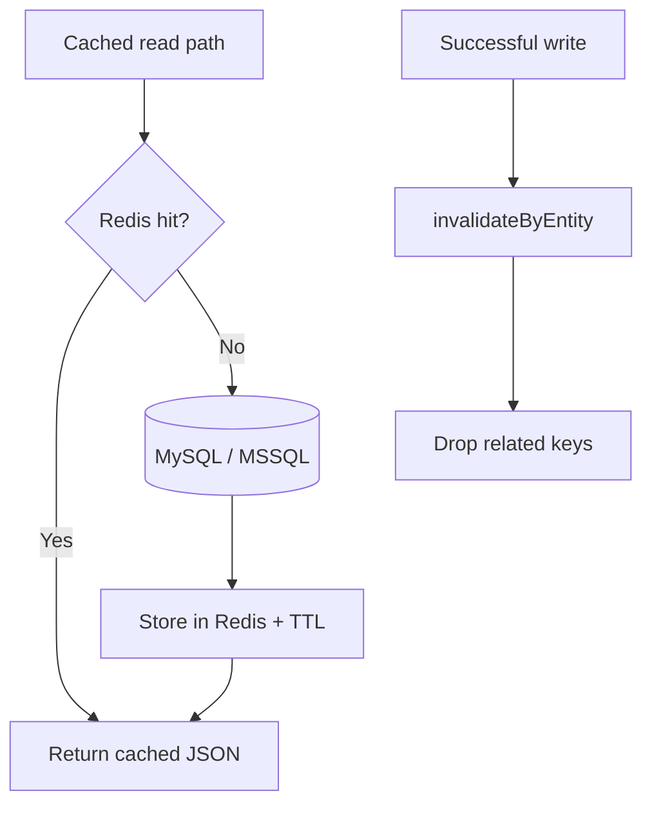
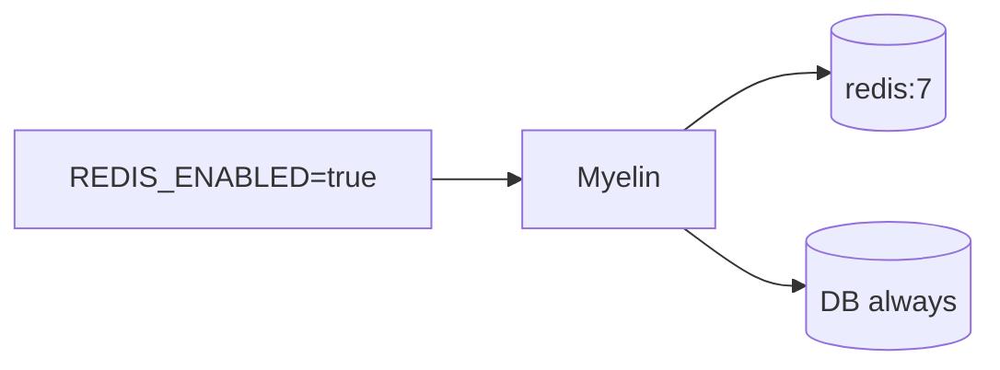

# Redis cache (optional) — complete guide

**Audience:** Operator  
**Access:** Environment only (`REDIS_*`) — not Administration → Features  
**Requires:** `REDIS_ENABLED=true` and a reachable Redis 7 instance  
**When disabled / missing:** App uses the database only; `/health` shows `redis: "disabled"`. Down Redis shows `redis: "error"` but the app keeps serving from DB.


Optional read-through cache for faster list/bootstrap/KPI reads on a single VPS. **MySQL/MSSQL remain the only source of truth.** Disabled by default.





## 1 — Behaviour

| Topic | Rule |
|-------|------|
| Source of truth | Database always |
| Cache style | Read-through + **invalidate-on-write** |
| TTL | Safety TTL (`REDIS_DEFAULT_TTL_SECONDS`, default `300`) |
| Not cached | Active timers, live notification counts |
| Redis down | Fallback to DB; `/health` can still be healthy if DB is fine |
| UI flag | None — env only |

## 2 — Enable (Docker Compose)

1. Set in `.env.docker`:

```env
REDIS_ENABLED=true
REDIS_URL=redis://redis:6379
REDIS_KEY_PREFIX=pm:
REDIS_DEFAULT_TTL_SECONDS=300
```

2. Start with the Compose profile:

```bash
docker compose --profile redis up -d
```

3. Confirm `/health` shows `"redis": "connected"`.

| Variable | Default | Purpose |
|----------|---------|---------|
| `REDIS_ENABLED` | `false` | Master switch |
| `REDIS_URL` | `redis://localhost:6379` | Connection URL |
| `REDIS_KEY_PREFIX` | `pm:` | Namespace all keys |
| `REDIS_DEFAULT_TTL_SECONDS` | `300` | Safety TTL |

Compose service: `redis:7-alpine`, port `6379`, profile `redis` only — [[06-install-and-ops/docker-and-health]].

## 3 — Enable (local / bare metal)

1. Run Redis 7 locally or on a host the API can reach.
2. Set the same env vars in `.env` (`REDIS_URL=redis://localhost:6379` typically).
3. Restart `pnpm run dev` / the production process.
4. Hit `/health`.

## 4 — Stale data playbook

1. Reproduce: create/update an entity, hard-refresh the list.
2. If stale only with Redis on: confirm the write route calls invalidation after success.
3. Fallback ops:
   - Restart the API process, or
   - Flush keys matching `REDIS_KEY_PREFIX` (default `pm:*`).
4. Do not treat Redis flush as a substitute for fixing missing invalidation in new routes.


> **SCREENSHOT** — Capture `/health` JSON with `"redis": "connected"` (redact hostnames if needed).
> File to add: `media/docs-ops-redis-health.png`


## Tips and mistakes

- Enabling Redis is **not** a System Settings Features checkbox.
- Never point production at an unauthenticated public Redis.
- Changing `REDIS_KEY_PREFIX` orphans old keys — flush or wait for TTL.
- Compose without `--profile redis` will not start the Redis service even if env says enabled (connection errors → DB fallback).

## Done when

- `/health` matches intent (`disabled` / `connected`).
- A write + refresh shows fresh data.
- Operators know the flush/restart fallback.

## Related

- [[06-install-and-ops/environment-variables]]
- [[06-install-and-ops/docker-and-health]]
- [[06-install-and-ops/deploy-checklist]]
- [[05-reference/troubleshooting]]
